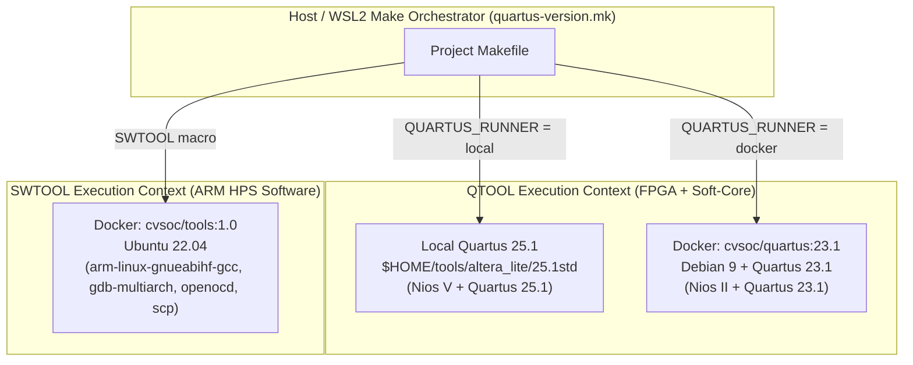

# Explanation: Containerized FPGA Toolchains and Multi-Version Quartus Architecture

> **Series:** cvsoc — Stepping into advanced FPGA development on the DE10-Nano  
> **Type:** Explanation (Understanding-oriented)  
> **Applies to:** [`tutorial_docker_dev_environment.md`](tutorial_docker_dev_environment.md), [`tutorial_docker_gui.md`](tutorial_docker_gui.md), [`tutorial_phase11_multi_version_quartus.md`](tutorial_phase11_multi_version_quartus.md)

---

## Introduction

Modern FPGA+SoC development requires an unusually diverse set of tools: an HDL synthesizer and place-and-route engine (Quartus Prime), a system integration generator (Platform Designer / Qsys), soft-core cross-compilers (Nios II GCC or RISC-V Nios V GCC), an ARM cross-compiler (`arm-linux-gnueabihf-gcc`), hardware debug servers (`nios2-gdb-server`, Ashling RiscFree, OpenOCD), and JTAG transport daemons (`jtagd`).

Installing and maintaining these tools directly on a developer's host machine is notoriously fragile. This document explains **why** the `cvsoc` repository isolates its toolchains into Docker containers combined with a declarative multi-version Make abstraction (`common/make/quartus-version.mk`), **how** the host-to-container boundaries (filesystems, USB/JTAG, network, and X11 GUI) work under the hood, and **why** specific shims exist to make Intel's tools behave on Linux and WSL2.

---

## 1. Why Containerize an FPGA Toolchain?

### The Host OS Drift Problem

Vendor EDA suites such as Intel Quartus Prime are built and validated against enterprise Linux distributions from several years prior to their release. When you install them on a rolling or modern Ubuntu/Debian host, three classes of incompatibilities arise:

1. **Shared Library ABI Drift:** Quartus Prime 23.1 bundles binaries linked against older versions of `libudev`, `libpng12`, `libncurses5`, and `glibc`. Meanwhile, `raetro/quartus:23.1` is built on **Debian 9 (Stretch)** with `glibc 2.24`, whereas Ubuntu 22.04/24.04 ships with `glibc 2.35` or `2.39`.
2. **Legacy 32-bit vs. 64-bit Sub-tools:** While the core Quartus synthesizer (`quartus_map`, `quartus_fit`) is 64-bit, parts of the legacy Nios II Embedded Design Suite (EDS) and licensing/JTAG utilities invoke helper binaries or Perl/Tcl interpreters expecting specific library paths.
3. **Coexistence of Competing Toolchains:** Building an ARM bare-metal binary, a Nios II ELF, a Nios V RISC-V ELF, and a Buildroot Linux image on the same machine risks `PATH` collisions and environment variable pollution (`QUARTUS_ROOTDIR`, `SOPC_KIT_NIOS2`, `CROSS_COMPILE`).

By packaging Quartus 23.1 inside `cvsoc/quartus:23.1`, the entire operating system userland that Quartus expects is frozen in time. A `git clone` followed by `make all` produces bit-for-bit identical results whether the host runs Ubuntu 22.04, Ubuntu 24.04, Arch Linux, or Windows 11 with WSL2.

---

## 2. Why Two Quartus Versions (23.1 and 25.1) and Two Containers?

### The Nios II Deprecation and Nios V Introduction

Across the lifecycle of Cyclone V SoC development, Intel transitioned its soft-core processor offering:

| Feature | Quartus Prime Lite 23.1 | Quartus Prime Lite 25.1 |
|---|---|---|
| **Nios II (`altera_nios2_gen2`)** | Fully supported (`nios2-elf-gcc`, `nios2-bsp`, `nios2-gdb-server`) | Removed / end-of-life |
| **Nios V/m (`intel_niosv_m`)** | Not present in Platform Designer IP catalog | Supported (`riscv32-unknown-elf-gcc`, `niosv-bsp`, `niosv-app`, Ashling RiscFree) |
| **Cyclone V RTL & HPS (`altera_hps`)** | Supported | Supported |

Because the `cvsoc` series teaches **both** the classic Nios II architecture (Projects `04`, `06`, `08`) and the modern RISC-V Nios V/m architecture (Projects `04b`, `06b`, `08b`), no single version of Quartus can build the entire repository.

### Decoupling Software Tools from Quartus (`cvsoc/tools:1.0`)

Originally, the ARM cross-compiler (`arm-linux-gnueabihf-gcc`), `gdb-multiarch`, `openocd`, and `scp` were installed inside `cvsoc/quartus:23.1`. However:
- If a developer builds an HPS project (`05_hps_led`) using a local installation of Quartus 25.1, forcing them to pull a **12.3 GB** Quartus 23.1 Docker image just to run a 50 MB ARM GCC compiler is wasteful.
- Debian 9 inside `cvsoc/quartus:23.1` is archived (`archive.debian.org`), making package updates slow and limited to older versions of GDB and Python.

To solve this, the repository splits the container responsibilities into two distinct images in `common/docker/`:



1. **`cvsoc/quartus:23.1`** (`common/docker/Dockerfile`): Extends `raetro/quartus:23.1` for FPGA synthesis, Platform Designer, and Nios II EDS.
2. **`cvsoc/tools:1.0`** (`common/docker/Dockerfile.tools`): A lightweight Ubuntu 22.04 image containing `gcc-arm-linux-gnueabihf`, `gdb-multiarch`, `openocd`, `openssh-client`, and `python3`.

---

## 3. How `common/make/quartus-version.mk` Resolves Versions and Contexts

Every project Makefile includes `common/make/quartus-version.mk` after declaring its supported versions:

```makefile
PROJECT_NAME         = 00_led_blinking
REVISION_NAME        = de10_nano
QUARTUS_SUPPORTED   ?= 23.1 25.1
QUARTUS_DEFAULT     ?= 23.1
NEEDS_SOFTWARE_TOOLS ?= 0

include ../../common/make/quartus-version.mk
```

### The Three-Tier Resolution Algorithm

When `make` parses `quartus-version.mk`, it determines `QUARTUS_VERSION` and `QUARTUS_RUNNER` in three steps:

1. **Explicit Override (`make QUARTUS_VERSION=25.1`):**
   - `quartus-version.mk` checks `$(filter $(QUARTUS_VERSION),$(QUARTUS_SUPPORTED))`.
   - If you request `QUARTUS_VERSION=23.1` on `04b_niosv_led` (which sets `QUARTUS_SUPPORTED = 25.1`), `make` immediately aborts with a clear error rather than failing obscurely inside Platform Designer.
2. **Local Filesystem Probe (`common/scripts/detect-quartus.sh`):**
   - Iterates through the project's `QUARTUS_SUPPORTED` list and tests whether `$ALTERA_LITE_ROOT/<ver>std/quartus/bin/quartus_sh` is an executable binary on the host.
   - The first matching local installation wins and sets `QUARTUS_RUNNER := local`.
3. **Docker Fallback (`QUARTUS_DEFAULT`):**
   - If no local installation is found, `QUARTUS_VERSION` falls back to `QUARTUS_DEFAULT` (typically `23.1`), and `QUARTUS_RUNNER` is set to `docker`.

### The Dual-Path Mental Model: `REPO_ROOT` vs. `QROOT`

One of the most subtle problems in hybrid local/Docker build systems is **path translation**. When `make` executes on the host, the repository lives at a host path such as `/home/alice/workspace/cvsoc`. However, when `QTOOL` launches a Docker container with `-v $(REPO_ROOT):/work`, processes *inside* the container see the repository at `/work`.

If a Makefile recipe wrote:
```makefile
# BROKEN in Docker mode if REPO_ROOT is used inside QTOOL:
$(call QTOOL, python3 $(REPO_ROOT)/00_led_blinking/scripts/check_timing_slacks.py ...)
```
Then in Docker mode, Python inside the container would look for `/home/alice/workspace/cvsoc/...`, which does not exist inside the container's mount namespace!

`quartus-version.mk` solves this by exporting two distinct root variables:

| Variable | Value in `local` mode | Value in `docker` mode | Where to use it |
|---|---|---|---|
| `$(REPO_ROOT)` | `/home/alice/workspace/cvsoc` | `/home/alice/workspace/cvsoc` | **Host-side commands** (e.g., `docker -v`, host file checks, `scp`) |
| `$(QROOT)` | `/home/alice/workspace/cvsoc` | `/work` | **Inside `$(call QTOOL,...)` and `$(call SWTOOL,...)`** |

Because `QROOT` adapts automatically to the execution context, a single Makefile recipe works identically whether Quartus runs natively on the host or inside Docker.

---

## 4. Under the Hood of WSL2, Kernel Shims, and USB Passthrough

### Why `uname_shim.sh` Exists

In several Makefiles and scripts, you will notice `common/docker/uname_shim.sh` mounted over `/usr/local/bin/uname` or `/bin/uname`:

```bash
#!/bin/sh
if [ "$1" = "-r" ]; then
    echo "5.15.0-generic"
else
    /bin/uname "$@"
fi
```

**Why is this necessary?**
Docker containers share the host's Linux kernel. Under WSL2, `uname -r` returns a string like `6.6.87.2-microsoft-standard-WSL2`. Several tools in the Nios II EDS (`nios2-download`, `nios2-gdb-server`, and Eclipse/Tcl wrappers) inspect `uname -r` or `uname -a` to detect whether they are running under Cygwin/Windows vs. Linux. When they see the substring `microsoft` or `WSL`, they falsely conclude they are running in a Windows environment and attempt to invoke `.exe` binaries (`quartus_pgm.exe`, `nios2-gdb-server.exe`) or convert POSIX paths into Windows `C:\` paths!

Mounting `uname_shim.sh` inside the container masks the WSL2 kernel version string, ensuring the Linux toolchain inside Docker behaves as standard Linux.

### USB/IP and the Exclusive Ownership Model

Physical JTAG communication with the DE10-Nano goes through the on-board **USB-Blaster II** (an Altera-programmed Cypress FX2LP USB microcontroller).

- **On Native Linux:** The host kernel's `usbcore` driver exposes `/dev/bus/usb/<bus>/<dev>`. Passing `--privileged -v /dev/bus/usb:/dev/bus/usb` to `docker run` allows `jtagd` inside the container to claim the USB interface via `libusb` (`usbfs`).
- **On Windows + WSL2:** The WSL2 virtual machine runs inside a lightweight Hyper-V utility VM and has no direct PCI/USB controller access by default. `usbipd-win` bridges this gap using the **USB/IP protocol**:
  1. On Windows, the `usbipd` service binds to the USB device and acts as a TCP server encapsulating raw USB Request Blocks (URBs).
  2. Inside WSL2, the Linux kernel's `vhci_hcd` (Virtual Host Controller Interface) driver attaches to the Windows USB/IP socket and materializes the device under `/dev/bus/usb/` inside WSL2.
  3. Because a USB device can only have one active host controller driver at a time, attaching the USB-Blaster to WSL2 (`make usb-wsl`) makes it invisible to Windows, and detaching it (`make usb-windows`) returns it to Windows.

---

## 5. How GUI Forwarding from Docker Works (`tutorial_docker_gui.md`)

When you run `quartus` or `qsys-edit` inside `cvsoc/quartus:23.1`, the container has no display server or GPU of its own. Instead, it relies on **X11 network transparency**:

```
┌─────────────────────────────────────────┐       Unix Domain Socket        ┌───────────────────────────────────┐
│ Docker Container (cvsoc/quartus:23.1)   │   /tmp/.X11-unix/X0 + DISPLAY   │ Host X Server (Xorg or WSLg)      │
│                                         │ ──────────────────────────────► │                                   │
│ Quartus GUI / Platform Designer (Xlib)  │                                 │ Renders windows on desktop screen │
└─────────────────────────────────────────┘                                 └───────────────────────────────────┘
```

1. **The X11 Socket (`-v /tmp/.X11-unix:/tmp/.X11-unix`):** X11 clients communicate with the X server over a Unix domain socket in `/tmp/.X11-unix/X0` when `DISPLAY=:0`. Bind-mounting this directory into the container lets X11 libraries inside the container talk directly to the host's X server at memory speed.
2. **Access Control (`xhost +local:docker`):** By default, the X server rejects connections from processes that do not present the current user's `MIT-MAGIC-COOKIE-1` token (stored in `~/.Xauthority`). Running `xhost +local:docker` grants local non-network Unix-domain connections from the container permission to open windows.
3. **Shared Memory (`--ipc=host` / `-e QT_X11_NO_MITSHM=1`):** X11 uses the MIT-SHM extension (POSIX SysV shared memory) to pass large pixmaps between client and server without copying them over the socket. Because Docker isolates the IPC namespace by default, either `--ipc=host` must be passed or MIT-SHM must be disabled so Java/Qt/Xlib GUI widgets render instead of crashing with `BadShmSeg`.

---

## Further Reading

- **Tutorials:**
  - [Building a Custom FPGA Development Docker Image](tutorial_docker_dev_environment.md)
  - [Visual Design Exploration — Launching Quartus & Platform Designer from Docker](tutorial_docker_gui.md)
  - [Multi-Version Quartus Support](tutorial_phase11_multi_version_quartus.md)
- **How-To Guides:**
  - [How-to: Program the DE10-Nano from Windows When Working in WSL2](howto_windows_wsl2_programmer.md)
  - [How-to: Troubleshoot JTAG, USB-Blaster, and `jtagd` Issues](howto_troubleshoot_jtag_and_usb_blaster.md)
