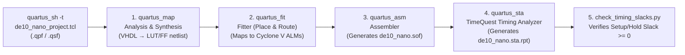

# Explanation: Pure VHDL Design, Reset Architecture, and Static Timing Analysis

> **Series:** cvsoc — Stepping into advanced FPGA development on the DE10-Nano  
> **Type:** Explanation (Understanding-oriented)  
> **Applies to:** Phase 0 (`00_led_blinking` — [`tutorial_phase0_led_blinking.md`](tutorial_phase0_led_blinking.md)) and Phase 1 (`01_led_running` — [`tutorial_phase1_led_running.md`](tutorial_phase1_led_running.md))

---

## Introduction

Phases 0 and 1 look deceptively simple on the surface: blink eight LEDs at 1 Hz, then shift a single lit LED across eight positions. Yet beneath those 50 lines of VHDL lie the core foundations of all digital hardware engineering on Intel Cyclone V FPGAs:

1. How VHDL-2008 constructs map to physical **Adaptive Logic Modules (ALMs)** and flip-flops.
2. Why **Power-On Reset (POR)** generation is essential even when FPGA SRAM cells have initial values.
3. How VHDL **delta-cycle signal assignment semantics** differ from software variables—illustrated by a subtle one-cycle wrap-around quirk in `led_running.vhd`.
4. How the **five-stage headless Quartus compilation pipeline** transforms RTL into a physical bitstream and why **Static Timing Analysis (STA)** is required before any design touches hardware.

---

## 1. How VHDL Maps to Cyclone V Silicon

### The Cyclone V Adaptive Logic Module (ALM)

Unlike a CPU that executes instructions sequentially from memory, an FPGA implements your VHDL by wiring together physical hardware resources inside the **5CSEBA6U23I7** silicon fabric:

- **Adaptive Look-Up Tables (ALUTs):** Combinational logic (such as `counter = C_COUNTER_MAX - 1`, `not led_toggle`, or `counter + 1`) is implemented inside 8-input fractured LUTs coupled with dedicated fast carry chains.
- **Programmable Flip-Flops (Registers):** Every signal assigned inside an `if rising_edge(clk_i) then` block infers physical D-type flip-flops clocked by the global clock network (`GCLK`).

```
                      ┌──────────────────────────────────────────────────┐
                      │              led_blinking Instance               │
                      │                                                  │
                      │   ┌───────────────────────┐                      │
  fpga_clk1_50 ──────►├──►│  25-bit Up-Counter    │                      │
  (50 MHz GCLK)       │   │  (25 Flip-Flops +     │                      │
                      │   │   Fast Carry Adder)   │                      │
                      │   └───────────┬───────────┘                      │
                      │               │ counter[24:0]                    │
                      │               ▼                                  │
                      │   ┌───────────────────────┐                      │
                      │   │  Equality Comparator  │                      │
                      │   │  (counter == 24999999)│                      │
                      │   └───────────┬───────────┘                      │
                      │               │ enable (1 pulse every 0.5 s)     │
                      │               ▼                                  │
                      │   ┌───────────────────────┐                      │
                      │   │  1-bit Toggle Reg     ├─────────────────────►├──► led_o
                      │   │  (led_toggle <= not)  │                      │
                      │   └───────────────────────┘                      │
                      └──────────────────────────────────────────────────┘
```

### Why `natural range` Matters for Synthesis

In `00_led_blinking/hdl/led_blinking.vhd`:

```vhdl
constant C_COUNTER_MAX : integer := G_CLK_FREQ_HZ / (2 * G_BLINK_FREQ_HZ);
signal counter : natural range 0 to C_COUNTER_MAX - 1 := 0;
```

In VHDL, an unconstrained `integer` or `natural` defaults to a **32-bit** signed/unsigned representation. By constraining the subtype with `range 0 to C_COUNTER_MAX - 1` (where `C_COUNTER_MAX - 1 = 24,999,999`), the synthesizer computes the minimum bit width required:

$$\lceil \log_2(25,000,000) \rceil = 25 \text{ bits}$$

Instead of synthesizing a 32-bit adder and 32-bit comparator for each of the 8 `led_blinking` instances, Quartus synthesizes a 25-bit counter—saving 7 flip-flops and carry-chain stages per instance (56 flip-flops across all 8 instances).

### Structural Duplication (`generate`) vs. Shared State

Comparing Phase 0 (`00_led_blinking`) and Phase 1 (`01_led_running`) highlights a fundamental RTL architectural trade-off:

- **Phase 0 (`for i in 0 to 7 generate`):** Instantiates **8 independent `led_blinking` modules**. Because all 8 instances receive the exact same clock and synchronous `power_on_reset`, they march in lockstep, blinking in unison. However, unless Quartus performs register merging (duplicate register elimination) during synthesis optimization, 8 independent 25-bit counters represent $8 \times 25 = 200$ counter flip-flops.
- **Phase 1 (single `led_running` instance):** Uses **one** 25-bit timebase counter (`counter`) to generate a 1 Hz enable event for an 8-bit state register (`led_running`). Separating the **timebase generator** (prescaler/tick) from the **datapath/FSM** (shift register) is the canonical RTL design pattern: it minimizes area and guarantees that all 8 bits update on the exact same clock edge with zero skew.

---

## 2. Reset Architecture: Why `power_on_reset_generator.vhd` Exists

In both projects, the top-level entity (`de10_nano_top.vhd`) instantiates `common/ip/power_on_reset/power_on_reset_generator.vhd`:

```vhdl
entity power_on_reset_generator is
  generic (
    G_CLK_FREQ_HZ       : integer := 50000000; -- 50 MHz
    G_RESET_DURATION_NS : integer := 1000000   -- 1 ms
  );
  port (
    clk_i : in std_logic;
    por_o : out std_logic
  );
end entity power_on_reset_generator;
```

### Wait—Doesn't the FPGA Have Built-In Initial Values?

Notice that `power_on_reset_generator.vhd` has **no external reset input pin**. Instead, it relies on signal initialization at declaration time:

```vhdl
signal power_on_reset : std_logic                               := '1';
signal counter        : integer range 0 to C_CYCLES_COUNTER_MAX := 0;
```

When an SRAM-based FPGA like the Cyclone V finishes loading its `.sof` bitstream and transitions into **User Mode**, the hardware configuration controller releases an internal global net (`DEV_CLRn` / internal POR). At that instant, every flip-flop in the FPGA starts with the initial value encoded into the bitstream (from the VHDL `:= '1'` or `:= 0` initializer).

**If flip-flops already have initial values, why do we need `power_on_reset_generator` at all?**

1. **Asynchronous Exit from Configuration:** The internal configuration release signal is not synchronized to your 50 MHz user clock (`fpga_clk1_50`). Different regions of a large FPGA die can exit configuration mode on slightly different clock cycles if the clock is already running at 50 MHz.
2. **Deterministic Synchronous Startup:** By holding `por_o = '1'` for $50,000$ clock cycles ($1\text{ ms}$ at $50\text{ MHz}$) after configuration completes and releasing it synchronously on a `rising_edge(clk_i)`, every downstream module (`led_blinking`, `led_running`, and in Phase 2 the entire Nios II Platform Designer interconnect) exits reset on the exact same clock edge after board power rails and clock oscillators have stabilized.
3. **Compile-Time Floating-Point Math (`ieee.math_real`):** Notice line 18 of `power_on_reset_generator.vhd`:
   ```vhdl
   constant C_CYCLES_COUNTER_MAX : integer := integer((real(G_CLK_FREQ_HZ) * real(G_RESET_DURATION_NS)) / real(1e9));
   ```
   While `real` (floating-point) types cannot be synthesized into hardware wires directly, using `ieee.math_real` to compute a **compile-time `constant`** is 100% synthesis-safe. It avoids 32-bit integer overflow that would occur if you multiplied `50_000_000 * 1_000_000` using 32-bit integers before dividing by $10^9$.

---

## 3. VHDL Signal Semantics: The One-Cycle Quirk in `led_running.vhd`

Look closely at lines 38–41 of `01_led_running/hdl/led_running.vhd`:

```vhdl
if counter = C_COUNTER_MAX - 1 then
  counter <= 0;

  led_running <= std_logic_vector(unsigned(led_running) sll 1);
  if led_running = x"00" then
    led_running <= x"01";
  end if;
```

To a software programmer accustomed to C or Python, those four lines look like:
1. Shift `led_running` left by 1 bit.
2. If the new value of `led_running` is `0x00`, set `led_running` to `0x01`.

**That is NOT what happens in VHDL hardware!**

### Signal Assignments Are Scheduled for the Next Delta Cycle

In VHDL, the `<=` operator is a **non-blocking signal assignment**. Inside a clocked `process(clk_i)`, reading a signal on the right-hand side or in an `if` condition **always reads the value the flip-flop held just before the rising clock edge**. Any assignment via `<=` only schedules a future value to take effect *after* the clock edge (and if multiple `<=` assignments target the same signal in the same process execution, the **last executed assignment wins**).

Let's trace what actually happens register-by-register on each 0.5-second tick when `counter = C_COUNTER_MAX - 1`:

| Tick | `led_running` *before* clock edge | Line 38 scheduled (`sll 1`) | Line 39 (`if led_running = x"00"`) evaluates against *old* value | Final `led_running` *after* clock edge | Board LEDs |
|---|---|---|---|---|---|
| 0 | `0x01` (`0000_0001`) | `0x02` | `0x01 = 0x00` is **False** | `0x02` | `LED[1]` on |
| ... | ... | ... | ... | ... | ... |
| 6 | `0x40` (`0100_0000`) | `0x80` | `0x40 = 0x00` is **False** | `0x80` | `LED[7]` on |
| **7** | **`0x80` (`1000_0000`)** | **`0x00`** | **`0x80 = 0x00` is False!** | **`0x00`** | **ALL LEDs OFF!** |
| **8** | **`0x00` (`0000_0000`)** | `0x00` | **`0x00 = 0x00` is True!** (Line 40 overrides Line 38) | **`0x01`** | `LED[0]` on |

Because `if led_running = x"00"` inspects the *pre-edge* value of `led_running`, when `LED[7]` is lit (`0x80`), the condition is false, so `sll 1` shifts the `1` out of bit 7 and loads `0x00` into the register. For one full tick period, **all 8 LEDs turn off**, and only on the *next* tick does `led_running = x"00"` evaluate true and reset the register to `0x01`.

### How to Eliminate the All-Zero Cycle

If you want a continuous 8-step ring counter (`0x01 → 0x02 → ... → 0x80 → 0x01`) with no dead cycle, there are three idiomatic VHDL ways to write it:

1. **Check the MSB (`x"80"` or `led_running(7) = '1'`) before shifting:**
   ```vhdl
   if led_running = x"80" then
     led_running <= x"01";
   else
     led_running <= std_logic_vector(unsigned(led_running) sll 1);
   end if;
   ```
2. **Use the Rotate Left (`rol`) operator from `ieee.numeric_std`:**
   ```vhdl
   led_running <= std_logic_vector(unsigned(led_running) rol 1);
   ```
   A hardware barrel rotation needs no comparator at all—it simply wires flip-flop `i` to flip-flop `(i+1) mod 8` (connecting bit 7 directly back to bit 0)!

---

## 4. The Headless Quartus Compilation Pipeline and Static Timing Analysis

When you run `make all`, `quartus_sh --flow compile` executes four distinct binaries in sequence:



### Setup Slack and Hold Slack Explained

Digital flip-flops are physical analog circuits at the transistor level. For a D flip-flop to reliably capture a `0` or `1` on the rising edge of `fpga_clk1_50` without entering a **metastable state**, the data input must obey two timing windows relative to the clock edge:

1. **Setup Time ($t_{su}$):** Data must arrive and remain stable for at least $t_{su}$ *before* the rising clock edge.
   - **Setup Slack** = $(\text{Clock Period} - \text{Clock Skew} - t_{su}) - (\text{Register-to-Register Logic + Routing Delay})$.
   - Our SDC file (`de10_nano.sdc`) specifies `create_clock -period "50.0 MHz" [get_ports fpga_clk1_50]`, which gives a $20.0\text{ ns}$ clock period.
   - If the longest combinational path (e.g., the 25-bit carry chain + equality comparator in `led_blinking`) takes $4.2\text{ ns}$, the setup slack is approximately $+15.8\text{ ns}$ (**positive slack = timing met**).
   - If setup slack is **negative**, the signal arrives too late and the circuit will compute corrupted values at $50\text{ MHz}$.

2. **Hold Time ($t_h$):** Data must not change for at least $t_h$ *after* the rising clock edge.
   - **Hold Slack** = $(\text{Shortest Contamination Delay}) - (\text{Clock Skew} + t_h)$.
   - Hold violations are independent of clock frequency and occur if clock skew between two flip-flops is larger than the logic delay between them. Quartus's Fitter automatically inserts routing delay buffers to keep hold slack $\ge 0$.

`00_led_blinking/scripts/check_timing_slacks.py` parses `de10_nano.sta.rpt` after every build to confirm that both worst-case setup slack and worst-case hold slack are non-negative across all PVT (Process, Voltage, Temperature) corners.

---

## Further Reading

- **Tutorials:**
  - [Phase 0 Tutorial — LED Blinking on the DE10-Nano](tutorial_phase0_led_blinking.md)
  - [Phase 1 Tutorial — LED Running on the DE10-Nano](tutorial_phase1_led_running.md)
- **Next Explanation:**
  - [Explanation: Soft-Core Processors in FPGA Fabric — Nios II vs. Nios V/m](explanation_phase2_soft_cpu_nios2_and_niosv.md)
