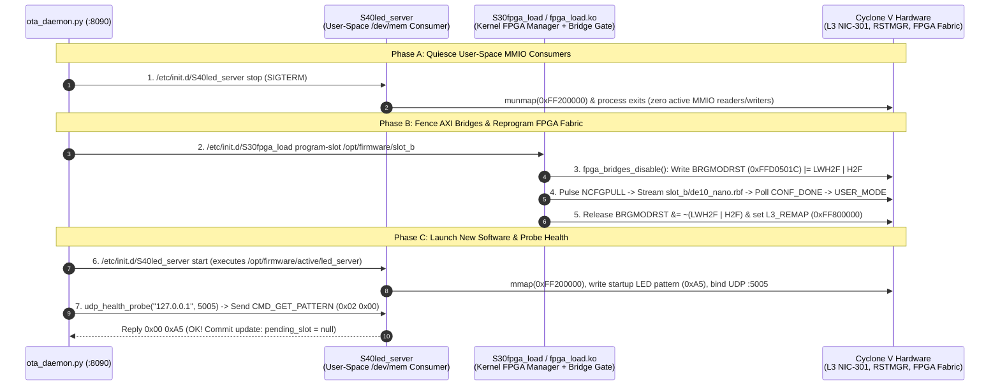
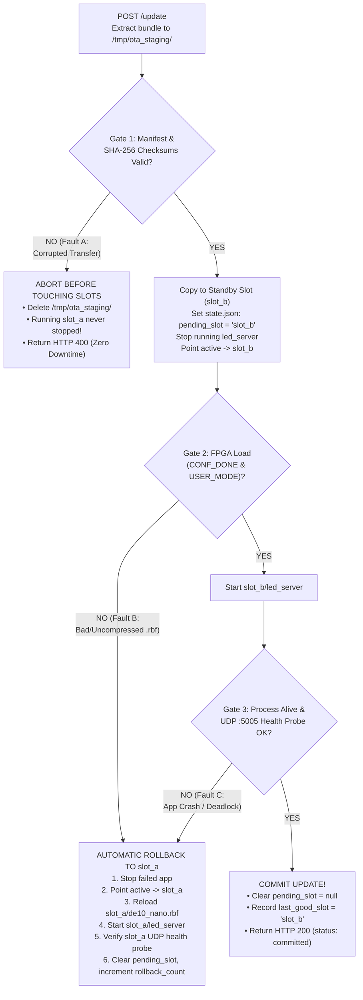

# Explanation: Atomic A/B Field Updates, Live FPGA Hot-Swap, and Automatic Rollback

> **Series:** cvsoc — Stepping into advanced FPGA development on the DE10-Nano  
> **Type:** Explanation (Understanding-oriented)  
> **Applies to:** Phase 10 (`16_field_update` — [`16_field_update/doc/README.md`](../16_field_update/doc/README.md))

---

## Introduction

In Phases 0–8, updating the FPGA bitstream or ARM software required a developer sitting at a desk with a JTAG USB-Blaster cable, a serial console, or a physical microSD card reader. In real-world deployed systems—such as an FPGA sensor node on a factory ceiling, a telecom base station, or a remote autonomous vehicle—**there is no JTAG cable and no human to swap SD cards**.

Furthermore, remote Over-The-Air (OTA) updates in an FPGA+SoC system carry a unique hazard: you are updating **both hardware (`de10_nano.rbf`) and software (`led_server`) simultaneously**. If a network glitch corrupts the transfer, if an uncompressed/corrupt bitstream fails `CONF_DONE`, if the new software binary crashes on startup, or if power fails mid-update, a naive update script will permanently brick the device—requiring an expensive field technician truck roll.

Phase 10 (`16_field_update`) implements a production-grade **Dual-Slot (A/B) Atomic Field Update and Rollback Engine** (`ota_daemon.py` + `ota_client.py` + `pack_bundle.py`). This document explains:

1. Why **in-place updates fail** and how **A/B slot isolation** with POSIX atomic symlinks (`os.replace`) guarantees zero half-written state.
2. How **live FPGA + software hot-swapping** reconfigures the Cyclone V fabric at runtime without rebooting Linux—and why **AXI bridge gating** is mandatory to prevent kernel bus lockups.
3. How the **4-stage health verification and automatic rollback state machine** catches faults at every layer (network, FPGA silicon, process startup, and application protocol).
4. How the **Boot-Guard (`pending_slot`)** recovers from unexpected power loss mid-update.

---

## 1. Why In-Place Updates Brick Devices and How Dual-Slot (A/B) Works

### The Failure Modes of Naive In-Place Updates

Suppose a naive update script simply ran `scp new_de10_nano.rbf root@board:/lib/firmware/de10_nano.rbf && scp new_led_server root@board:/usr/bin/led_server`. What goes wrong in the real world?

1. **Power Loss or Network Drop Mid-Transfer:** If power drops when `scp` has written 50% of `/lib/firmware/de10_nano.rbf`, the original working bitstream is destroyed and the new one is truncated. On next boot, the device is dead.
2. **`ETXTBSY` (Text File Busy) on Running Executables:** The Linux kernel forbids overwriting an executable file on disk while a process is mapped and executing from it (`open(..., O_WRONLY)` returns `-ETXTBSY`).
3. **No Fallback Copy for Runtime Faults:** Even if the file transfer completes 100% intact, what if `new_led_server` has a bug that crashes 500 ms after startup, or `new_de10_nano.rbf` fails timing or `CONF_DONE`? Because the known-good `v1.0.0` files were overwritten, there is nothing left on the board to roll back to!

### The A/B Slot Layout and POSIX Atomic Symlink Flip (`atomic_symlink`)

`16_field_update` solves all three problems by partitioning `/opt/firmware/` into two immutable version slots (`slot_a` and `slot_b`) plus an **atomic symlink** (`/opt/firmware/active`) and a persistent state journal (`/opt/firmware/state.json`):

```
/opt/firmware/
├── state.json                  ◄── Persistent state journal (fsync'd via atomic_write_json)
├── active -> slot_a            ◄── Single atomic pointer to the active slot
├── slot_a/                     ◄── Currently RUNNING slot (untouched during update!)
│   ├── manifest.json           (version: "1.0.0", sha256 hashes)
│   ├── de10_nano.rbf
│   └── led_server              (LED startup pattern: 0x0F)
└── slot_b/                     ◄── STANDBY slot (target for incoming update)
    ├── manifest.json           (version: "2.0.0", sha256 hashes)
    ├── de10_nano.rbf
    └── led_server              (LED startup pattern: 0xA5)
```

Look at how `atomic_symlink()` and `atomic_write_json()` in `16_field_update/daemon/ota_daemon.py` (lines 50–76) update the active pointer and state file:

```python
def atomic_symlink(target: str, link_path: str) -> None:
    tmp_link = f"{link_path}.tmp.{os.getpid()}"
    os.symlink(target, tmp_link)
    os.replace(tmp_link, link_path)
```

**Why create a temporary symlink and call `os.replace()` instead of `os.unlink(link_path)` followed by `os.symlink()`?**
- If you call `unlink("/opt/firmware/active")` and power fails one microsecond later *before* `symlink()` completes, `/opt/firmware/active` **does not exist at all** when the board reboots!
- In POSIX (`rename(2)` / `os.replace()`), replacing `link_path` with `tmp_link` on the same filesystem is guaranteed by the Linux VFS and `ext4` journal to be **indivisible (atomic)**: at every instant in time, `/opt/firmware/active` points either to `slot_a` or to `slot_b`—never to nothing!
- Similarly, `atomic_write_json()` writes to `state.json.tmp.<pid>`, calls `f.flush()` and **`os.fsync(f.fileno())`** (flushing dirty page-cache buffers to physical storage media), and only then calls `os.replace()` to atomically swap `state.json`.

---

## 2. Safe Live FPGA + Software Hot-Swap Mechanics (Bridge Gating)

One of the most powerful capabilities demonstrated in `16_field_update` is **zero-reboot live hardware + software reconfiguration**: upgrading both the FPGA bitstream and the ARM daemon over HTTP in ~2 seconds while Linux stays up and SSH sessions remain connected.

To hot-swap an FPGA bitstream underneath a running Linux OS without causing a kernel panic or L3 bus hang, the hardware/software dependency order must be strictly respected:



### Why Stopping `led_server` and Gating Bridges (`0xFFD0501C`) Before `NCFGPULL` Is Critical

What would happen if `ota_daemon.py` reprogrammed the FPGA *while* `led_server` was still running or while the Lightweight H2F AXI bridge (`0xFF200000`) was left enabled?

1. The instant `fpga_load.ko` asserts `CTRL_NCFGPULL` to enter `STATE_RESET`, all logic inside the FPGA fabric—including the Qsys AXI-to-Avalon slave interconnect at `0xFF200000`—is wiped and tri-stated.
2. If `led_server` issues a read or write to its `mmap`'d pointer at `0xFF200000` during that window (or if spurious transitions occur on the floating FPGA AXI wires while the bridge is unfenced), the HPS AXI master port waits forever for an AXI `BVALID`/`RVALID` handshake that never arrives.
3. Because the Cortex-A9 and L3 NIC-301 bus have no hardware bus timeout on stalled AXI slave transactions, **the CPU core hangs permanently inside the memory instruction**, freezing Linux!

By:
1. Stopping `led_server` first (`S40led_server stop`), and
2. Asserting `BRGMODRST_LWH2F | BRGMODRST_H2F` inside `fpga_bridges_disable()` (`10_linux_led/software/fpga_load/fpga_load.c` lines 92–102) *before* asserting `NCFGPULL`,

the HPS side of the AXI bridge is cleanly isolated in reset throughout the entire FPGA configuration cycle and only re-opened after `STATE_USER_MODE` (`0x4`) is confirmed.

---

## 3. The Four-Stage Verification and Automatic Rollback State Machine

An update bundle (`fw_v2.0.0.tar.gz` created by `16_field_update/client/pack_bundle.py`) contains three files:
- `manifest.json` (`version`, `created_at`, and per-file `sha256` digests + byte sizes)
- `de10_nano.rbf` (compressed FPGA bitstream)
- `led_server` (ARM ELF binary)

When `ota_daemon.py` receives a `POST /update` request, it executes a **four-gate verification pipeline**. A failure at any gate triggers the appropriate recovery path:



### Why Each Gate Exists

1. **Gate 1 — Pre-Activation Cryptographic Hash Check (Fault Scenario A):**
   Before stopping the running `led_server` or touching `/opt/firmware/slot_b`, `ota_daemon.py` extracts the archive into `/tmp/ota_staging/` (in RAM `tmpfs`) and computes the SHA-256 of every file against `manifest.json` (plus path-traversal sanitization). If a single bit was corrupted in transit (`fw_corrupt.tar.gz`), the update is rejected **with zero milliseconds of downtime** to the running system.
2. **Gate 2 — Hardware Bitstream Verification (Fault Scenario B):**
   A bitstream file can have a 100% valid SHA-256 in `manifest.json` (it was transferred without network corruption), yet still be invalid for the hardware—for example, a developer accidentally packaged an *uncompressed* `.rbf` (`fw_bad_rbf.tar.gz`) that fails `CONF_DONE` on `MSEL=0x0A`, or a bitstream with a framing CRC error (`MON_CRC_ERROR`). When `S30fpga_load program-slot` returns non-zero, `ota_daemon.py` immediately invokes `_rollback_to(prev_slot)`, restoring the previous slot's working `.rbf` and `led_server`.
3. **Gate 3 — Closed-Loop Application Health Probe (Fault Scenario C):**
   Checking that `S40led_server start` returned exit code `0` is **not sufficient**! A buggy C binary (`fw_crash_app.tar.gz`) might fork into the background and immediately crash with `SIGSEGV` (`exit(139)`), or deadlock before binding its UDP socket, or fail to `mmap(/dev/mem)`.
   Therefore, `ota_daemon.py` performs an **end-to-end functional health probe (`udp_health_probe`)**: it opens a real UDP socket to `127.0.0.1:5005`, sends a `CMD_GET_PATTERN` (`0x02 0x00`) packet, and verifies that `led_server` replies with `0x00 <pattern>` (which proves the process is alive, its UDP socket is bound, and its `/dev/mem` FPGA register mapping is working!). If the probe fails after 5 retries, `ota_daemon.py` rolls back to `slot_a`.

---

## 4. Power-Loss Resilience: How the Boot-Guard (`pending_slot`) Works

What happens if power is yanked from the DE10-Nano *after* `active` was switched to `slot_b`, right in the middle of FPGA programming or health checking—before `ota_daemon.py` could either commit or roll back?

Look at how `state.json` tracks the transaction window in `16_field_update/daemon/ota_daemon.py`:
1. **Before switching `active` to `slot_b`:** `ota_daemon.py` writes `"pending_slot": "slot_b"` and `"last_good_slot": "slot_a"` to `/opt/firmware/state.json` and calls `os.fsync()`.
2. **Only after Gate 2 and Gate 3 both pass:** `ota_daemon.py` clears `"pending_slot": null`.
3. **On Next Power-Up (`S50ota_daemon` / `boot_guard_check()`):**
   When Linux boots and starts `ota_daemon.py`, the daemon inspects `state.json`:
   - If `pending_slot` is non-null (meaning a previous update was interrupted by a power failure before committing) and the current active slot fails its health check (or `boot_attempts` exceeds the threshold), `boot_guard_check()` automatically rolls `/opt/firmware/active` back to `last_good_slot` (`slot_a`), reprograms `slot_a`'s FPGA bitstream, and restarts `slot_a`'s `led_server`!

---

## Further Reading

- **Tutorial:**
  - [Phase 10: Network Field Update & Automatic Rollback (No JTAG)](../16_field_update/doc/README.md)
- **How-To Guide:**
  - [How-to: Create, Test, and Troubleshoot OTA Firmware Bundles and Rollbacks](howto_create_and_test_ota_firmware_bundles.md)
