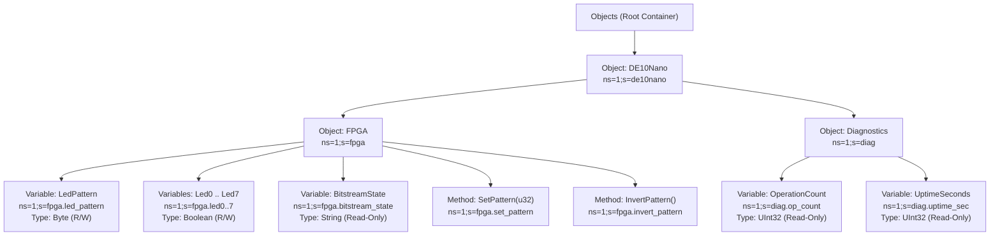

# Explanation: Industrial OPC UA Architecture (`opc.tcp` & Part 14 UADP PubSub) and Comparison with `11_ethernet_hps_led`

> **Series:** cvsoc — Stepping into advanced FPGA development on the DE10-Nano  
> **Type:** Explanation (Understanding-oriented)  
> **Applies to:** Phase 11 ([`17_opcua_hps_led`](../17_opcua_hps_led/doc/README.md) — [`tutorial_phase11_opcua_industrial.md`](tutorial_phase11_opcua_industrial.md)) and Phase 7 ([`11_ethernet_hps_led`](../11_ethernet_hps_led/doc/README.md) — [`explanation_phase7_networking_protobuf_and_dashboard.md`](explanation_phase7_networking_protobuf_and_dashboard.md))

---

## Introduction

Across Phase 7 ([`11_ethernet_hps_led`](../11_ethernet_hps_led/doc/README.md)) and Phase 11 ([`17_opcua_hps_led`](../17_opcua_hps_led/doc/README.md)), the DE10-Nano exposes the exact same physical hardware peripheral—the 8-bit FPGA LED PIO slave at physical address `0xFF200000` on the Lightweight HPS-to-FPGA AXI bridge—over **five distinct network protocols**:

1. **Phase 7.0 (`led_server.c`, UDP `:5005`):** A 2-byte positional binary protocol (`[cmd][pattern]`).
2. **Phase 7.5 (`led_server_pb.c`, UDP `:5006`):** Schema-driven binary serialization using **Nanopb / Google Protocol Buffers** ([`led_command.proto`](../11_ethernet_hps_led/proto/led_command.proto)).
3. **Phase 7.6 (`gateway.py`, TCP/WebSocket `:8080`):** An asynchronous Python protocol gateway translating browser JSON over WebSockets into UDP Protobuf datagrams.
4. **Phase 11 Client/Server (`led_opcua_server.c`, TCP `:4840` `opc.tcp`):** A stateful, self-describing **OPC UA Binary (IEC 62541-6)** server supporting dynamic Address Space discovery (`Browse`), typed `Read`/`Write`, RPC `Method` calls (`Call`), and Report-by-Exception `Subscriptions`.
5. **Phase 11 PubSub (`led_opcua_server.c`, UDP `:4841` UADP):** A connectionless **OPC UA Part 14 UADP (IEC 62541-14)** publisher broadcasting cyclic 24-byte telemetry frames over UDP.

This document explains how the OPC UA architecture works under the hood and provides a rigorous, byte-level and architectural comparison against all three sub-phases of `11_ethernet_hps_led`.

---

## 1. Why Industrial Systems Need More Than Wire Serialization

In [Phase 7.5 (`explanation_phase7_networking_protobuf_and_dashboard.md`)](explanation_phase7_networking_protobuf_and_dashboard.md), we saw why **Protocol Buffers** are a major improvement over raw positional bytes: fields are tagged with numbers (`1`, `2`), integers are Varint-compressed, and adding a new optional field does not break older clients.

**Why isn't Protocol Buffers enough for an industrial factory floor (PLCs, SCADA, MES, HMIs)?**

Because Protocol Buffers is **only a wire serialization format**, not an application protocol or information model:
1. **No Self-Discovery on the Wire:** A Protobuf packet on the wire for `SET_PATTERN(0xA5)` is literally `10 a5 01` (`field_number = 2, wire_type = 0, value = 165`). Unless the client already possesses [`led_command.proto`](../11_ethernet_hps_led/proto/led_command.proto) at compile time, it has no way to know that field `2` is called `pattern`, that it represents an 8-bit LED bitmask, or what other registers exist on the DE10-Nano.
2. **No Standard Transport or Session Layer:** Protobuf does not specify whether messages travel over UDP, TCP, or HTTP, how errors are reported, or how a client subscribes to state changes.
3. **No Semantic Hierarchy:** A factory PLC or SCADA system (such as Ignition, WinCC, or UaExpert) manages thousands of devices from dozens of vendors. It expects every device to expose a browsable tree of **Objects**, **Variables**, **Methods**, **DataTypes**, and **Access Permissions** over a single standardized port (`opc.tcp://:4840`).

**OPC UA (Open Platform Communications Unified Architecture, IEC 62541)** solves all three problems by combining a **self-describing Object-Oriented Information Model** with **standardized binary transports** (`opc.tcp` for Client/Server and `UADP` for UDP PubSub).

---

## 2. The OPC UA Information Model (Address Space) and `UA_DataSource` Callbacks

### How Hardware Peripherals Are Modeled as a Node Graph

Instead of exposing flat command IDs, [`led_opcua_server.c`](../17_opcua_hps_led/software/opcua_server/led_opcua_server.c) organizes the DE10-Nano into a hierarchical graph of **Nodes** in **Namespace 1 (`ns=1`)**:



Every node in [`ua_micro.h`](../17_opcua_hps_led/software/opcua_server/ua_micro.h) carries rich metadata that clients can query at runtime via the **Browse Service (`527`)**:
- **`NodeId` (`ns=1;s=fpga.led_pattern`):** Globally unique address within Namespace `1` (application-specific hardware nodes), whereas Namespace `0` (`ns=0;i=...`) is reserved by the OPC Foundation for standard service and type definitions.
- **`NodeClass`:** `Object` (`1` — organizational folder), `Variable` (`2` — readable/writable value), or `Method` (`4` — server-side RPC function).
- **`DataType`:** Standard IEC 62541-6 built-in type ID: `Boolean` (`1`), `Byte` (`3`), `UInt32` (`7`), or `String` (`12`).
- **`AccessLevel`:** Bitmask enforcing whether the node is Read-Only (`0x01`, e.g., `fpga.bitstream_state`) or Read/Write (`0x03`, e.g., `fpga.led_pattern`).

### Hardware-Backed `UA_DataSource` Callbacks (Zero Polling Overhead)

In a naive OPC UA server, a background thread might poll `/dev/mem` every millisecond to copy hardware registers into an in-memory database. Instead, both `open62541` and our embedded [`ua_micro.c`](../17_opcua_hps_led/software/opcua_server/ua_micro.c) runtime use **DataSource Callbacks (`UA_DataSource`)**:

```c
static UA_StatusCode ds_read_led_pattern(void *user_ctx,
                                         const UA_NodeId *node_id,
                                         UA_Variant *out_val)
{
    HardwareContext *ctx = (HardwareContext *)user_ctx;
    out_val->type     = UA_TYPE_BYTE;
    out_val->value.u8 = (uint8_t)(*(ctx->led_reg) & 0xFFu); /* Direct MMIO read @ 0xFF200000 */
    return UA_STATUSCODE_GOOD;
}
```

When a client sends a `ReadRequest` (`631`) or `WriteRequest` (`673`) for `ns=1;s=fpga.led_pattern` (or a single bit `ns=1;s=fpga.led3`), the server invokes the attached `read` or `write` C function pointer **on demand**, executing a single CPU load/store instruction across the Lightweight HPS-to-FPGA AXI bridge.

---

## 3. The `opc.tcp` Binary Protocol State Machine & Little-Endian Encoding

### Why OPC UA Binary Uses Little-Endian Byte Order

Almost all traditional IETF network protocols (IPv4, IPv6, TCP, UDP) use **Big-Endian** ("network byte order", `htons()`/`htonl()`). Why does **OPC UA Binary (`opc.tcp` and `UADP`)** explicitly mandate **Little-Endian** encoding for all 16-bit, 32-bit, and 64-bit integers?

Because when IEC 62541-6 was designed for modern industrial CPUs, both **x86/x86_64** (industrial PCs and SCADA servers) and **ARM Cortex-A / Cortex-M / RISC-V Nios V** (embedded SoCs like the Cyclone V HPS) are natively **Little-Endian**. By specifying Little-Endian on the wire, an ARM or x86 processor can serialize and deserialize multi-byte integers with **zero byte-swapping overhead**!

### The `opc.tcp` Connection Lifecycle (`HELF` → `ACKF` → `OPNF` → `MSGF` → `CLOF`)

Unlike Phase 7's connectionless UDP servers (`led_server` and `led_server_pb`), `opc.tcp` runs over TCP port `4840` and establishes a stateful session before exchanging service calls:

```mermaid
sequenceDiagram
    participant C as OPC UA Client (opcua_client.py)
    participant S as DE10-Nano (led_opcua_server :4840)

    C->>S: 1. HELF (56 B) — ProtocolVersion=0, MaxBuf=65536, EndpointUrl="opc.tcp://..."
    S->>C: 2. ACKF (28 B) — Negotiated buffer sizes & chunk limits
    C->>S: 3. OPNF (63 B) — OpenSecureChannel (SecurityPolicy#None)
    S->>C: 4. OPNF (46 B) — Assigned SecureChannelId=1, TokenId=1, Lifetime=3600s
    Note over C,S: SecureChannel Active — Client can now invoke Services via MSGF
    C->>S: 5. MSGF — BrowseRequest (ServiceId=527)
    S->>C: 6. MSGF — BrowseResponse (ServiceId=530, 17 Nodes discovered)
    C->>S: 7. MSGF — WriteRequest (ServiceId=673, ns=1;s=fpga.led_pattern <- 0xA5)
    S->>C: 8. MSGF — WriteResponse (ServiceId=676, StatusCode=0x00000000 Good)
    C->>S: 9. CLOF (16 B) — CloseSecureChannel
```

Every chunk on the TCP stream begins with an **8-byte Message Header**:
- **Bytes `0..2` (`MessageType`):** 3 ASCII characters (`"HEL"`, `"ACK"`, `"OPN"`, `"MSG"`, or `"CLO"`).
- **Byte `3` (`ChunkType`):** `'F'` (`0x46`) indicating the Final chunk of the message.
- **Bytes `4..7` (`MessageSize`):** `uint32_le` total chunk length in bytes (allowing the TCP receiver in [`led_opcua_server.c`](../17_opcua_hps_led/software/opcua_server/led_opcua_server.c) to frame exact message boundaries over a byte-stream socket).

For `MSGF` service chunks, bytes `8..23` carry the **16-byte Secure Conversation Header** (`SecureChannelId`, `TokenId`, `SequenceNumber`, `RequestId`), followed at bytes `24..27` by the **4-byte Numeric NodeId** of the invoked service (`[0x01][0x00][uint16_le service_id]`).

---

## 4. OPC UA Part 14 PubSub (`UADP` over UDP): Bridging the Control Plane and Real-Time Data Plane

A common misconception about OPC UA is that it *only* runs over stateful TCP (`opc.tcp`), which would be too heavy for high-frequency cyclic telemetry from an FPGA.

To address deterministic real-time streaming, **IEC 62541-14 (OPC UA PubSub)** introduced **UADP (UA Datagram Protocol)** over connectionless UDP (or raw Ethernet Layer-2 / Time-Sensitive Networking).

In [`17_opcua_hps_led`](../17_opcua_hps_led/doc/README.md), `led_opcua_server` implements **both** planes simultaneously:
1. **Control Plane (`opc.tcp` on TCP `:4840`):** Used by SCADA/engineering tools to browse the Address Space, read/write configuration registers, and invoke RPC methods (`fpga.set_pattern`, `fpga.invert_pattern`).
2. **Real-Time Telemetry Plane (`UADP` on UDP `:4841`):** Periodically broadcasts a compact **24-byte binary `NetworkMessage`** containing `PublisherId = 0x000A`, `DataSetWriterId = 1`, a monotonically increasing `SequenceNumber`, and 3 typed telemetry fields (`LedPattern`, `OperationCount`, `UptimeSeconds`) with **zero request packet overhead (0 TX bytes from the subscriber)**.

---

## 5. Comprehensive Comparison: `11_ethernet_hps_led` (Phase 7) vs. `17_opcua_hps_led` (Phase 11)

### 5.1 Byte-by-Byte Wire Anatomy for `SET_PATTERN(0xA5)`

You can reproduce all byte sequences below at any time by running `make -C 17_opcua_hps_led compare`.

#### 1. Phase 7.0 Raw UDP (`11_ethernet_hps_led`, Port `5005`) — **2 Bytes TX / 2 Bytes RX**
```text
TX (2 B):  01          a5
           │           └── Pattern = 0xA5
           └────────────── Command = 0x01 (SET_PATTERN)

RX (2 B):  00          a5
           │           └── Current LED Readback = 0xA5
           └────────────── Status  = 0x00 (OK)
```

#### 2. Phase 7.5 Nanopb Protobuf (`11_ethernet_hps_led`, Port `5006`) — **3 Bytes TX / 3 Bytes RX**
```text
TX (3 B):  10          a5 01
           │           └────── Base-128 Varint for 165 (0xA5): 0x25|0x80, 0x01
           └────────────────── Tag: (field_number=2 << 3) | wire_type=0 (Varint)
           (Note: field 1 `command = SET_PATTERN (0)` is omitted by proto3 default elision!)

RX (3 B):  10          a5 01
           (Note: field 1 `status = OK (0)` is omitted by proto3 default elision!)
```

#### 3. Phase 7.6 WebSocket JSON (`11_ethernet_hps_led`, Port `8080`) — **35 Bytes TX / 42 Bytes RX**
```text
TX (35 B): {"cmd":"SET_PATTERN","pattern":165}
RX (42 B): {"status":"OK","pattern":165,"hex":"0xA5"}
```

#### 4. Phase 11 OPC UA Client/Server `WriteRequest` (`17_opcua_hps_led`, TCP `:4840`) — **53 Bytes TX / 32 Bytes RX**
```text
TX (53 B):
  4d 53 47 46              "MSGF" — OPC UA Message Chunk, Final
  35 00 00 00              MessageSize = 53 bytes (uint32_le)
  01 00 00 00              SecureChannelId = 1
  01 00 00 00              TokenId = 1
  01 00 00 00              SequenceNumber = 1
  01 00 00 00              RequestId = 1
  01 00 a1 02              Service NodeId: Four-Byte (0x01), ns=0, id=673 (0x02A1 = WriteRequest)
  03 01 00                 Target NodeId: String (0x03), ns=1 (0x0001)
  10 00 00 00              Identifier Length = 16 bytes
  66 70 67 61 2e 6c 65 64  "fpga.led_pattern" (16 UTF-8 bytes)
  5f 70 61 74 74 65 72 6e
  03 a5                    UA_Variant: Type=Byte (0x03), Value=0xA5

RX (32 B):
  4d 53 47 46              "MSGF"
  20 00 00 00              MessageSize = 32 bytes
  01 00 00 00 01 00 00 00  SecureChannelId=1, TokenId=1
  01 00 00 00 01 00 00 00  SequenceNumber=1, RequestId=1
  01 00 a4 02              Service NodeId: id=676 (0x02A4 = WriteResponse)
  00 00 00 00              UA_StatusCode = 0x00000000 (UA_STATUSCODE_GOOD)
```

#### 5. Phase 11 OPC UA Part 14 UADP PubSub (`17_opcua_hps_led`, UDP `:4841`) — **0 Bytes TX / 24 Bytes RX**
```text
RX (24 B):
  11 01                    UADP v1, PublisherId enabled (UInt16), DataSetPayloadHeader enabled
  0a 00                    PublisherId = 0x000A (DE10-Nano Node 10)
  01 01 00                 1 DataSetMessage, DataSetWriterId = 0x0001
  09 01 00                 Valid=1, Variant encoding, SequenceNumber = 1
  03 00                    FieldCount = 3
  03 a5                    Field 0 (LedPattern):     Byte   = 0xA5
  07 2a 00 00 00           Field 1 (OperationCount): UInt32 = 42
  07 10 0e 00 00           Field 2 (UptimeSeconds):  UInt32 = 3600
```

---

### 5.2 Complete 12-Dimension Architectural Matrix

| Dimension | Phase 7.0: Raw UDP (`11_ethernet_hps_led`) | Phase 7.5: Nanopb Protobuf (`11_ethernet_hps_led`) | Phase 7.6: WebSocket JSON (`11_ethernet_hps_led`) | Phase 11: OPC UA `opc.tcp` (`17_opcua_hps_led`) | Phase 11: OPC UA UADP PubSub (`17_opcua_hps_led`) |
| :--- | :--- | :--- | :--- | :--- | :--- |
| **1. Transport Protocol** | UDP (`:5005`) | UDP (`:5006`) | TCP + HTTP/WS (`:8080`) | TCP (`:4840` `opc.tcp`) | UDP (`:4841` UADP) |
| **2. Connection State** | Stateless datagrams | Stateless datagrams | Stateful WebSocket | Stateful (`HEL`/`ACK`/`OPN`/`CLO`) | Stateless broadcast/multicast |
| **3. Byte Endianness** | Single bytes (`uint8`) | Little-Endian Base-128 Varint | UTF-8 text | **Little-Endian** (`uint16_le`/`uint32_le`) | **Little-Endian** (`uint16_le`/`uint32_le`) |
| **4. Session Handshake** | 0 B | 0 B | HTTP `Upgrade: websocket` | 2 chunks (`HELF`/`ACKF` + `OPNF`) | 0 B |
| **5. `SET(0xA5)` Payload Size** | **2 B req / 2 B resp** | **3 B req / 3 B resp** | **35 B req / 42 B resp** | **53 B req / 32 B resp** | **0 B req / 24 B frame** |
| **6. Client Schema Dependency** | Hardcoded byte positions | Must compile `led_command.proto` | Must know JSON keys | **Zero** — discovered via `Browse` (`527`) | Standard IEC 62541-14 header |
| **7. Runtime Self-Discovery** | ❌ Impossible | ❌ Impossible | ❌ Impossible | ✅ Full node tree, types & descriptions | Via companion `opc.tcp` server |
| **8. Sub-Register Addressing** | ❌ Full 8-bit register only | ❌ Full 8-bit register only | ❌ Full 8-bit register only | ✅ Individual bit nodes (`fpga.led0..7`) | Configurable per `DataSetWriter` |
| **9. Server-Side RPC Methods** | Custom `cmd` byte | Enum `CommandType` | REST routes (`/api/...`) | ✅ First-class `Method` nodes (`Call` `712`) | N/A (telemetry stream) |
| **10. Standardized Error Codes** | 1-byte (`0x00` / `0xFF`) | Enum `StatusCode` (4 values) | HTTP / JSON string | ✅ 32-bit IEC `UA_StatusCode` (`0x80340000`, etc.) | Sequence gap detection |
| **11. Push Notifications** | ❌ Client must poll | ❌ Client must poll | ✅ WebSocket broadcast | ✅ `MonitoredItem` `DataChange` (`829`) | ✅ Cyclic UDP datagrams |
| **12. Industrial Interoperability** | Custom script only | Custom client only | Web browsers | ✅ Native SCADA, PLC, MES, UaExpert | ✅ Native PLC-to-PLC & TSN |

---

### 5.3 Engineering Decision Guide: Which Protocol Should You Choose?

On a Cyclone V SoC (FPGA + ARM Cortex-A9), each protocol in this tutorial series occupies a distinct engineering sweet spot:

1. **Choose Raw UDP (Phase 7.0) when:**
   - The UDP endpoint is terminated **directly in FPGA VHDL logic** (where parsing strings or varints in LUTs/flip-flops is expensive and a fixed 2-byte offset can be decoded in a single clock cycle).
2. **Choose Nanopb Protocol Buffers (Phase 7.5) when:**
   - You control **both** the client and the embedded server (e.g., an internal microservice or a soft-core Nios V processor with 32 KB of RAM), bandwidth is constrained, and you want compile-time type safety with minimal wire overhead (2–3 bytes).
3. **Choose OPC UA `opc.tcp` Client/Server (Phase 11) when:**
   - Your board is deployed in an **industrial environment** where third-party PLCs, SCADA dashboards, or field technicians need to connect, browse the available FPGA peripherals dynamically without custom `.proto` files, enforce read/write access levels, call calibration/control methods, and subscribe to state changes.
4. **Choose OPC UA Part 14 UADP PubSub (Phase 11) when:**
   - You need **both** industrial standardization **and** low-overhead, connectionless UDP telemetry streaming (for example, broadcasting FPGA DMA counters or sensor samples from [`15_ddr3_fpga_hps`](../15_ddr3_fpga_hps/doc/README.md) at fixed intervals to multiple listeners simultaneously).
