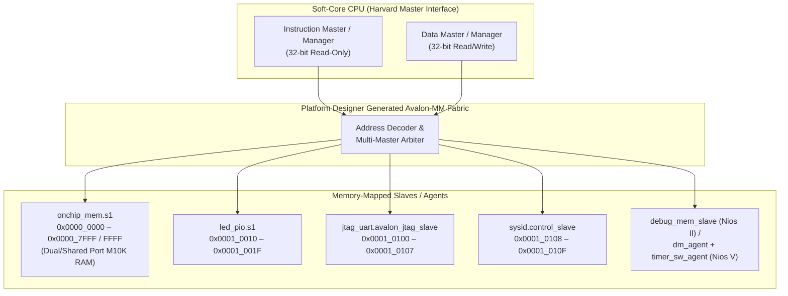
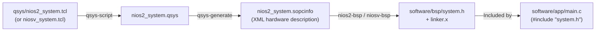

# Explanation: Soft-Core Processors in FPGA Fabric — Nios II vs. Nios V/m

> **Series:** cvsoc — Stepping into advanced FPGA development on the DE10-Nano  
> **Type:** Explanation (Understanding-oriented)  
> **Applies to:** Phase 2 (`04_nios2_led` — [`tutorial_phase2_nios2.md`](tutorial_phase2_nios2.md) and `04b_niosv_led` — [`04b_niosv_led/doc/README.md`](../04b_niosv_led/doc/README.md), [`REGISTER_SHELL_TUTORIAL.md`](../04b_niosv_led/doc/REGISTER_SHELL_TUTORIAL.md))

---

## Introduction

In Phases 0 and 1, changing the LED animation pattern required editing VHDL and waiting several minutes for Quartus synthesis and place-and-route. Phase 2 introduces a fundamentally different paradigm: synthesizing a **soft-core microprocessor** inside the FPGA fabric and driving the LEDs from software (`main.c` / `main.cpp`).

This repository implements Phase 2 on **two different soft-core architectures**:
- **Project `04_nios2_led`:** Intel's classic 32-bit **Nios II/e** processor (Quartus 23.1).
- **Project `04b_niosv_led`:** Intel's modern 32-bit **Nios V/m** processor based on the open **RISC-V (RV32I)** instruction set (Quartus 25.1), featuring an interactive C++ register shell over JTAG UART.

This document explains how a CPU is constructed out of FPGA LUTs and BRAM blocks, how Platform Designer (Qsys) synthesizes the Avalon Memory-Mapped (Avalon-MM) interconnect, how the Board Support Package (BSP) bridges hardware parameters into C/C++ headers, and why Nios II and Nios V differ in their bus topology and debug/timer architectures.

---

## 1. What Is a Soft-Core Processor in Hardware?

Unlike the ARM Cortex-A9 Hard Processor System (HPS) used in Phase 3—which is a fixed block of transistors etched into the corner of the Cyclone V silicon die—a **soft-core processor** is just another RTL module synthesized into standard FPGA resources:

- **ALU and Control Unit:** Synthesized into Cyclone V **Adaptive Logic Modules (ALMs)** (~600 ALMs for Nios II/e Tiny; ~900–1,200 ALMs for Nios V/m).
- **Register File ($32 \times 32\text{-bit}$ general-purpose registers):** Mapped into **M10K embedded SRAM blocks** or MLAB distributed LUT RAM.
- **Program and Data Memory (`onchip_mem`):** Mapped into Cyclone V **M10K memory blocks** (32 KB in `04_nios2_led`, 64 KB in `04b_niosv_led`).

### When to Choose a Soft-Core CPU vs. Pure RTL vs. Hard ARM CPU

| Requirement | Pure RTL (VHDL) | Soft-Core CPU (Nios II / Nios V) | Hard ARM Cortex-A9 (HPS) |
|---|---|---|---|
| **Timing precision** | Cycle-exact (20 ns @ 50 MHz) | Tens of cycles (software loop / ISR) | Hundreds of ns (AXI bridge latency) |
| **Control complexity** | Hard to scale (complex FSMs, string parsing) | Easy (C/C++ control flow, UART shell, state machines) | Very high (Linux, TCP/IP, Python, RTOS) |
| **Iteration time** | 3–8 minutes (full Quartus compile) | **~2 seconds** (`make app && make download-elf`) | **~2 seconds** (`make app && make download-elf`) |
| **Board footprint** | Uses FPGA ALMs | Uses ~2–4% of Cyclone V ALMs + M10K RAM | Uses dedicated silicon (requires DDR3 setup) |

A soft-core CPU excels at **housekeeping, calibration state machines, register shells, and slow protocol parsing** right inside the FPGA clock domain, without needing to bring up the ARM HPS or DDR3 controller.

---

## 2. Platform Designer and the Avalon-MM Interconnect

When you run `qsys-script --script=nios2_system.tcl` followed by `qsys-generate`, Platform Designer does much more than instantiate IP blocks—it automatically synthesizes a **custom bus interconnect fabric** tailored to your exact address map.



### Why the CPU Has Two Bus Masters (Harvard Bus Topology)

Both Nios II and Nios V expose two separate Avalon-MM master ports:
1. **`instruction_master` (Nios II) / `instruction_manager` (Nios V):** Fetches 32-bit instructions pointed to by the Program Counter (`PC`). It never issues write transactions and does **not** need to be wired to I/O peripherals like `led_pio`, `jtag_uart`, or `sysid` (the CPU never executes code out of an LED register!).
2. **`data_master` (Nios II) / `data_manager` (Nios V):** Executes load/store instructions (`ldw`/`stw` on Nios II, `lw`/`sw` on RISC-V Nios V). It connects to *both* `onchip_mem` (so software can read/write `.rodata`, `.data`, `.bss`, and the stack) and all I/O peripherals.

Because both masters connect to `onchip_mem.s1` (and the debug module), Platform Designer automatically inserts a **2-to-1 round-robin/priority arbiter** in front of `onchip_mem.s1`. If an instruction fetch and a data load/store target `onchip_mem` on the same clock cycle, the arbiter asserts `waitrequest` to one master for 1 cycle while granting access to the other.

### Why Both Masters Must Connect to the Debug Module

In `04_nios2_led/qsys/nios2_system.tcl`:
```tcl
add_connection nios2.data_master        nios2.debug_mem_slave
add_connection nios2.instruction_master nios2.debug_mem_slave
```
And in `04b_niosv_led/qsys/niosv_system.tcl`:
```tcl
add_connection niosv.data_manager        niosv.dm_agent
add_connection niosv.instruction_manager niosv.dm_agent
```

**Why does a CPU connect its own master ports back into its own debug slave port?**
When JTAG halts the processor (for `nios2-download`, `niosv-download`, or GDB), the processor does not use dedicated hardware wires to read/write every peripheral in the system. Instead, the CPU enters **Debug Mode** and jumps its Program Counter into a tiny **Debug Park Loop / Program Buffer** located inside the debug module (`debug_mem_slave` at `0x00010800` or `dm_agent` at `0x00100000`):
- The **instruction master** must reach the debug module to fetch and execute the debug park loop instructions injected over JTAG.
- The **data master** must reach the debug module so those debug instructions can read/write debug data registers and transfer ELF segments into `onchip_mem`.

---

## 3. Architectural Comparison: Nios II (`04`) vs. Nios V/m (`04b`)

Intel's transition from Nios II to Nios V brings standard RISC-V architecture and IEEE/AMBA terminology changes:

| Architectural Aspect | Nios II/e (`04_nios2_led`) | Nios V/m (`04b_niosv_led`) |
|---|---|---|
| **Instruction Set (ISA)** | Altera proprietary 32-bit RISC (`nios2-elf-gcc`) | Open **RISC-V RV32I + Zicsr** (`riscv32-unknown-elf-gcc`) |
| **Qsys Component** | `altera_nios2_gen2` (`impl = Tiny`) | `intel_niosv_m` (`enableAvalonInterface = True`) |
| **Bus Master Names** | `data_master`, `instruction_master` | `data_manager`, `instruction_manager` |
| **Debug Target Port** | `debug_mem_slave` (`0x00010800`) | `dm_agent` (`0x00100000` — RISC-V Debug Spec 0.13) |
| **Internal Timer / SW IRQ** | Separate Qsys IP if needed | Built-in **CLINT** (`timer_sw_agent` at `0x00010140`: `mtime`, `mtimecmp`, `msip`) |
| **IRQ Receiver Port** | `nios2.irq` (32-bit IIC) | `niosv.platform_irq_rx` (maps to RISC-V `mie`/`mip` bits `[31:16]`) |
| **Clock Rate Metadata** | Implicit | Explicit: `clk_0 EXPLICIT_CLOCK_RATE {50000000}` required so `niosv-bsp` generates `ALT_CPU_FREQ` |
| **BSP & App Build System** | `nios2-bsp` + GNU Make (`Makefile`) | `niosv-bsp` + `niosv-app` → **CMake** (`CMakeLists.txt`) |

### Why `04b_niosv_led` Uses 64 KB On-Chip RAM Instead of 32 KB

In `04_nios2_led`, the C program uses minimal HAL I/O (`IOWR_ALTERA_AVALON_PIO_DATA`) and fits in ~4 KB of `.text`. In `04b_niosv_led`, the firmware is written in C++ (`main.cpp`) and implements an interactive command parser (`CommandShell`) over JTAG UART. While the C++ templates themselves are zero-overhead, the RISC-V HAL runtime plus string tables and stack benefit from 64 KB (`65536` bytes) of M10K RAM—still well within the Cyclone V `5CSEBA6`'s ~553 M10K blocks (~5.5 Mb total).

---

## 4. How the BSP Bridges Hardware and Software

How does C/C++ code know that `led_pio` lives at `0x00010010`?



1. **`qsys-generate`** emits `<system>.sopcinfo`, an XML database containing every component's parameter values, base addresses, address spans, IRQ numbers, and clock frequencies.
2. **`nios2-bsp` / `niosv-bsp`** parses `.sopcinfo` and generates two critical files in `software/bsp/`:
   - **`system.h`:** C preprocessor macros for every peripheral (`#define LED_PIO_BASE 0x10010`, `#define JTAG_UART_BASE 0x10100`, `#define JTAG_UART_IRQ 0`).
   - **`linker.x`:** The GNU `ld` linker script that places `.entry` at `resetOffset` (`0x00000000`), `.exceptions` at `exceptionOffset` (`0x00000020`), and `.text`, `.rodata`, `.rwdata`, `.bss`, heap, and stack inside `onchip_mem` (`0x00000000`–`0x00007FFF`).

If you change `led_pio`'s base address in `nios2_system.tcl` and re-run `make all`, `system.h` updates automatically and `main.c` compiles against the new address without touching a single line of C code.

### Cache Bypass Macros (`IORD` / `IOWR`)

In `04_nios2_led/software/app/main.c`, register writes use:
```c
IOWR_ALTERA_AVALON_PIO_DATA(LED_PIO_BASE, pattern);
```
Why not just `*(volatile uint32_t *)LED_PIO_BASE = pattern`?
- On Nios II cores with a data cache (such as Nios II/f), a normal memory store (`stw`) might stay in the data cache and never reach the hardware PIO register! `IOWR` expands to the Nios II **`stwio`** (*Store Word I/O*) instruction (or sets bit 31 of the address), which forces the CPU to bypass the data cache and issue an immediate Avalon-MM bus write.
- On Nios V (`intel_niosv_m`), RISC-V does not have separate `stwio` instructions; instead, I/O regions are uncached and accessed via `volatile` 32-bit loads/stores (`lw`/`sw`).

---

## 5. Inside the Nios V Embedded C++ Register Shell (`04b_niosv_led`)

Project `04b_niosv_led` goes a step further than passive LED cycling: it exposes an interactive CLI over the JTAG UART (`led.status`, `led.control = 0x55`, `led.on 3`, `led.toggle 7`, `led.cycle off`).

### Compile-Time Hardware Binding with C++ Templates

Look at how `04b_niosv_led/software/app/main.cpp` binds hardware addresses:

```cpp
using BoardLed  = Led<LED_PIO_BASE, 8u>;
using BoardUart = cvsoc::JtagUart<JTAG_UART_BASE>;
using Shell     = cvsoc::CommandShell<BoardUart>;
```

In traditional embedded C, passing peripheral instances around requires either global variables or runtime pointers stored in structs (which consume RAM and require pointer indirection on every register access). By passing `LED_PIO_BASE` and `JTAG_UART_BASE` as **C++ template non-type parameters**:
- The address `0x00010010` is a compile-time constant (`constexpr std::uintptr_t`).
- `BoardLed::control(val)` compiles down to a single inline `lui` + `sw` RISC-V instruction pair—identical in machine code size and speed to a raw C macro, but with full C++ type safety and encapsulation (`led.hpp`).
- `CommandShell<BoardUart>` is parameterized on the transport type without needing `virtual` functions (no vtable in RAM/ROM) and without using dynamic memory allocation (`new` / `malloc` are never called).

### Why `JtagUart::begin()` Disables JTAG UART Interrupts

In `common/software/niosv_shell/jtag_uart.hpp`, `uart.begin()` explicitly writes `0` to the JTAG UART `control` register (offset `0x04`) to disable its read/write interrupts. Why?
Because the HAL startup code registers a default interrupt-driven `stdio` driver for `jtag_uart`. If that driver remained active, its ISR would steal incoming characters from the JTAG UART `data` FIFO (offset `0x00`) before `shell.poll()` could read them! Disabling the JTAG UART interrupt bit hands exclusive non-blocking polling control of the 64-byte hardware RX/TX FIFOs to `JtagUart`.

---

## Further Reading

- **Tutorials:**
  - [Phase 2 Tutorial — Nios II Soft-Core CPU with LED Control](tutorial_phase2_nios2.md)
  - [04b — Nios V/m LED Demo](../04b_niosv_led/doc/README.md)
  - [Building an Interactive Register Shell with Embedded C++](../04b_niosv_led/doc/REGISTER_SHELL_TUTORIAL.md)
- **How-To Guides:**
  - [How-to: Migrate a Soft-Core Project from Nios II (23.1) to Nios V/m (25.1)](howto_migrate_nios2_to_niosv.md)
  - [How-to: Create and Integrate a Custom Avalon-MM Slave/Master Peripheral](howto_add_custom_avalon_mm_peripheral.md)
