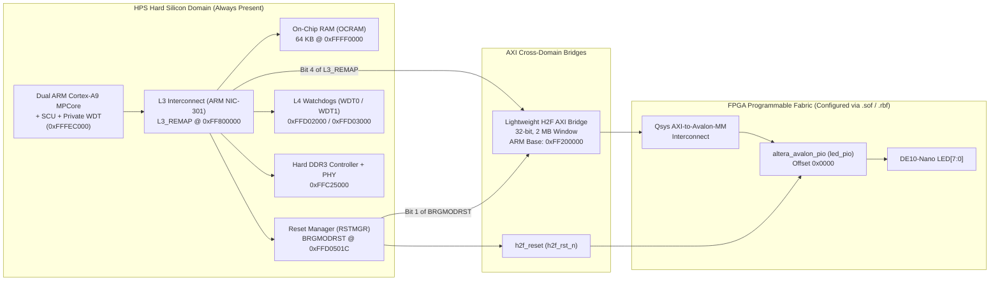
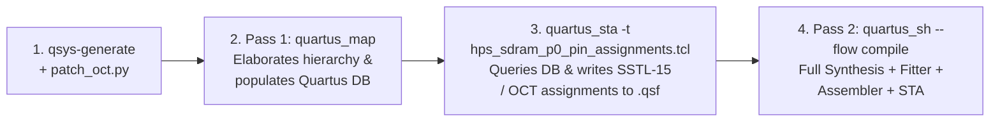

# Explanation: Cyclone V HPS Silicon Architecture, Bridges, Watchdogs, and the DDR3 PHY Compile Flow

> **Series:** cvsoc — Stepping into advanced FPGA development on the DE10-Nano  
> **Type:** Explanation (Understanding-oriented)  
> **Applies to:** Phase 3 (`05_hps_led` — [`tutorial_phase3_hps_baremetal.md`](tutorial_phase3_hps_baremetal.md))

---

## Introduction

Phase 3 transitions from a synthesized soft-core CPU in FPGA fabric to the **Hard Processor System (HPS)**—a dual-core 800 MHz ARM Cortex-A9 MPCore fabricated in dedicated silicon inside the Cyclone V SoC (`5CSEBA6U23I7`).

While the application goal in `05_hps_led` is identical to Phase 2 (cycle 8 LEDs via a memory-mapped PIO), bringing up the HPS in bare-metal exposes a set of real-world SoC engineering challenges that surprise almost every developer new to Cyclone V:

1. Why Quartus forces you to configure the **DDR3 SDRAM controller** and run a **two-pass compilation flow** + **SystemVerilog OCT patch (`patch_oct.py`)**, even when your code runs entirely from On-Chip RAM (OCRAM) and never touches DDR3.
2. Why accessing `0xFF200000` (the Lightweight HPS-to-FPGA bridge) crashes with an ARM **Data Abort** unless two separate hardware blocks—the **Reset Manager** and the **L3 NIC-301 Interconnect**—are initialized in the right sequence.
3. Why a bare-metal HPS application mysteriously resets itself after ~30 seconds unless **three separate hardware watchdog timers** are neutralized.
4. How `startup.S` and `linker.ld` bootstrap an ARMv7-A processor in `0xFFFF0000` (OCRAM) without a generated BSP.

---

## 1. The Cyclone V SoC Partitioning: HPS Silicon vs. FPGA Fabric

The Cyclone V SoC die is physically divided into two distinct power and configuration domains connected by high-speed bridges:



Unlike Nios II, the HPS is **hard silicon**:
- Its peripheral base addresses (`0xFF200000` for LW H2F, `0xFF800000` for L3 GPV, `0xFFD05000` for Reset Manager, `0xFFFF0000` for OCRAM) are permanently fixed in the silicon address decoder and documented in the *Cyclone V Hard Processor System Technical Reference Manual (TRM)*.
- You do not need to program a `.sof` into the FPGA just to execute ARM instructions in OCRAM—the ARM cores can run via JTAG even when the FPGA fabric is unconfigured! However, the moment the ARM core reads or writes `0xFF200000`, the transaction crosses into the FPGA fabric, which *must* be configured, clocked, and out of reset.

---

## 2. Why Does `altera_hps` Require DDR3, `patch_oct.py`, and a Two-Pass Compile?

### Why DDR3 Cannot Be Omitted from `hps_system.tcl`

In Platform Designer, the `altera_hps` component models the entire HPS hard block—including its hard DDR3 memory controller and hard I/O pads. Intel's `altera_hps` IP generator unconditionally instantiates the `hps_sdram` sub-module (based on Intel's UniPHY memory IP architecture) and exports the `memory` conduit (`memory_mem_a`, `memory_mem_dq`, `memory_oct_rzqin`, etc.) to the top-level entity.

Because those ports connect to physical HPS DDR3 I/O buffers on the silicon periphery, the Quartus Fitter (`quartus_fit`) validates every electrical I/O standard (SSTL-15 Class I), delay chain, and On-Chip Termination (OCT) block on those pins—even if your software in `05_hps_led` never accesses DDR3!

### Root Cause of Fitter Error 174068 and `patch_oct.py`

When `qsys-generate` creates the HPS DDR3 PHY soft wrapper in:
`hps_system/synthesis/submodules/altdq_dqs2_acv_connect_to_hard_phy_cyclonev.sv`

a long-standing bug in Quartus's UniPHY generator surfaces:
1. The parent Verilog module (`hps_sdram_p0_altdqdqs.v`) overrides a string parameter on its child module using a Verilog-1995 `defparam` statement:
   ```verilog
   defparam altdq_dqs2_inst.USE_TERMINATION_CONTROL = "true";
   ```
2. Inside `altdq_dqs2_acv_connect_to_hard_phy_cyclonev.sv`, the module connects the `.seriesterminationcontrol(...)` wire to the low-level silicon primitive `cyclonev_io_obuf`, **but forgets to pass `.use_termination_control("true")` in the primitive's `#(...)` parameter list** (or relies on parameter propagation that Quartus's elaborator fails to apply across the `defparam` boundary).
3. During `quartus_fit`, the Fitter sees a `cyclonev_io_obuf` primitive with `seriesterminationcontrol` wired up while `use_termination_control` defaults to `"false"`, and aborts with:
   ```
   Error (174068): Output buffer atom "...obuf..." has port "SERIESTERMINATIONCONTROL[0]" connected, but does not use calibrated on-chip termination
   ```

**How `05_hps_led/scripts/patch_oct.py` fixes this:**
`patch_oct.py` runs immediately after `qsys-generate` and explicitly injects `.use_termination_control("true")` into the five `cyclonev_io_obuf` instantiations (`obuf_os_bar_0`, `obuf_os_0`, `data_out` bidir, `data_out` output, and `obuf_1`) inside `altdq_dqs2_acv_connect_to_hard_phy_cyclonev.sv`.

### Why `de10_nano_project.tcl` Must Use `QIP_FILE` Instead of `QSYS_FILE`

If you add `set_global_assignment -name QSYS_FILE ../qsys/hps_system.qsys` to a Quartus project, Quartus automatically re-runs `qsys-generate` inside a private `db/ip/` directory during `quartus_map`—**overwriting `patch_oct.py`'s fixes with unpatched SystemVerilog!**

By instead pointing Quartus at the already-generated `.qip` manifest:
```tcl
set_global_assignment -name QIP_FILE hps_system/synthesis/hps_system.qip
```
Quartus synthesizes the exact files in `hps_system/synthesis/` that `patch_oct.py` patched, without re-extracting unpatched IP into `db/ip/`.

### Why the Two-Pass Quartus Compile Is Required

Why does `05_hps_led/quartus/Makefile` run `quartus_map` first, then run a Tcl script (`hps_sdram_p0_pin_assignments.tcl`), and only then run the full compile?



 Intel's generated `hps_sdram_p0_pin_assignments.tcl` does not hardcode pin names like `hps_ddr3_dq[0]`. Instead, it uses Quartus's Tcl timing netlist API (`get_names`, `get_pins`) to dynamically discover the hierarchical path of the DDR3 pads in your top-level design and attach SSTL-15 / OCT / termination assignments to them in `de10_nano.qsf`.
- Those Tcl database queries **cannot run until `quartus_map` has elaborated the design at least once** to create the `db/` hierarchy database.
- Simultaneously, `quartus_fit` (the Fitter) **cannot succeed until `hps_sdram_p0_pin_assignments.tcl` has written those SSTL-15 assignments into `.qsf`**.
- Therefore, every Cyclone V HPS design requires: **Pass 1 (`quartus_map`) → Run DDR3 pin Tcl script → Pass 2 (`quartus_sh --flow compile`)**.

### Why `h2f_lw_axi_clock` Must Share the Slave's Clock Domain

In `05_hps_led/qsys/hps_system.tcl`:
```tcl
add_connection clk_0.clk led_pio.clk
add_connection clk_0.clk hps_0.h2f_lw_axi_clock
```
The AXI signals leaving the HPS hard silicon (`h2f_lw_axi_master`) enter the FPGA fabric synchronously to whatever clock you feed into the `hps_0.h2f_lw_axi_clock` input port. By connecting `clk_0.clk` (50 MHz) to **both** `hps_0.h2f_lw_axi_clock` and `led_pio.clk`:
- The AXI-to-Avalon bridge logic and `led_pio` operate in a **single synchronous 50 MHz clock domain**.
- No asynchronous clock-crossing FIFO (`altera_avalon_dc_fifo`) is needed, avoiding both latency overhead and a known Quartus `EntityWritingException` in `hps_io_border` generation.

---

## 3. Enabling the Lightweight HPS-to-FPGA Bridge: Why Two Registers Are Required

When the ARM Cortex-A9 executes `LED_PIO_DATA = patterns[idx]` (writing to `0xFF200000`), the CPU's AXI transaction travels through:
1. The **Cortex-A9 SCU / L2 master port**
2. The **L3 Interconnect (ARM CoreLink NIC-301)**
3. The **Lightweight H2F Bridge slice** (controlled by the Reset Manager)
4. The **FPGA Qsys interconnect** and **`led_pio`** (held in reset by `h2f_reset`)

After cold reset or JTAG FPGA reprogramming, **two independent gates block this path**:

| Hardware Gate | Register & Address | Bit(s) | What Happens If You Forget It |
|---|---|---|---|
| **1. L3 Address Visibility (`L3_REMAP`)** | `0xFF800000` (Write-only GPV register) | Bit 4 (`LWHPS2FPGA`), Bit 3 (`HPS2FPGA`), Bit 0 (`OCRAM`) | The L3 NIC-301 interconnect treats `0xFF200000` as an unmapped hole and returns an AXI `DECERR` (Decode Error), triggering an immediate **Data Abort exception** on the ARM CPU. |
| **2. Bridge & Fabric Reset (`RSTMGR_BRGMODRST`)** | `0xFFD0501C` (`RSTMGR_BASE + 0x1C`) | Bit 0 (`hps2fpga`), Bit 1 (`lwhps2fpga`), Bit 2 (`fpga2hps`) | The bridge slice stays in reset (`1`), or `h2f_rst_n` into the FPGA never pulses cleanly after `.sof` load, causing the bus transaction to hang forever or writes to be ignored by `led_pio`. |

Look at `hps_bridge_init()` in `05_hps_led/software/app/main.c`:

```c
static void hps_bridge_init(void)
{
    /* 1. Make LW H2F (bit 4) and OCRAM at 0x0 (bit 0) visible in L3 NIC-301 */
    L3_REMAP = L3_REMAP_LWHPS2FPGA | L3_REMAP_OCRAM;

    /* 2. Pulse bridge resets (1 -> 0) so h2f_rst_n resets Qsys slaves cleanly */
    RSTMGR_BRGMODRST |= BRGMODRST_ALL;
    delay(200000UL);
    RSTMGR_BRGMODRST &= ~BRGMODRST_ALL;
    delay(200000UL);
}
```

> ** Subtlety on `L3_REMAP` (`0xFF800000`):** In the ARM NIC-301 Global Programmer's View (GPV), the `remap` register at `0xFF800000` is **write-only**! Reading `L3_REMAP` returns unpredictable data (or `0`), so `L3_REMAP |= ...` is unsafe in bare-metal unless you explicitly include `L3_REMAP_OCRAM` (`bit 0`) so the exception vector table at `0x00000000` remains mapped to OCRAM (`0xFFFF0000`).

---

## 4. The Three Cyclone V Watchdog Timers

Why does `05_hps_led/software/app/main.c` define `wdt_init()` and `wdt_kick()`?

The Cyclone V HPS contains **three hardware watchdog timers**:
1. **L4 Watchdog 0 (`WDT0` at `0xFFD02000`):** Synopsys DesignWare APB Watchdog.
2. **L4 Watchdog 1 (`WDT1` at `0xFFD03000`):** Second Synopsys DesignWare APB Watchdog.
3. **Cortex-A9 MPCore Private Watchdog (`0xFFFEC620`):** ARM private peripheral watchdog.

### Why Can't `WDT0`Simply Be Disabled by Clearing `WDT_CR[0]`?

In the Synopsys DW_apb_wdt hardware IP, there is a synthesis configuration parameter called `WDT_ALWAYS_EN`. On Cyclone V silicon, once the BootROM or U-Boot SPL enables `WDT0` (`WDT_CR[0] = 1`), **the enable bit cannot be cleared by writing `0` to `WDT_CR`—it can only be cleared by a system reset!**

If your bare-metal program loaded via JTAG ignores `WDT0`, the counter counts down from the timeout value set by the preloader/BootROM (~few seconds) and triggers a warm reset of the entire HPS, wiping out your running program!

Therefore, `wdt_init()` in `main.c` handles both architectures properly:
- **For `WDT0` and `WDT1`:** Writes `0xFF` to the Timeout Range Register (`WDT_TORR`, setting the maximum $2^{31}$ `osc1_clk` cycles $\approx 85\text{ seconds}$ at $25\text{ MHz}$) and periodically writes the magic reload byte `0x76` to the Counter Restart Register (`WDT_CRR`) inside `wdt_kick()` and `delay()`.
- **For the ARM MPCore Private Watchdog (`0xFFFEC620`):** Writes the ARM-specified two-word unlock sequence (`0x12345678` followed by `0x87654321`) to `MPCORE_WDT_DISABLE` (`+0x14`), which switches the private watchdog into regular timer mode so `MPCORE_WDT_CTRL = 0` permanently stops it.

---

## 5. Bare-Metal ARM Startup (`startup.S`) and OCRAM Linker Script (`linker.ld`)

Without an OS or generated HAL BSP, how does the ARM Cortex-A9 go from reset/JTAG entry to executing `main()` in C?

### Memory Map Inside 64 KB OCRAM (`0xFFFF0000`–`0xFFFFFFFF`)

```
0xFFFFFFFF  ┌──────────────────────────────────────────┐  ◄── _stack_top (0xFFFFFFFC)
            │             SVC Stack (↓)                │      (grows downward)
            │                    │                     │
            │                    ▼                     │
            ├──────────────────────────────────────────┤  ◄── __bss_end
            │ .bss   (zero-initialized globals)        │
            ├──────────────────────────────────────────┤  ◄── __bss_start
            │ .data  (initialized globals)             │
            ├──────────────────────────────────────────┤
            │ .text + .rodata (C functions, patterns)  │
            ├──────────────────────────────────────────┤
            │ .startup (_start: mode, SP, BSS clear)   │
0xFFFF0000  │ _vectors (8 × branch instructions, 32 B) │  ◄── ENTRY(_start) / OCRAM Base
            └──────────────────────────────────────────┘
```

1. **Vector Table at Offset 0 (`_vectors`):**
   When `L3_REMAP_OCRAM` (bit 0) is set (or `SCTLR.V = 1` high vectors are used), the ARM CPU fetches exception vectors from the start of OCRAM (`0xFFFF0000`). Placing `.startup` first in `linker.ld` guarantees that `_vectors` lands at `0xFFFF0000`.
2. **CPU Mode and Interrupt Masking (`msr cpsr_c, #0xD3`):**
   Bit breakdown of `0xD3` (`0b1101_0011`):
   - Bits `[4:0] = 0b10011` (`0x13`): **Supervisor (SVC) mode** (privileged mode required for bare-metal system control).
   - Bit `5 (T) = 0`: **ARM 32-bit instruction state** (not Thumb).
   - Bit `6 (F) = 1`: **FIQ disabled**.
   - Bit `7 (I) = 1`: **IRQ disabled**.
3. **Stack Initialization (`ldr sp, =_stack_top`):**
   C functions cannot execute without a valid stack pointer (`r13` / `sp`). `linker.ld` computes `_stack_top = ORIGIN(OCRAM) + LENGTH(OCRAM) - 4 = 0xFFFFFFFC`.
4. **C Runtime Contract (`.bss` Zeroing):**
   The C standard guarantees that uninitialized global/static variables start at `0`. The loop between `__bss_start` and `__bss_end` writes `0x00000000` across `.bss` before branching to `main` (`bl main`).

### Why `-nostdlib` Forbids the `%` Operator on ARMv7-A (`05_hps_led`)

Notice in `05_hps_led/software/app/main.c` lines 176–178:
```c
idx++;
if (idx >= num_patterns)
    idx = 0;
```
Why didn't the author write `idx = (idx + 1) % num_patterns`?
Because the ARMv7-A instruction set used in Cortex-A9 (without `idiva` enabled or when targeting general ARMv7) performs integer division and modulo via a compiler helper function in `libgcc` (`__aeabi_uidivmod`). When linking a bare-metal binary with `-nostdlib` (without `-lgcc`), calling `%` on non-power-of-two values causes an `undefined reference to '__aeabi_uidivmod'` linker error! Using an explicit `if (idx >= num_patterns) idx = 0;` is both smaller and faster.

---

## Further Reading

- **Tutorial:**
  - [Phase 3 Tutorial — HPS Bare-Metal LED Control](tutorial_phase3_hps_baremetal.md)
- **How-To Guide:**
  - [How-to: Fix HPS DDR3 Fitter Error 174068, Bridge Data Aborts, and Watchdog Resets](howto_fix_hps_ddr3_fitter_and_bridge_errors.md)
- **Next Explanation:**
  - [Explanation: Cyclone V DDR3 Subsystem, F2H SDRAM Bridge, and Custom Avalon-MM Masters](explanation_phase3b_ddr3_and_avalon_master.md)
