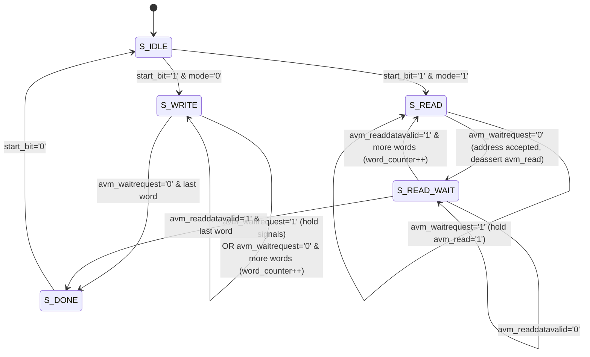

# Explanation: Cyclone V DDR3 Subsystem, F2H SDRAM Bridge, and Custom Avalon-MM Masters

> **Series:** cvsoc — Stepping into advanced FPGA development on the DE10-Nano  
> **Type:** Explanation (Understanding-oriented)  
> **Applies to:** Phase 3B (`14_ddr3_hps_test` and `15_ddr3_fpga_hps` — [`tutorial_phase3b_ddr3_memory.md`](tutorial_phase3b_ddr3_memory.md))

---

## Introduction

In Phase 3 (`05_hps_led`), our bare-metal ARM application executed inside the 64 KB On-Chip RAM (`0xFFFF0000`) and communicated with the FPGA over the 32-bit Lightweight HPS-to-FPGA bridge (`0xFF200000`). While 64 KB and a 32-bit register bus are fine for blinking LEDs, real-world FPGA+SoC applications—such as video frame buffers, software-defined radio sample streams, or neural network accelerators—require **hundreds of megabytes of memory** and **gigabytes per second of bandwidth** between the FPGA fabric and the ARM processor.

Phase 3B (`14_ddr3_hps_test` and `15_ddr3_fpga_hps`) unlocks the DE10-Nano's **1 GB DDR3L SDRAM** (`0x00000000`–`0x3FFFFFFF`) and the **FPGA-to-HPS (F2H) SDRAM Bridge**. This document explains:

1. How the physical DDR3L chips on the DE10-Nano connect to the HPS hard memory controller and why the **U-Boot SPL** must calibrate the PHY before DDR3 can be used.
2. The electrical fault physics behind the three memory test algorithms in `14_ddr3_hps_test`.
3. How the **three HPS-FPGA bridges** compare and how the **F2H SDRAM bridge** grants FPGA logic direct access to DDR3.
4. How `15_ddr3_fpga_hps/hdl/ddr3_test_master.vhd` implements a dual-interface **Avalon-MM Slave + Avalon-MM Master** DMA engine in VHDL—and why its state machine is structured to prevent duplicate bus transactions.
5. How **ARM Cortex-A9 cache coherency** interacts with shared FPGA/HPS memory.

---

## 1. Physical DDR3 Topology on the DE10-Nano and Role of the Preloader (SPL)

### Two 16-bit Chips Forming a 32-bit Bus

The Terasic DE10-Nano mounts two **Micron MT41K256M16HA-125** (or `-107`) DDR3L SDRAM devices wired in parallel to the HPS hard memory pins:

- **Address, Bank, Clock, and Control lines (`A[14:0]`, `BA[2:0]`, `CK/CK#`, `RAS#`, `CAS#`, `WE#`):** Shared across both chips in a fly-by/balanced tree topology.
- **Data and Strobe lines (`DQ[31:0]`, `DQS[3:0]`, `DM[3:0]`):**
  - Chip 1 handles the lower 16 bits (`DQ[15:0]`, `DQS[1:0]`).
  - Chip 2 handles the upper 16 bits (`DQ[31:16]`, `DQS[3:2]`).
- **Capacity Calculation:**
  $$2^{15}\text{ rows} \times 2^{10}\text{ columns} \times 2^3\text{ banks} \times 32\text{ bits} = 2^{28} \times 4\text{ bytes} = 1\text{ GiB} \quad (\text{0x00000000 – 0x3FFFFFFF})$$
- **Bandwidth:** Operating at a $400\text{ MHz}$ memory clock with Double Data Rate ($800\text{ MT/s}$) across $4\text{ bytes}$ gives a theoretical peak bandwidth of **$3.2\text{ GB/s}$**.

### Why You Cannot Jump Directly into DDR3 After Power-On

Unlike static SRAM (OCRAM at `0xFFFF0000`), dynamic SDRAM (DDR3) is completely unusable at power-on until a complex initialization and calibration sequence has executed:
1. **JEDEC Power-Up Sequence:** Assert `RESET#` for $200\ \mu\text{s}$, wait $500\ \mu\text{s}$ with `CKE` low, program Mode Registers `MR2`, `MR3`, `MR1`, `MR0` (CAS latency, write recovery, DLL reset), and issue `ZQCL` (ZQ calibration long).
2. **UniPHY Read/Write Levelling Calibration:** At $800\text{ MT/s}$, data bit windows are only $1.25\text{ ns}$ wide. The Cyclone V hard SDRAM sequencer sweeps input/output delay chains on each `DQS` byte lane to center the sampling clock eye inside the valid data window.
3. **Address Filtering & L3 Visibility:** The SDRAM L3 address range (`0x00100000`–`0x3FFFFFFF`) must be opened in the L3 interconnect / SDRAM controller.

Who performs this calibration? **U-Boot SPL (Secondary Program Loader)**.
When the DE10-Nano boots from an SD card (or when OpenOCD loads `u-boot-spl` into OCRAM at `0xFFFF0000` and runs it for 1 second), the SPL executes Intel's SDRAM calibration routine using the handoff parameters generated from `hps_system.tcl`. Only *after* the SPL finishes can JTAG load `14_ddr3_hps_test.elf` or `15_ddr3_fpga_hps.elf` at `0x00100000`.

---

## 2. Fault Models Behind the DDR3 Memory Test (`14_ddr3_hps_test`)

Why does `14_ddr3_hps_test/software/app/main.c` run **three specific test passes** instead of just writing `0x12345678` everywhere? Each pattern targets a distinct physical hardware failure mode:

| Test Pass | Pattern Written | Physical Fault Detected | Why Other Tests Miss It |
|---|---|---|---|
| **1. Walking Ones** | `1 << b` for $b \in [0..31]$ (`0x00000001`, `0x00000002`, ..., `0x80000000`) | **Data Line Stuck-At & Short-Circuit Faults:** A solder bridge between `DQ[4]` and `DQ[5]` or a pin shorted to GND/VCC. | If you write `0xFFFFFFFF`, two shorted data lines both carry `1` and read back `1` without error! Walking a single `1` while all other 31 bits are `0` proves every `DQ[i]` toggles independently. |
| **2. Address-as-Data** | `*(uint32_t *)addr = (uint32_t)addr` across the entire 62 MB range before reading back | **Address Line Aliasing (Open/Shorted `A[14:0]` or `BA[2:0]`):** If address line `A10` is stuck low, writes to `0x00200400` overwrite `0x00200000`. | A test that writes and immediately reads back a single address at a time will pass even if every address maps to the exact same 32-bit cell! Writing unique values across the entire memory range *first* and reading back *second* exposes any aliasing. |
| **3. Alternating Checkerboard** | Pass A: `0xAAAAAAAA` (`1010...`)<br/>Pass B: `0x55555555` (`0101...`) | **Capacitive Crosstalk & Bit-Cell Coupling Faults:** Simultaneous switching noise (SSN) when all odd bits transition high while all even bits transition low. | Walking ones only switches two bits at a time (`dI/dt` is tiny). Alternating `0xAAAAAAAA` and `0x55555555` maximizes adjacent-trace voltage swing (`3.0 V` differential swing on neighboring PCB traces). |

---

## 3. Comparing the Three HPS–FPGA Bridges

The Cyclone V SoC provides three independent AXI bridges between the HPS and FPGA fabric. Understanding their roles is critical for system architecture:

```
┌───────────────────────────────────────────────────────────────────────────────────┐
│                                 Cyclone V HPS                                     │
│                                                                                   │
│  ┌──────────────────────┐                       ┌──────────────────────────────┐  │
│  │  ARM Cortex-A9 CPUs  │                       │  Hard Multi-Port DDR3 Ctrl   │  │
│  └──────────┬───────────┘                       └──────▲───────────────▲───────┘  │
│             │                                          │               │          │
│             ▼                                          │               │          │
│  ┌──────────────────────────────────────────┐          │               │          │
│  │       L3 Interconnect (NIC-301)          ├──────────┘               │          │
│  └───┬──────────────────┬───────────────▲───┘                          │          │
└──────┼──────────────────┼───────────────┼──────────────────────────────┼──────────┘
       │                  │               │                              │
  1. LW H2F          2. H2F Heavy    3. F2H Bridge              4. F2H SDRAM Bridge
  (0xFF200000)       (0xC0000000)    (FPGA → L3/OCRAM)          (f2h_sdram0: Direct)
   32-bit AXI        32/64/128-bit    32/64/128-bit              32/64/128-bit AXI
   Master=HPS         Master=HPS       Master=FPGA                Master=FPGA
       │                  │               │                              │
┌──────▼──────────────────▼───────────────┴──────────────────────────────┴──────────┐
│                                  FPGA Fabric                                      │
└───────────────────────────────────────────────────────────────────────────────────┘
```

| Bridge | Initiator (Master) | Target (Slave) | Bus Width | Best Used For |
|---|---|---|---|---|
| **Lightweight H2F (`h2f_lw_axi_master`)** | ARM HPS | FPGA CSR registers (`0xFF200000`, 2 MB) | Fixed 32-bit | Control/status registers (`led_pio`, `button_pio`, `ddr3_test_master` control slave). Low area, non-bursting. |
| **Heavy H2F (`h2f_axi_master`)** | ARM HPS | FPGA high-speed memory/IP (`0xC0000000`, 960 MB) | 32 / 64 / 128-bit | CPU pushing large bursts into FPGA BRAM or FIFOs. |
| **FPGA-to-HPS (`f2h_axi_slave`)** | FPGA Master | HPS L3 Interconnect (OCRAM, peripherals, ACP) | 32 / 64 / 128-bit | FPGA accessing HPS peripherals, OCRAM, or cache-coherent ACP port. |
| **F2H SDRAM (`f2h_sdram0_data`)** | FPGA Master | **HPS DDR3 Controller Multi-Port Front-End (MPFE)** | 32 / 64 / 128-bit (up to 6 ports) | **High-bandwidth FPGA DMA directly to/from DDR3 (`0x00000000`–`0x3FFFFFFF`)**, bypassing the L3 interconnect entirely! |

In Project `15_ddr3_fpga_hps`, we use **two bridges simultaneously**:
- The **LW H2F bridge** lets the ARM CPU configure and poll the 5 control/status registers (`CTRL`, `BASE_ADDR`, `LENGTH`, `STATUS`, `PATTERN`) of `ddr3_test_master` at offset `0x00000010` (`0xFF200010`).
- The **F2H SDRAM bridge (`f2h_sdram0`)** lets `ddr3_test_master` read and write 1 MB blocks of DDR3 directly at `0x00200000` and `0x03000000`.

### How `F2H SDRAM` Reset Works (`RSTMGR_BRGMODRST` vs. `SDR_PORT_RESET`)

For the `f2h_sdram0` port to accept transactions from the FPGA:
1. In `hps_system.tcl`, `F2S_Width {2}` enables a 64-bit AXI port on the HPS SDRAM controller's Multi-Port Front-End (MPFE), and `clk_0.clk` drives `hps_0.f2h_sdram0_clock`.
2. U-Boot SPL configures the SDRAM controller's `fpgaportrst` register (`0xFFC25080`) and the Reset Manager releases `BRGMODRST` (`0xFFD0501C`). If `fpgaportrst` is not enabled or `f2h_sdram0_clock` is not ticking, `avm_waitrequest` stays permanently asserted (`'1'`) and the FPGA master hangs in `S_WRITE`/`S_READ`.

---

## 4. Deep-Dive: Custom Avalon-MM Master FSM (`ddr3_test_master.vhd`)

Let's examine how `15_ddr3_fpga_hps/hdl/ddr3_test_master.vhd` implements the Avalon Memory-Mapped (Avalon-MM) Master protocol.

### The Avalon-MM Handshake Contract (`waitrequest` and `readdatavalid`)

Unlike a simple register inside the FPGA that responds in 1 cycle, DDR3 SDRAM is a dynamic memory shared with the ARM CPU. A DDR3 access may stall while a row is precharged/activated (`tRCD`, `tRP`), while a refresh cycle (`tRFC`) runs, or while the ARM CPU is accessing the same bank.

Avalon-MM handles variable latency using two flow-control signals:
1. **`avm_waitrequest` (Slave → Master):**
   - While `avm_waitrequest = '1'`, the interconnect/SDRAM controller has **not yet accepted** the transaction. The master **must hold `avm_address`, `avm_read`/`avm_write`, and `avm_writedata` constant** across clock edges until a rising clock edge where `avm_waitrequest = '0'`.
   - The transaction request is accepted on the exact rising edge where `(avm_read = '1' or avm_write = '1') and avm_waitrequest = '0'`.
2. **`avm_readdatavalid` (Slave → Master, for pipelined reads):**
   - For a read transaction, `avm_waitrequest = '0'` only means the **read address was accepted into the command queue**—the actual data from DDR3 arrives several clock cycles later when `avm_readdatavalid = '1'`.

### Why the FSM Uses Single-State `S_WRITE` and Split `S_READ` → `S_READ_WAIT`

Look at the FSM in `15_ddr3_fpga_hps/hdl/ddr3_test_master.vhd` (lines 188–240):



Notice the critical design comment in `ddr3_test_master.vhd` (lines 188–213):
- **Why not use a two-state `S_WRITE → S_WRITE_WAIT`?**
  In VHDL, if `S_WRITE` asserts `avm_write <= '1'` and unconditionally transitions to `S_WRITE_WAIT` on the next clock cycle (which also keeps `avm_write <= '1'` if `avm_waitrequest = '1'`), what happens when `avm_waitrequest` was *already `'0'`* during the first cycle in `S_WRITE`? The slave accepts the write on the `S_WRITE` clock edge, and then sees `avm_write = '1'` *again* on the entry to `S_WRITE_WAIT`—issuing a **duplicate write (or duplicate read)**!
- By staying in `S_WRITE` and checking `if avm_waitrequest = '0'` in the **same state** where `avm_write <= '1'` is driven, each word is written **once and only once**.
- Similarly, in `S_READ`, `avm_read <= '1'` is asserted, and only when `avm_waitrequest = '0'` does the FSM deassert `avm_read <= '0'` and transition to `S_READ_WAIT` to await the single `avm_readdatavalid = '1'` pulse.

### Byte Addressing vs. Word Addressing

Notice the subtle difference between the Slave interface (`avs_address`) and Master interface (`avm_address`) in `ddr3_test_master.vhd`:
- **Slave interface (`avs_address : in std_logic_vector(2 downto 0)`):** Uses **word addressing** (`000` = offset `0x00`, `001` = offset `0x04`, ..., `100` = offset `0x10`). Platform Designer automatically strips the lower 2 byte-offset bits `[1:0]` when wiring a 32-bit slave whose `addressUnits` is set to `WORDS` in `ddr3_test_master_hw.tcl`.
- **Master interface (`avm_address : out std_logic_vector(31 downto 0)`):** Uses **byte addressing** (`addressUnits` = `SYMBOLS`). Therefore, line 89 shifts `word_counter` left by 2 bits (`word_counter(29 downto 0) & "00"`) to advance by 4 bytes per 32-bit word:
  ```vhdl
  current_addr <= unsigned(reg_base_addr) + (word_counter(29 downto 0) & "00");
  ```

---

## 5. Cache Coherency Between ARM HPS and FPGA Fabric

In `15_ddr3_fpga_hps`, the ARM CPU writes Region A (`0x00200000`) and reads Region B (`0x03000000`), while the FPGA `ddr3_test_master` writes Region B and reads Region A.

**Why does this work in Phase 3B without any cache flush calls, and what changes under Linux?**

```
  ARM Cortex-A9 Core
         │
         ▼
  ┌──────────────┐
  │ L1 / L2 Cache│  ◄── In Bare-Metal (Phase 3B): Caches are DISABLED (SCTLR.C = 0)
  └──────┬───────┘      In Linux (Phase 6+):      Caches are ENABLED  (SCTLR.C = 1)
         │
         ▼
  ┌──────────────┐      F2H SDRAM Bridge (f2h_sdram0)
  │ DDR3 SDRAM   │ ◄──────────────────────────────────── FPGA ddr3_test_master
  └──────────────┘      (Bypasses ARM L1/L2 caches!)
```

1. **The `f2h_sdram0` Bridge Bypasses the ARM Caches:**
   The F2H SDRAM bridge connects directly to the hard DDR3 controller's Multi-Port Front-End (MPFE). It does **not** snoop the Cortex-A9's L1 data cache or L2 cache controller (PL310).
2. **In Bare-Metal (`15_ddr3_fpga_hps`):**
   After reset / U-Boot SPL, the Cortex-A9's System Control Register (`SCTLR`, CP15 c1) has the Data Cache bit (`C`, bit 2) and MMU bit (`M`, bit 0) **disabled (`0`)**. Every ARM `str` and `ldr` instruction goes straight through to physical DDR3 RAM, so the ARM CPU and FPGA see each other's writes immediately.
3. **In Linux or an RTOS with Caches Enabled:**
   - If the ARM CPU writes a pattern to a normal cached DDR3 buffer, those bytes sit inside dirty lines in the Cortex-A9 L1/L2 cache—the FPGA reading DDR3 via `f2h_sdram0` would read stale garbage!
   - Conversely, if the FPGA writes new data into DDR3 via `f2h_sdram0`, the ARM CPU reading a cached buffer would hit stale L1/L2 cache lines!
   - **Solutions when caches are enabled:**
     - Allocate shared buffers using `dma_alloc_coherent()` in a Linux kernel driver (which maps the pages as uncached/write-combining in the ARM page tables), or `mmap(/dev/mem)` with `O_SYNC`.
     - Or use the streaming DMA API (`dma_map_single()` / `dma_sync_single_for_cpu()`) to explicitly clean (flush) cache lines before FPGA reads and invalidate cache lines before CPU reads.
     - Or route FPGA traffic through the `f2h_axi_slave` bridge into the Cortex-A9 **ACP (Accelerator Coherency Port)** at `0x80000000` with AxCACHE/AxUSER attributes set so the SCU snoops the L1/L2 caches in hardware.

---

## Further Reading

- **Tutorials:**
  - [Phase 3B — DDR3 Memory](tutorial_phase3b_ddr3_memory.md)
  - [Tutorial 14 — DDR3 Memory Test from HPS](../14_ddr3_hps_test/doc/README.md)
  - [Tutorial 15 — Shared DDR3 Access from FPGA and HPS](../15_ddr3_fpga_hps/doc/README.md)
- **How-To Guides:**
  - [How-to: Create and Integrate a Custom Avalon-MM Slave/Master Peripheral](howto_add_custom_avalon_mm_peripheral.md)
  - [How-to: Fix HPS DDR3 Fitter Error 174068, Bridge Data Aborts, and Watchdog Resets](howto_fix_hps_ddr3_fitter_and_bridge_errors.md)
