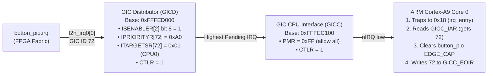

# Explanation: Hardware Interrupt Subsystems — Nios II IIC, Nios V RISC-V CLINT, and ARM GICv1

> **Series:** cvsoc — Stepping into advanced FPGA development on the DE10-Nano  
> **Type:** Explanation (Understanding-oriented)  
> **Applies to:** Phase 4 (`06_nios2_interrupts`, `06b_niosv_interrupts`, `07_hps_interrupts` — [`tutorial_phase4_interrupts.md`](tutorial_phase4_interrupts.md))

---

## Introduction

Phase 4 replaces busy-wait polling with **hardware interrupts** triggered by the DE10-Nano's push-buttons (`KEY[0]` and `KEY[1]`). Across the repository's three Phase 4 projects (`06_nios2_interrupts`, `06b_niosv_interrupts`, and `07_hps_interrupts`), the **exact same FPGA peripheral** (`altera_avalon_pio` configured for falling-edge capture) drives **three completely different processor interrupt architectures**:

1. **Nios II (`06_nios2_interrupts`):** Altera's 32-input Internal Interrupt Controller (IIC) managed via the HAL.
2. **Nios V/m (`06b_niosv_interrupts`):** RISC-V Machine-mode platform interrupts (`platform_irq_rx` / `mie` / `mip` CSRs).
3. **ARM Cortex-A9 HPS (`07_hps_interrupts`):** ARM CoreLink GIC-390 (Generic Interrupt Controller v1) with bare-metal assembly exception vectors, banked processor modes (`SVC` vs. `IRQ`), and Distributor/CPU-Interface handshaking.

This document traces an interrupt pulse from the physical push-button on the PCB all the way into the C Interrupt Service Routine (ISR) and back, explaining the hardware mechanics and software invariants at every stage.

---

## 1. Stage 1: From Physical Push-Button to the `altera_avalon_pio` IRQ Line

### Hardware Debouncing and Active-Low Polarity on the DE10-Nano

On the Terasic DE10-Nano schematic, the two user push-buttons `KEY[0]` (FPGA pin `PIN_AH17`) and `KEY[1]` (`PIN_AH16`) are wired as **active-low** circuits passed through an on-board RC filter and a **74AUC1G17 Schmitt-trigger buffer**:
- **Released (idle):** Pulled up to `3.3 V` → FPGA pin sees logic `'1'`.
- **Pressed:** Pulled down to `GND` → FPGA pin transitions `'1' → '0'` (**falling edge**).
- Because the DE10-Nano board includes hardware RC + Schmitt-trigger debouncing on `KEY[0]` and `KEY[1]`, a mechanical button press produces a clean digital falling edge without contact bounce chatter.

### Inside the `altera_avalon_pio` Register Block

When `button_pio` is parameterized in `qsys/*.tcl` with:
```tcl
set_instance_parameter_value button_pio captureEdge {1}
set_instance_parameter_value button_pio edgeType    {FALLING}
set_instance_parameter_value button_pio generateIRQ {1}
```
Platform Designer synthesizes four 32-bit registers (at word offsets `0`, `1`, `2`, `3`, or byte offsets `0x00`, `0x04`, `0x08`, `0x0C`):

```
              ┌────────────────────────────────────────────────────────────────┐
              │                   altera_avalon_pio (button_pio)               │
              │                                                                │
              │   ┌─────────────────┐     ┌────────────────────────────────┐   │
  KEY[1:0] ──►├──►│ 2-FF Sync +     │────►│ Offset 0x00: DATA (Read-Only)  │   │
  (Active-Low)│   │ Falling-Edge    │     │ Current instantaneous pin state│   │
              │   │ Detector        │     └────────────────────────────────┘   │
              │   └────────┬────────┘                                          │
              │            │ pulse on 1→0                                      │
              │            ▼                                                   │
              │   ┌────────────────────────────────────────┐                   │
              │   │ Offset 0x0C: EDGE_CAP (Sticky Latch)   │◄── Write '1' to   │
              │   │ Bit i latches '1' until software clears│    clear bit(s)   │
              │   └───────────────────┬────────────────────┘                   │
              │                       │                                        │
              │                       ▼                                        │
              │                     ┌───┐                                      │
              │                     │ & │──────►_or_reduce──────► irq_o        │
              │                     └─▲─┘                        (to CPU / GIC)│
              │                       │                                        │
              │   ┌───────────────────┴────────────────────┐                   │
              │   │ Offset 0x08: IRQ_MASK (Read/Write)     │                   │
              │   │ Bit i = '1' enables interrupt for KEY i│                   │
              │   └────────────────────────────────────────┘                   │
              └────────────────────────────────────────────────────────────────┘
```

The combinational equation driving the PIO's `irq` output wire is simply:

$$\text{irq\_o} = \bigvee_{i=0}^{1} \left( \text{EDGE\_CAP}[i] \wedge \text{IRQ\_MASK}[i] \right)$$

### Critical Invariant: Why You Must Clear `EDGE_CAP` *Before* Processing the Event

Look at `button_isr()` in `06_nios2_interrupts/software/app/main.c` (and `06b` / `07`):

```c
uint32_t edges = IORD_ALTERA_AVALON_PIO_EDGE_CAP(BUTTON_PIO_BASE);
IOWR_ALTERA_AVALON_PIO_EDGE_CAP(BUTTON_PIO_BASE, edges);  /* <-- Clear IMMEDIATELY! */
```

**Why clear `EDGE_CAP` at the very top of the ISR rather than at the bottom?**
1. **Preventing Infinite Re-entry:** Because `irq_o` is a level signal derived directly from `EDGE_CAP & IRQ_MASK`, as long as `EDGE_CAP` is non-zero, `irq_o` remains asserted HIGH. If an ISR returns without clearing `EDGE_CAP` (or clears it after acknowledging the interrupt controller), the CPU immediately traps right back into the ISR in an infinite interrupt storm!
2. **Preventing Race-Condition Edge Loss:** Suppose `KEY[0]` triggers the ISR (`edges = 0x1`), and while the ISR is executing its body, `KEY[1]` is pressed (`EDGE_CAP` becomes `0x3`).
   - If you cleared all bits with `IOWR(..., 0x3)` at the *end* of the ISR, you would wipe out `KEY[1]`'s bit without ever having read or processed it!
   - By reading `edges` (`0x1`) at the start and immediately writing back `edges` (`0x1`—a write-1-to-clear operation in newer PIO revisions, or clearing before new edges arrive), only the bits you just snapshotted are cleared, and any new edge arriving during ISR execution latches cleanly and triggers a follow-up interrupt.

---

## 2. Why Platform Designer Connects `nios2.irq` as the "Master"

In `06_nios2_interrupts/qsys/nios2_system.tcl`:
```tcl
add_connection nios2.irq button_pio.irq
set_connection_parameter_value nios2.irq/button_pio.irq irqNumber {1}
```
And in `06b_niosv_interrupts/qsys/niosv_system.tcl`:
```tcl
add_connection niosv.platform_irq_rx button_pio.irq
set_connection_parameter_value niosv.platform_irq_rx/button_pio.irq irqNumber {1}
```
And in `07_hps_interrupts/qsys/hps_system.tcl`:
```tcl
add_connection hps_0.f2h_irq0 button_pio.irq
set_connection_parameter_value hps_0.f2h_irq0/button_pio.irq irqNumber {0}
```

Electrically, the wire goes **from** `button_pio.irq` (an output) **to** the CPU's interrupt input. Why does `add_connection` list the CPU *first* and `button_pio` *second*?

Because Platform Designer associates each peripheral's `.irq` sender interface with a specific Avalon-MM slave interface. In Qsys's connection graph model, the **Interrupt Receiver (the CPU / GIC)** owns the 32-bit interrupt number namespace (`irqNumber 0..31`) just like an Avalon-MM Bus Master owns the 32-bit memory address namespace (`baseAddress`). Therefore, Qsys models the Interrupt Receiver as the "start" (master) of the connection and the Interrupt Sender as the "end" (slave).

---

## 3. Comparing the Three CPU Interrupt Architectures

When `button_pio.irq` goes HIGH, how does each processor detect it, save state, vector to C code, and return?

| Mechanism | Nios II/e (`06_nios2_interrupts`) | Nios V/m (`06b_niosv_interrupts`) | ARM Cortex-A9 (`07_hps_interrupts`) |
|---|---|---|---|
| **Interrupt Controller** | Internal Interrupt Controller (IIC, 32 lines) | RISC-V Machine-Mode CSRs (`platform_irq_rx`, 16 lines) | ARM CoreLink **GIC-390 (GICv1)** (256 lines: SGI/PPI/SPI) |
| **Pending / Mask Regs** | `ctl4` (`ipending`), `ctl3` (`ienable`), `ctl0` (`status.PIE`) | `mip[31:16]`, `mie[31:16]`, `mstatus.MIE` (bit 3) | GIC Distributor (`GICD_*` @ `0xFFFED000`) + CPU Interface (`GICC_*` @ `0xFFFEC100`) |
| **IRQ Number for `button_pio`** | `irqNumber = 1` (`irq 0` is `jtag_uart`) | `irqNumber = 1` (maps to `mie`/`mip` bit `16 + 1 = 17`) | `f2h_irq0[0]` = `SPI[40]` = **GIC ID `32 + 40 = 72`** |
| **Vector Entry Address** | Single funnel at `exceptionOffset` (`0x00000020`) | RISC-V `mtvec` CSR trap vector | ARM Vector Table offset `0x18` (`0xFFFF0018` in OCRAM) |
| **Who Writes the Vector Stub?** | Generated automatically by `nios2-bsp` (`alt_irq_entry.S`) | Generated automatically by `niosv-bsp` (`alt_irq_entry.S`) | **Hand-written by us in `07_hps_interrupts/software/app/startup.S`** (`irq_entry`) |
| **Return Instruction** | `eret` (copies `estatus` → `status`, jumps to `ea - 4`) | `mret` (restores `mstatus.MIE` from `MPIE`, jumps to `mepc`) | `ldmfd sp!, {r0-r3, r12, pc}^` (copies `SPSR_irq` → `CPSR`) |

---

## 4. Deep-Dive: ARM GICv1 and Cortex-A9 Exception Handling (`07_hps_interrupts`)

Unlike Nios II and Nios V where `alt_ic_isr_register()` hides the interrupt controller behind a single HAL function call, `07_hps_interrupts` programs the **ARM Generic Interrupt Controller (GICv1)** and the **ARMv7-A exception model** directly in bare-metal assembly and C.

### How `f2h_irq0[0]` Becomes GIC Interrupt ID 72

The ARM GICv1 partitions its interrupt ID space (`0` to `255`) into three ranges:
- **IDs `0–15` (SGIs — Software Generated Interrupts):** Used for inter-processor signaling between Core 0 and Core 1.
- **IDs `16–31` (PPIs — Private Peripheral Interrupts):** Local to each Cortex-A9 core (e.g., Global Timer = ID 27, Private Timer = ID 29, Private Watchdog = ID 30).
- **IDs `32–255` (SPIs — Shared Peripheral Interrupts):** Routed from SoC peripherals and the FPGA fabric to either or both cores via the GIC Distributor.

On the Cyclone V SoC, the 64 FPGA-to-HPS interrupt lines are split across two 32-bit conduits:
- `f2h_irq0[31:0]` maps to **SPI `40..71`**, which equals **GIC Interrupt IDs `72..103`** ($32 + 40 = 72$).
- `f2h_irq1[31:0]` maps to **SPI `72..103`**, which equals **GIC Interrupt IDs `104..135`** ($32 + 72 = 104$).

Since `button_pio.irq` is wired to `hps_0.f2h_irq0` with `irqNumber {0}`, its GIC Interrupt ID is **`72`**.

### The GIC Distributor (`GICD`) vs. CPU Interface (`GICC`) Handshake



Why are register offsets in `GICD` calculated differently for different registers?
Because each `GICD` register array packs a different number of bits per interrupt ID $N = 72$:

| GICD Register | Bits per IRQ | Array Index for $N=72$ | Bit / Byte Offset within 32-bit Word | Purpose in `gic_init()` |
|---|---|---|---|---|
| `GICD_ISENABLER` (`+0x100`) | **1 bit** | $72 / 32 = 2$ (`+0x108`) | Bit $72 \bmod 32 = 8$ (`1u << 8`) | Enables Interrupt ID 72 |
| `GICD_ICFGR` (`+0xC00`) | **2 bits** | $72 / 16 = 4$ (`+0xC10`) | Bits $[9:8] = 00_2$ (level-sensitive) | Configures trigger sensitivity |
| `GICD_IPRIORITYR` (`+0x400`) | **8 bits (1 byte)** | Byte offset `72` (`+0x448`) | Byte `0xA0` (lower value = higher priority; must be $< \text{GICC\_PMR} = \text{0xFF}$) | Sets priority level |
| `GICD_ITARGETSR` (`+0x800`) | **8 bits (1 byte)** | Byte offset `72` (`+0x848`) | Byte `0x01` (Bit 0 = Cortex-A9 CPU 0) | Routes SPI 72 to Core 0 |

When the interrupt fires, `irq_c_handler()` in `07_hps_interrupts/software/app/main.c` performs a strict four-step sequence:
1. **Acknowledge (`uint32_t iar = GICC_IAR`):** Reading `GICC_IAR` (`0xFFFEC10C`) returns the active Interrupt ID (`72` in bits `[9:0]`) and transitions ID 72 inside the GIC from **Pending** to **Active**.
2. **Clear Source (`BUTTON_PIO_EDGE_CAP = edges`):** Deasserts the physical `f2h_irq0[0]` wire in the FPGA *before* telling the GIC the interrupt is finished.
3. **Update Application State:** Rotates `g_led_pattern` or increments `g_press_count`.
4. **End of Interrupt (`GICC_EOIR = iar`):** Writing the exact `iar` value back to `GICC_EOIR` (`0xFFFEC110`) transitions ID 72 from **Active** to **Inactive**, allowing the GIC to deliver future interrupts.

---

## 5. ARM Banked Stacks, Pipeline Offset (`sub lr, lr, #4`), and `ldmfd ... ^`

Look at `07_hps_interrupts/software/app/startup.S`:

```armasm
_start:
    /* 1. Set up IRQ mode stack (mode 0x12, IRQ+FIQ masked: 0xD2) */
    msr     cpsr_c, #0xD2
    ldr     sp, =_irq_stack_top

    /* 2. Switch to SVC mode (mode 0x13, IRQ+FIQ masked: 0xD3) */
    msr     cpsr_c, #0xD3
    ldr     sp, =_svc_stack_top
...
irq_entry:
    sub     lr, lr, #4              /* Adjust: LR_irq -> address of interrupted instr */
    stmfd   sp!, {r0-r3, r12, lr}   /* Save scratch regs + return address on IRQ stack */
    bl      irq_c_handler           /* Call C ISR dispatcher */
    ldmfd   sp!, {r0-r3, r12, pc}^  /* Restore regs, CPSR <- SPSR_irq, return */
```

Every single instruction in this 10-line sequence is load-bearing:

1. **Why initialize two stacks (`_irq_stack_top` and `_svc_stack_top`)?**
   In ARMv7-A, each exception mode has its own **banked `r13` (`sp`) and `r14` (`lr`) physical registers**. While `main()` runs in **Supervisor (`SVC`, `0x13`) mode**, `sp` refers to `SP_svc` (`0xFFFFFDFC`). The instant an IRQ arrives, the hardware switches the processor mode bits in `CPSR` to **IRQ (`0x12`) mode**, swapping out `SP_svc` and `LR_svc` for `SP_irq` and `LR_irq`. If `_start` had not switched into mode `0xD2` first to initialize `SP_irq` (`_irq_stack_top = 0xFFFFFFFC`), `stmfd sp!, ...` inside `irq_entry` would push onto an uninitialized `SP_irq`, causing a catastrophic Data Abort!
2. **Why `sub lr, lr, #4`?**
   Due to the historic 3-stage ARM7TDMI pipeline architecture preserved in the ARMv7-A ISA specification, when an asynchronous IRQ is taken after instruction at address $A$ completes, `PC` is already at $A + 8$, and hardware stores $A + 8$ (the next-to-execute instruction $A + 4$, plus $4$) into `LR_irq`. Subtracting `4` from `lr` points `lr` at $A + 4$—the exact instruction in `main()` that should execute when the ISR returns.
3. **Why save `{r0-r3, r12, lr}`?**
   According to the **ARM Architecture Procedure Call Standard (AAPCS)**, a C function (`irq_c_handler`) is allowed to freely clobber `r0–r3` and `r12` (`ip`), while it is required to preserve `r4–r11` itself. Saving `r0–r3` and `r12` on the IRQ stack guarantees that `main()`'s registers are completely untouched by the asynchronous interrupt.
4. **What does the caret `^` in `ldmfd sp!, {r0-r3, r12, pc}^` do?**
   When `pc` is in the register list of an `ldm` instruction with the `^` suffix, the ARM CPU performs two actions **atomically in a single cycle**:
   - Pops the saved return address from the IRQ stack into `PC`.
   - Copies **`SPSR_irq` back into `CPSR`**—simultaneously switching the CPU from IRQ mode back to SVC mode (restoring `SP_svc` and `LR_svc`) and clearing `CPSR.I` to re-enable interrupts!

---

## Further Reading

- **Tutorial:**
  - [Phase 4 Tutorial — Hardware Interrupts on Nios II and HPS](tutorial_phase4_interrupts.md)
  - [06b — Nios V/m Interrupt Demo](../06b_niosv_interrupts/doc/README.md)
- **Next Explanation:**
  - [Explanation: Hardware JTAG Debug Architecture — Nios II, Nios V RISC-V, and ARM CoreSight DAP](explanation_phase5_jtag_and_gdb_debugging.md)
