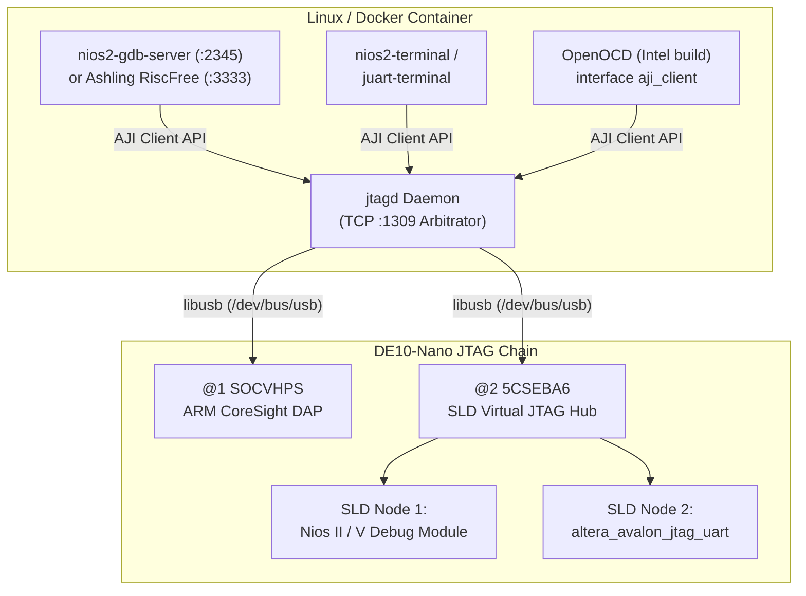

# Explanation: Hardware JTAG Debug Architecture — Nios II, Nios V RISC-V, and ARM CoreSight DAP

> **Series:** cvsoc — Stepping into advanced FPGA development on the DE10-Nano  
> **Type:** Explanation (Understanding-oriented)  
> **Applies to:** Phase 5 (`08_nios2_debug`, `08b_niosv_debug`, `09_hps_debug` — [`tutorial_phase5_gdb_debugging.md`](tutorial_phase5_gdb_debugging.md) and [`tutorial_debug_setup.md`](tutorial_debug_setup.md))  
> **See also:** [`explanation_ide_debugging.md`](explanation_ide_debugging.md) for the IDE / DAP / VS Code / Neovim software stack

---

## Introduction

While [`explanation_ide_debugging.md`](explanation_ide_debugging.md) explains how VS Code and Neovim communicate with GDB over the Debug Adapter Protocol (DAP), this companion document explains the **silicon and JTAG hardware layer beneath GDB**:

1. How the **two-TAP physical JTAG chain** on the DE10-Nano (`@1 SOCVHPS` and `@2 5CSEBA6`) routes debug traffic to either the hard ARM processor or soft-core processors inside the FPGA fabric.
2. Why Intel's **System-Level Debug (SLD) Virtual JTAG Hub** (`jtagd` + `aji_client`) is required when multiple soft IP cores (`nios2`/`niosv`, `jtag_uart`, SignalTap) share a single FPGA JTAG TAP.
3. How the three on-chip debug architectures—**Nios II JTAG Debug Module**, **Nios V RISC-V Debug Module (`dm_agent`)**, and **ARM CoreSight DAP (Debug Access Port)**—halt the CPU, inject instructions, and implement hardware vs. software breakpoints and watchpoints.
4. How compiler flags (`-O0 -g3`), DWARF debug sections, `volatile`, and `__attribute__((noinline))` shape what GDB can observe at runtime.

---

## 1. The DE10-Nano Physical JTAG Chain (`@1` vs. `@2`)

When you run `jtagconfig` with the DE10-Nano connected, it reports **two devices** on a single USB cable:

```
1) DE-SoC [1-1]
  4BA00477   SOCVHPS
  02D020DD   5CSEBA6(.|ES)/5CSEMA6/..
```

Why are there two JTAG IDCODEs when there is only one Cyclone V SoC package on the board?

```
                ┌────────────────────────────────────────────────────────────────────┐
                │                     DE10-Nano Cyclone V SoC                        │
                │                                                                    │
  USB-Blaster II│      Device @1 (IDCODE 0x4BA00477)    Device @2 (IDCODE 0x02D020DD)│
  (Cypress FX2) │      ┌───────────────────────────┐    ┌──────────────────────────┐ │
       TDI ─────┼─────►│    SOCVHPS JTAG TAP       ├───►│   5CSEBA6 FPGA JTAG TAP  ├─┼────► TDO
                │      │   (ARM CoreSight DAP)     │TDO │  (Configuration + SLD    │ │
  TCK / TMS ────┼─────►│                           │TDI │   Virtual JTAG Hub)      │ │
                │      └─────────────┬─────────────┘    └──────┬──────────┬────────┘ │
                │                    │                         │          │          │
                │                    ▼                         ▼          ▼          │
                │           ARM Cortex-A9 Cores         Nios II / V   jtag_uart      │
                │          (OpenOCD :3333 debug)        Debug Unit   (:terminal)     │
                └────────────────────────────────────────────────────────────────────┘
```

Inside the Cyclone V package, the JTAG Test Access Port (TAP) daisy-chains two independent silicon blocks in series (`TDI → Device @1 → Device @2 → TDO`):

1. **Device `@1` (`SOCVHPS`, IDCODE `0x4BA00477`):** The standard ARM Ltd. CoreSight JTAG-DP (Debug Port) for the Hard Processor System. OpenOCD (`09_hps_debug/scripts/de10_nano_hps.cfg`) targets this TAP exclusively to debug the Cortex-A9 cores.
2. **Device `@2` (`5CSEBA6`, IDCODE `0x02D020DD`):** The FPGA fabric configuration and Virtual JTAG TAP.
   - `quartus_pgm -m jtag -o "p;de10_nano.sof@2"` targets `@2` to load the FPGA bitstream.
   - `nios2-download`, `nios2-gdb-server`, `nios2-terminal`, and Ashling RiscFree (`08b_niosv_debug`) also target `@2`—communicating through an internal multiplexer inside the FPGA called the **System-Level Debug (SLD) Hub**.

---

## 2. The Intel SLD Hub and Why `jtagd` Exists

Look at Project `06_nios2_interrupts` or `08_nios2_debug`: at runtime, `nios2-gdb-server` is stepping the Nios II CPU **at the exact same time** that `nios2-terminal` is reading `printf` output from `jtag_uart`—over the **same USB-Blaster cable** and the **same `@2` FPGA JTAG TAP**!

How can two separate Linux processes talk to two separate hardware peripherals over a single serial JTAG chain without corrupting each other's shift registers?



1. **In Hardware — The SLD Hub (`sld_hub`):**
   Whenever a Platform Designer system contains one or more JTAG-accessible IP blocks (`altera_nios2_gen2`, `intel_niosv_m`, `altera_avalon_jtag_uart`), Quartus automatically synthesizes an **`sld_hub`** multiplexer connected to the FPGA's physical JTAG `USER0`/`USER1` instruction registers. Each IP core is assigned a unique **SLD Node ID** (with a manufacturer ID, type ID, and instance index).
2. **In Software — `jtagd` and the AJI (Altera JTAG Interface) Protocol:**
   - Standard upstream OpenOCD uses raw `libusb` (`interface usb_blaster`) to claim exclusive OS-level ownership of the USB-Blaster interface. If one process claims the USB interface via `libusb`, no other process can touch the cable.
   - Instead, Intel's tools (`quartus_pgm`, `nios2-gdb-server`, `nios2-terminal`, Ashling RiscFree, and Intel's custom OpenOCD build) never open `/dev/bus/usb` directly. They act as **AJI clients** that connect over TCP (`localhost:1309`) to the **`jtagd` daemon**.
   - `jtagd` is the sole owner of the USB-Blaster hardware. It time-multiplexes JTAG scans between `@1` (HPS DAP) and each SLD Node inside `@2` (Nios debug unit vs. JTAG UART), allowing you to keep `nios2-terminal` open in one window while debugging with GDB in another!

---

## 3. Comparing On-Chip Debug Hardware: Nios II vs. Nios V vs. ARM Cortex-A9

How does a GDB command like `stepi`, `info registers`, or `x/4xw 0x10010` actually execute on each of the three CPUs in this repository?

| Feature | Nios II/e (`08_nios2_debug`) | Nios V/m (`08b_niosv_debug`) | ARM Cortex-A9 (`09_hps_debug`) |
|---|---|---|---|
| **Debug Specification** | Altera Nios II JTAG Debug Module (Level 1) | **RISC-V External Debug Spec v0.13** (`dm_agent`) | **ARM CoreSight v7-A** (JTAG-DP + APB-AP + AHB-AP) |
| **GDB Server** | `nios2-gdb-server` (`:2345`) | Ashling `ash-riscv-gdb-server` (`:3333`) | Intel `openocd` (`:3333`) |
| **GDB Client** | `nios2-elf-gdb` | `riscv32-unknown-elf-gdb` | `arm-none-eabi-gdb` / `gdb-multiarch` |
| **How Memory is Read/Written** | CPU executes debug park loop instructions from `debug_mem_slave` (`0x00010800`) | CPU executes Abstract Commands / Program Buffer in `dm_agent` (`0x00100000`) | CoreSight **AHB-AP** accesses memory bus directly (or via CPU debug registers) |
| **Hardware Breakpoints (`hbreak`)** | **0 available to user** (1 comparator reserved by `nios2-gdb-server` for single-stepping) | **Trigger Module** (2–4 hardware triggers depending on IP config) | **6 hardware breakpoint comparators** (`DBGBVR0..5` / `DBGBCR0..5`) |
| **Hardware Watchpoints (`watch`)** | **Not supported** on Nios II/e Tiny | Supported via RISC-V `mcontrol` trigger CSRs | **4 hardware watchpoint comparators** (`DBGWVR0..3` / `DBGWCR0..3`) |

### Software Breakpoints (`break`) vs. Hardware Breakpoints (`hbreak`)

When you type `break set_led` or `hbreak set_led` in GDB, two completely different physical mechanisms are used:

1. **Software Breakpoint (`break` — GDB `Z0` packet):**
   - GDB reads the original 32-bit machine instruction at the target address in RAM (`onchip_mem` or `OCRAM`) and saves it in a host-side table.
   - GDB overwrites that RAM address with an architectural trap instruction:
     - **Nios II:** `break` (`0x003da03a`)
     - **Nios V (RISC-V):** `ebreak` (`0x00100073`)
     - **ARMv7-A:** `bkpt #0` (`0xe1200070`)
   - When the CPU fetches and executes that instruction, it immediately enters Debug Mode and notifies the GDB server.
   - When you type `continue`, GDB temporarily restores the original instruction, single-steps 1 instruction (`s`), re-inserts the trap instruction, and resumes execution!
   - **Pros:** Unlimited number of breakpoints as long as code resides in writable RAM (`onchip_mem` / `OCRAM` / `DDR3`).
   - **Cons:** Modifies memory (cannot be used on code in read-only ROM, and requires I-cache/D-cache flushing if caches are enabled).

2. **Hardware Breakpoint (`hbreak` — GDB `Z1` packet):**
   - GDB does **not** modify a single byte of RAM.
   - Instead, the GDB server writes the target address into a dedicated **hardware comparator register** wired directly to the CPU's instruction fetch address bus (e.g., `DBGBVR0` on Cortex-A9).
   - Every clock cycle, a hardware equality comparator checks `if PC == DBGBVR0`; when it matches, the CPU halts before executing the instruction.
   - **Why `09_hps_debug` uses `hbreak`:** The Cortex-A9 has 6 dedicated hardware breakpoint comparators and 4 hardware data-address watchpoint comparators (`DBGWVR`). Using `hbreak` in `09_hps_debug/scripts/hps_debug.gdb` avoids any instruction-cache/data-cache incoherency in OCRAM and never wears or alters program memory.

---

## 4. How `-O0 -g3`, DWARF, `volatile`, and `noinline` Enable Source-Level Debugging

The CPU hardware only understands raw 32-bit addresses (`0xFFFF0124`) and raw 32-bit registers (`r0`–`r15`). How does GDB know that address `0xFFFF0124` corresponds to line 142 of `main.c`, or that `g_debug.led_pattern` lives at `0xFFFF0280`?

### DWARF Debug Sections Inside the `.elf` File

When `software/app/Makefile` compiles `main.c` with **`-O0 -g3`**:
- The **`.bin`** file (or the memory image transferred by `load`) contains **only** `.startup`, `.text`, `.rodata`, and `.data`. No debug strings or variable names are ever uploaded to the FPGA or HPS!
- The **`.elf`** file on your host PC contains additional non-allocatable **DWARF v4/v5 sections** read exclusively by the GDB client:
  - **`.debug_info`:** Maps every C variable, struct (`debug_state_t`), typedef, and function parameter to its type, byte offset, and memory address or CPU register.
  - **`.debug_line`:** A compressed state-machine table mapping every machine instruction address range back to `(source_file, line_number, column)`.
  - **`.debug_frame`:** Call Frame Information (CFI) explaining how each function pushes `lr`/`fp` onto the stack so GDB's `backtrace` (`bt`) command can unwind the call stack even without a frame pointer.
  - **`.debug_macro` (enabled specifically by `-g3` over `-g2`):** Embeds C `#define` preprocessor macros (`LED_PIO_BASE`, `GICC_IAR`) into the ELF so you can type `print/x LED_PIO_BASE` directly at the `(gdb)` prompt!

### Why `__attribute__((noinline))` and `debug_state_t` Are Used in Projects `08`, `08b`, and `09`

In embedded firmware, helper functions like `set_led(uint8_t pattern)` and `process_button(uint8_t edges)` are often only 3–5 lines long.
- Even at `-O1` or `-Os`, GCC inlines small static functions into their caller (`main()` or `button_isr()`). Once inlined, `set_led` has no prologue/epilogue and no stack frame of its own, so `bt` inside `set_led` would not show a distinct call frame. Marking them `__attribute__((noinline))` guarantees a clean `main() → set_led()` or `irq_entry → irq_c_handler() → process_button()` call stack for educational inspection.
- Grouping observable state into a single global struct (`debug_state_t debug_state` / `g_debug`) allows a single GDB command (`print /x g_debug`) or a single VS Code Watch expression to snapshot the entire system state (`led_pattern`, `step_count`, `irq_count`, `last_edges`) at once.

---

## Further Reading

- **Tutorials:**
  - [Phase 5 Tutorial — Software Debugging with GDB](tutorial_phase5_gdb_debugging.md)
  - [Hardware Debug Setup — Programming & Running on the DE10-Nano from WSL2](tutorial_debug_setup.md)
  - [08b — Nios V/m Software Debugging with RISC-V GDB](../08b_niosv_debug/doc/README.md)
- **Companion Explanation:**
  - [Explanation: IDE Debugging for Embedded Targets — VS Code and Neovim](explanation_ide_debugging.md)
- **How-To Guides:**
  - [How-to: Debug Nios II and ARM HPS with VS Code](howto_vscode_debugging.md)
  - [How-to: Troubleshoot JTAG, USB-Blaster, and `jtagd` Issues](howto_troubleshoot_jtag_and_usb_blaster.md)
