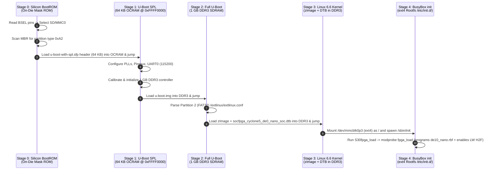
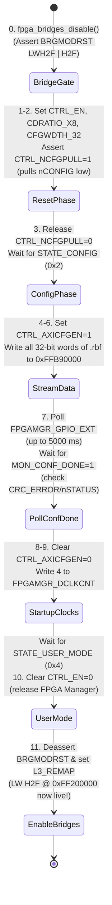

# Explanation: Embedded Linux Boot Architecture, Buildroot, FPGA Manager, and `/dev/mem` MMIO

> **Series:** cvsoc — Stepping into advanced FPGA development on the DE10-Nano  
> **Type:** Explanation (Understanding-oriented)  
> **Applies to:** Phase 6 (`10_linux_led` — [`tutorial_phase6_embedded_linux.md`](tutorial_phase6_embedded_linux.md))

---

## Introduction

Phase 6 (`10_linux_led`) transforms the DE10-Nano from a JTAG-tethered bare-metal target into a standalone embedded Linux computer that boots autonomously from a microSD card, configures the Cyclone V FPGA fabric from software during kernel startup, enables the AXI bridges, and controls the FPGA LEDs from C and Python user-space applications.

This document explains the four foundational pillars of Phase 6:
1. **The Four-Stage Cyclone V SoC Boot Chain:** How control passes from hard-coded silicon BootROM → Partition `0xA2` (U-Boot SPL) → FAT32 (U-Boot + `extlinux.conf`) → Linux 6.6 Kernel → `ext4` BusyBox `init`.
2. **Buildroot and the `BR2_EXTERNAL` Architecture:** How Buildroot constructs a cross-compiler, bootloader, kernel, custom out-of-tree kernel module (`fpga_load.ko`), user-space package (`fpga_led`), and partitioned `sdcard.img` in a single reproducible pass.
3. **Inside the Cyclone V FPGA Manager (`fpga_load.c`):** How the HPS programs the FPGA fabric over the internal configuration bus, why `MSEL=0x0A` requires compressed `.rbf` bitstreams and `CDRATIO=x8`, why `fpga_load.ko` gates the AXI bridges before reconfiguration, and why it bypasses the mainline Linux driver's 10 ms IRQ timeout.
4. **Virtual Memory vs. Physical MMIO:** How the ARM MMU isolates user space from hardware, and how `ioremap()` in kernel space and `mmap("/dev/mem")` with `O_SYNC` in user space punch controlled windows through the page tables to reach `0xFF200000`.

---

## 1. The Four-Stage Cyclone V Boot Chain

Why does a Cyclone V Linux SD card require **three partitions** (`0xA2` raw, `0x0C` FAT32, and `0x83` ext4) and **two separate bootloaders** (U-Boot SPL + full U-Boot)?



### Why Can't the Silicon BootROM Load U-Boot or Linux Directly?

1. **At Power-On, DDR3 SDRAM Is Uninitialized:**
   When power is applied to the Cyclone V, the only working RAM on the chip is the **64 KB On-Chip RAM (OCRAM)** at `0xFFFF0000` (of which the BootROM reserves 4 KB for its own stack/workspace, leaving at most **60 KB** for the first-stage bootloader).
2. **Full U-Boot (~500 KB) and the Linux Kernel (~5 MB) Cannot Fit in 60 KB:**
   Therefore, U-Boot is compiled twice from the same source tree:
   - **U-Boot SPL (Secondary Program Loader, ~40 KB):** Wrapped with an Altera `.sfp` boot header (`0xA2` partition) containing a magic word (`0x31305341`, `"AS01"`), length, and CRC-16. The BootROM verifies the CRC, copies the SPL into OCRAM, and jumps to it. The SPL's sole job is to initialize the clocks, UART, and the **1 GB DDR3 memory controller**, and then load the full `u-boot.img` into DDR3.
   - **Full U-Boot (`u-boot.img`, ~500 KB):** Runs inside the newly initialized 1 GB DDR3 RAM. It includes full FAT32/ext4 filesystem drivers, networking, FIT image verification, and `distro_bootcmd`, which reads `/extlinux/extlinux.conf` from the FAT32 boot partition (`mmc 0:2`), loads `zImage` and `.dtb` into DDR3, and boots the Linux kernel.

---

## 2. Buildroot and the `BR2_EXTERNAL` Design Pattern

Why does `10_linux_led/` keep all its configurations in `br2-external/` instead of modifying files inside `buildroot-2024.11.1/`?

```
10_linux_led/
├── buildroot-2024.11.1/          ◄── Untouched upstream tarball (gitignored)
└── br2-external/                 ◄── Tracked in Git (~15 KB total!)
    ├── external.desc             ("name: DE10_NANO")
    ├── external.mk               (includes package/*/*.mk)
    ├── Config.in                 (sources package/*/Config.in)
    ├── configs/de10_nano_defconfig
    ├── board/de10_nano/
    │   ├── linux-uio.fragment    (Kernel Kconfig overrides)
    │   ├── uboot.fragment        (U-Boot Kconfig overrides)
    │   ├── S30fpga_load          (SysV init script)
    │   ├── post-build.sh         (Runs before rootfs ext4 image is packed)
    │   ├── post-image.sh         (Runs genimage to build sdcard.img)
    │   └── genimage.cfg          (Declarative MBR + FAT32 + ext4 partition layout)
    └── package/
        ├── fpga-mgr-load/        (Builds fpga_load.ko against Buildroot's Linux kernel tree)
        └── fpga-led/             (Cross-compiles fpga_led C app into /usr/bin/fpga_led)
```

Using `BR2_EXTERNAL`:
1. **Separates Upstream from Project Code:** The 80 MB Buildroot source tree is never committed to Git (`buildroot-2024.11.1/` is downloaded on demand by `make buildroot-download`). Upgrading Buildroot or the Linux kernel version only requires changing version strings in `Makefile` and `de10_nano_defconfig`.
2. **Guarantees Kernel-Module ABI Match (`fpga-mgr-load.mk`):** A Linux kernel module (`.ko`) must be compiled with the exact same GCC cross-compiler, kernel headers, and `.config` symbols as the running `zImage`. Because `fpga-mgr-load.mk` uses Buildroot's `$(eval $(kernel-module))` infrastructure, Buildroot automatically compiles `fpga_load.c` against its own freshly built Linux 6.6 kernel tree and runs `depmod` on the target root filesystem.

---

## 3. Deep-Dive: How the Cyclone V FPGA Manager Works (`fpga_load.c`)

In Phases 0–5, you programmed the FPGA from an external PC over the USB-Blaster JTAG cable using `quartus_pgm`. In Phase 6, **the ARM processor inside the Cyclone V programs the FPGA fabric internally** with zero external cables!

### The Physical Hardware Path: `FPGAMGR` (`0xFF706000`) and `FPGAMGRDATA` (`0xFFB90000`)

Inside the Cyclone V SoC, the HPS contains a dedicated hardware block called the **FPGA Manager**. It has two memory-mapped regions in the ARM address space:
- **Control & Status Registers (`0xFF706000`, 4 KB):** Controls the FPGA configuration pins (`nCONFIG`, `nCE`, `DCLK`), reads status pins (`nSTATUS`, `CONF_DONE`, `INIT_DONE`, `CRC_ERROR`, `MSEL[4:0]`), and configures the data width and clock ratio.
- **Configuration Data FIFO Port (`0xFFB90000`, 4 bytes):** Every 32-bit word written to `0xFFB90000` by the ARM CPU is serialized into the FPGA's internal Fast Passive Parallel (FPP) configuration port.

### MSEL Switches (`0x0A`), Compression, and `CDRATIO = x8`

On the underside of the Terasic DE10-Nano board sits a 6-position DIP switch block (`SW10`) that drives the Cyclone V's **`MSEL[4:0]` (Mode Select)** pins. By factory default, the DE10-Nano sets `MSEL[4:0] = 0b01010` (`0x0A`).

According to the *Cyclone V Device Handbook (Table: MSEL Pin Settings)*, `MSEL = 0x0A` selects:
- **Configuration Scheme:** Fast Passive Parallel (FPP) with **32-bit data width (`CFGWDTH = 32`)**.
- **AES Encryption:** Optional / Off.
- **Hardware Decompression Engine:** **ENABLED (Mandatory)**.

This hardware strapping has two critical consequences in `10_linux_led`:
1. **The `.rbf` File MUST Be Compressed (`bitstream_compression=on`):**
   Because `MSEL = 0x0A` permanently enables the FPGA's on-chip decompression circuit, feeding an *uncompressed* `.rbf` bitstream (~7 MB) into `0xFFB90000` causes the decompression engine to choke on invalid compression headers—`nSTATUS` drops LOW or `CONF_DONE` never asserts! `10_linux_led/scripts/convert_sof_to_rbf.sh` passes `--option=bitstream_compression=on` to `quartus_cpf`, producing a ~1.9 MB compressed `.rbf`.
2. **`CDRATIO` Must Be Set to `x8` (`CDRATIO_X8`):**
   When decompression and 32-bit width (`CFGWDTH_32`) are active, the FPGA's internal decompression engine needs multiple `DCLK` configuration clock edges per 32-bit compressed word to unpack the variable-length bitstreams into configuration SRAM frames. Setting `CDRATIO = x8` in `FPGAMGR_CTRL` (`bits [7:6] = 0b11`) instructs the FPGA Manager hardware to generate 8 `DCLK` pulses for every 32-bit word written to `0xFFB90000`.

### Tracing the 11-Step State Machine in `fpga_load.c`

Let's trace `fpga_load_init()` in `10_linux_led/software/fpga_load/fpga_load.c` step-by-step:



#### Why Step 0 (`fpga_bridges_disable()`) Is Essential for Live Reconfiguration
Suppose the FPGA is *already* running and the LW H2F AXI bridge (`0xFF200000`) is enabled. If you pulse `NCFGPULL` to wipe the FPGA while the AXI bridge is active, any in-flight AXI signal or glitch from the disappearing FPGA fabric can lock up the HPS L3 NIC-301 interconnect, freezing the entire Linux kernel! Calling `fpga_bridges_disable()` (which sets `BRGMODRST_LWH2F | BRGMODRST_H2F` at `0xFFD0501C`) fences the AXI bridges in reset *before* `NCFGPULL` resets the FPGA fabric, and Step 11 only re-opens the bridges *after* the new bitstream reaches `STATE_USER_MODE`.

#### Why `fpga_load.c` Exists Instead of Using Mainline `socfpga.c`
In the mainline Linux kernel (`drivers/fpga/socfpga.c`), after writing the last word of `.rbf` data, the driver enables an edge interrupt on `CONF_DONE` and waits with a hard-coded **10 ms timeout**—while clearing `AXICFGEN` too early for certain compressed bitstreams. On Cyclone V with `MSEL=0x0A`, final frame decompression can take slightly longer or complete while `AXICFGEN=1` is still required. `fpga_load.c` keeps `CTRL_AXICFGEN=1` while polling `FPGAMGR_GPIO_EXT` every 1 ms (typically completing in `< 5 ms`, with a safe `5000 ms` ceiling) and explicitly checking `MON_CRC_ERROR` and `MON_NSTATUS`.

---

## 4. Virtual Memory vs. Physical MMIO (`ioremap` and `/dev/mem`)

In bare-metal (Phases 3–5), the ARM Cortex-A9's **Memory Management Unit (MMU)** was disabled (`SCTLR.M = 0`). Every pointer in C was a **physical bus address**, so `*(volatile uint32_t *)0xFF200000 = 0xAA` worked directly.

Under Linux, the MMU is **enabled**:
- Every user-space process (`fpga_led`, `python3`, `led_server`) runs in its own isolated **virtual address space**.
- If a user-space program dereferences `(uint32_t *)0xFF200000` directly, the MMU looks up `0xFF200000` in that process's user-space page table, finds no mapping, and raises a **Data Abort**, which the Linux kernel delivers to the process as **`SIGSEGV` (Segmentation Fault)**!

How do we access physical hardware registers under Linux?

```
┌─────────────────────────────────────────────────────────────────────────┐
│ User-Space Process (fpga_led / led_server / fpga_led.py)                │
│                                                                         │
│   fd = open("/dev/mem", O_RDWR | O_SYNC);                               │
│   vptr = mmap(NULL, 4096, PROT_READ|PROT_WRITE, MAP_SHARED,             │
│               fd, 0xFF200000);                                          │
│   *vptr = 0xAA;   // Writes to virtual address (e.g. 0xB6F12000)        │
└───────────────────────────────┬─────────────────────────────────────────┘
                                │
                    ARM Cortex-A9 MMU Page Table
           (Translates Virtual 0xB6F12000 ──► Physical 0xFF200000)
           (Page attributes: Strongly-Ordered / Device, Non-Cacheable)
                                │
┌───────────────────────────────▼─────────────────────────────────────────┐
│ Physical Bus: Lightweight H2F AXI Bridge (0xFF200000) ──► FPGA led_pio  │
└─────────────────────────────────────────────────────────────────────────┘
```

### Why `O_SYNC` and `MAP_SHARED` Are Mandatory on `/dev/mem`

In `10_linux_led/software/fpga_led/fpga_led.c`:
```c
int fd = open("/dev/mem", O_RDWR | O_SYNC);
void *map = mmap(NULL, PAGE_SIZE, PROT_READ | PROT_WRITE, MAP_SHARED, fd, H2F_LW_BASE);
```
1. **`O_SYNC`:** Instructs the Linux kernel's `/dev/mem` driver (`drivers/char/mem.c`) to mark the resulting ARM page table entry (`PTE`) as **Uncached / Device Memory (`MT_DEVICE_NONSHARED`)**. Without `O_SYNC`, if the physical address falls in a range the kernel considers cacheable, writes to `*vptr` could be absorbed by the CPU data cache and never reach the FPGA register!
2. **`MAP_SHARED`:** Ensures writes modify the underlying physical mapping directly rather than creating a private Copy-On-Write (COW) anonymous RAM page.
3. **Page Alignment (`4096` bytes):** The ARMv7 MMU maps memory in **4 KB (`0x1000`) pages**. Therefore, the offset passed to `mmap()` (`0xFF200000`) must always be a multiple of `sysconf(_SC_PAGE_SIZE)` (`0x1000`). If a peripheral lives at `0xFF200010` (like `ddr3_test_master`), you `mmap()` the page base `0xFF200000` and add the sub-page byte offset `0x10` to the returned virtual pointer.

---

## Further Reading

- **Tutorial:**
  - [Phase 6 Tutorial — Embedded Linux on HPS](tutorial_phase6_embedded_linux.md)
- **How-To Guides:**
  - [How-to: Deploy Binaries, Kernel Modules, and Bitstreams to the DE10-Nano Over Ethernet or Serial](howto_deploy_to_board_over_serial_and_ethernet.md)
- **Next Explanation:**
  - [Explanation: Embedded Networking, IPv6 SLAAC, Nanopb Protocol Buffers, and Async Web Gateways](explanation_phase7_networking_protobuf_and_dashboard.md)
