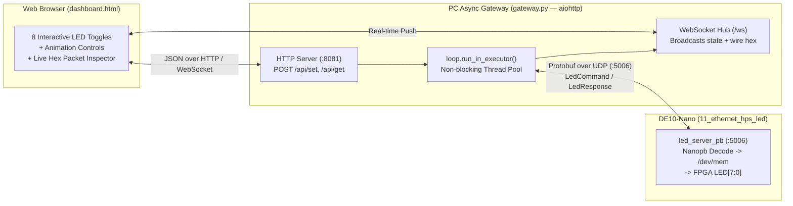

# Explanation: Embedded Networking, IPv6 SLAAC, Nanopb Protocol Buffers, and Async Web Gateways

> **Series:** cvsoc — Stepping into advanced FPGA development on the DE10-Nano  
> **Type:** Explanation (Understanding-oriented)  
> **Applies to:** Phase 7 (`11_ethernet_hps_led` — [`tutorial_phase7_ethernet.md`](tutorial_phase7_ethernet.md) and [`11_ethernet_hps_led/doc/deploying_without_ssh.md`](../11_ethernet_hps_led/doc/deploying_without_ssh.md))

---

## Introduction

Phase 7 (`11_ethernet_hps_led`) extends the Embedded Linux system from Phase 6 into a complete networked IoT/industrial control stack across three progressive sub-phases:
- **Phase 7.0 (Track A):** A dual-stack C UDP server (`led_server.c`) on port `5005` speaking a compact 2-byte binary wire protocol, paired with a Python CLI client (`send_led_pattern.py`).
- **Phase 7.5 (Protocol Buffers):** A schema-driven server (`led_server_pb.c`) on port `5006` using **Nanopb** (zero-malloc C Protobuf) and **Google Protocol Buffers** (`led_command.proto`) for type-safe, evolvable serialization.
- **Phase 7.6 (Web Dashboard):** An asynchronous Python HTTP + WebSocket gateway (`gateway.py`) and real-time browser UI (`dashboard.html`) that bridges browser WebSockets to board UDP Protobuf packets.

This document explains the networking and software architecture behind all three layers: how the Cyclone V Ethernet hardware works, why IPv6 link-local SLAAC (`fe80::%zone`) allows zero-configuration direct cabling without a router or DHCP server, how dual-stack sockets work in the Linux kernel, how Protobuf varint/tag-wire encoding and Nanopb operate in constrained C, and how the async WebSocket gateway avoids blocking the event loop.

---

## 1. Cyclone V HPS Ethernet Hardware and Zero-Config IPv6 SLAAC

### The Hardware Path: Synopsys `stmmac` EMAC1 + Micrel KSZ9031RNX PHY

The RJ45 Ethernet jack on the DE10-Nano is wired not to the FPGA fabric, but to **EMAC1** inside the Cyclone V Hard Processor System:
1. **MAC Layer (Inside HPS Silicon):** A hard **Synopsys DesignWare 10/100/1000 Ethernet MAC (`dwmac1000`)** at `0xFF702000` with its own dedicated DMA engine that reads and writes packet ring buffers directly in DDR3 SDRAM. In Linux 6.6, this is driven by the `stmmac` (`socfpga-dwmac`) kernel driver, exposing network interface `eth0`.
2. **PHY Layer (On the DE10-Nano PCB):** A **Micrel/Microchip KSZ9031RNX** Gigabit Ethernet transceiver connected to EMAC1 over a 12-pin **RGMII (Reduced Gigabit Media Independent Interface)** bus.

### Why Direct PC-to-Board Cabling Has No IPv4 Address by Default

When you plug an Ethernet cable directly between your PC (or a USB-Ethernet dongle on WSL2) and the DE10-Nano—with **no router and no DHCP server** on the wire—what happens when `ifup eth0` runs?
- **IPv4 requires a DHCP server** (or manual static IP assignment on both ends). Without a DHCP server replying to `DHCPDISCOVER`, an interface configured for DHCP has **no IPv4 address** (`inet` is absent in `ip addr show eth0`).
- **IPv6 works automatically via SLAAC (Stateless Address Autoconfiguration, RFC 4862)!**

### How IPv6 Link-Local SLAAC (`fe80::/10`) and Zone IDs (`%iface`) Work

The moment the Linux kernel brings `eth0` UP (`IFF_UP`), the IPv6 stack automatically constructs a **Link-Local IPv6 Address** without needing any external server:

```
  MAC Address of eth0:          2a : 33 : 8a : 95 : cb : 3d
                                │         │    │
                     Flip bit 1 ┘         └────┴── Insert FF:FE in middle
                     (2a ──► 28)
                                ▼
  Modified EUI-64 Interface ID: 2833 : 8aff : fe95 : cb3d
                                │
  Prepend fe80::/64 prefix ─────┘
                                ▼
  Link-Local IPv6 Address:      fe80::2833:8aff:fe95:cb3d/64
```

1. **Duplicate Address Detection (DAD):** The board sends an ICMPv6 Neighbor Solicitation on the link to verify no other node uses `fe80::2833:8aff:fe95:cb3d`. Within 1 second, the address is live!
2. **Multicast Discovery (`ff02::1`):** Every IPv6-enabled device on a local Ethernet segment joins the **All-Nodes Link-Local Multicast Group (`ff02::1`)**. Running `ping6 -I <iface> ff02::1` from your PC causes the DE10-Nano to reply with its `fe80::...` source address—giving you instant board discovery with zero prior configuration.
3. **Why the `%<interface>` Zone ID (RFC 4007) Is Mandatory:**
   Because *every* network interface on your PC (`eth0`, `wlan0`, `docker0`, `enx08beac224c03`) has the exact same `fe80::/64` network prefix in the kernel routing table, if you tell `ping6`, `ssh`, or Python `sendto()` to connect to `fe80::2833:8aff:fe95:cb3d`, the OS kernel has **no way to know which physical network card** is plugged into that cable!
   Appending `%enx08beac224c03` sets the `sin6_scope_id` field inside `struct sockaddr_in6` to the OS interface index (`if_nametoindex("enx08beac224c03")`), binding the packet route to that exact network adapter.

---

## 2. Dual-Stack Sockets (`AF_INET6` + `IPV6_V6ONLY = 0`)

Look at `11_ethernet_hps_led/software/led_server/led_server.c`:

```c
int sock = socket(AF_INET6, SOCK_DGRAM, 0);
int off = 0;
setsockopt(sock, IPPROTO_IPV6, IPV6_V6ONLY, &off, sizeof(off));

struct sockaddr_in6 addr = {0};
addr.sin6_family = AF_INET6;
addr.sin6_port   = htons(port);
addr.sin6_addr   = in6addr_any;   /* "::" */
bind(sock, (struct sockaddr *)&addr, sizeof(addr));
```

Why doesn't `led_server.c` open two sockets (one `AF_INET` for IPv4 and one `AF_INET6` for IPv6) and `select()`/`poll()` between them?

Because in the Linux kernel networking stack, an `AF_INET6` socket bound to `::` (`in6addr_any`) with `IPV6_V6ONLY = 0` is a **Dual-Stack Socket**:
- If a client sends a native **IPv6** UDP datagram to `[fe80::...]:5005`, `recvfrom()` receives it with `sin6_addr = fe80::...`.
- If a client sends a legacy **IPv4** UDP datagram to `192.168.1.100:5005`, the Linux kernel automatically wraps the sender's IPv4 address into an **IPv4-mapped IPv6 address** (`::ffff:192.168.1.1`) and delivers it to the exact same `recvfrom()` call!
- When `led_server` replies using `sendto(sock, resp, 2, 0, (struct sockaddr *)&client_addr, addr_len)`, the kernel unwraps `::ffff:192.168.1.1` and transmits a native IPv4 UDP reply packet on the wire.

On the client side (`client/send_led_pattern.py`), calling `socket.getaddrinfo(host, port, socket.AF_UNSPEC, socket.SOCK_DGRAM)` automatically parses IPv4 (`192.168.1.100`), global IPv6 (`fd00::1`), or scoped link-local IPv6 (`fe80::...%eth0`—populating `sin6_scope_id` in the 4-tuple `(host, port, flowinfo, scope_id)`) without a single `if ipv6:` branch in the socket logic.

---

## 3. Wire Protocol Evolution: Raw Binary (7.0) vs. Nanopb Protocol Buffers (7.5)

### Phase 7.0: Fixed 2-Byte Raw Protocol (Port `5005`)

In `led_server.c`, every request and response is a fixed 2-byte UDP payload:
- **Request:** `[cmd: uint8][data: uint8]` (`0x01` = `SET_PATTERN`, `0x02` = `GET_PATTERN`).
- **Response:** `[status: uint8][pattern: uint8]` (`0x00` = `OK`, `0xFF` = `ERROR`).

**Why is a raw positional byte protocol brittle as a system grows?**
Suppose next month you want to add an optional `brightness` parameter (0–100%) or `duration_ms` (a 16-bit or 32-bit integer), or return a firmware version string. With a raw positional protocol:
- Every time you add or widen a field, **every existing client breaks** unless you manually version the header byte and maintain parallel C structs and Python `struct.pack()` format strings.
- Endianness (little-endian vs. network big-endian) and struct padding (`__attribute__((packed))`) must be hand-verified across every language.

### Phase 7.5: Protocol Buffers (`proto3`) and Nanopb (Port `5006`)

Protocol Buffers (`11_ethernet_hps_led/proto/led_command.proto`) solve this by replacing positional offsets with **Tag-Value (TLV) self-describing encoding**:

```protobuf
message LedCommand {
  CommandType command = 1;
  uint32 pattern = 2;
}
```

#### How Protobuf Encodes `{command: SET_PATTERN (0), pattern: 0xA5 (165)}` on the Wire

1. **Proto3 Default Value Elision:** In `proto3`, if a scalar field has its default zero value (`command = 0 = SET_PATTERN`), **it is omitted from the wire entirely** to save bandwidth!
2. **Tag Byte (`(field_number << 3) | wire_type`):**
   - For `pattern` (`field_number = 2`, `wire_type = 0` for Varint):
     $$\text{Tag} = (2 \ll 3) \mid 0 = 16 = \text{0x10}$$
3. **Base-128 Varint Encoding of `0xA5` (`165` = `0b1010_0101`):**
   - Varints store 7 payload bits per byte, setting bit 7 (`MSB = 1`) if more bytes follow:
   - Lower 7 bits of `165`: `010_0101` (`0x25`) with continuation bit `1` → `0xA5`.
   - Upper bits of `165`: `000_0001` (`0x01`) with continuation bit `0` → `0x01`.
   - Total UDP payload on the wire: **`10 a5 01` (just 3 bytes!)**
   - And for `GET_PATTERN` (`command = 1`, `pattern = 0` omitted): **`08 01` (just 2 bytes!)**

#### Why Nanopb Instead of Standard C++ `libprotobuf` on Embedded Targets?

Google's official C++ `libprotobuf` library is several megabytes in size and relies heavily on dynamic heap allocation (`new` / `malloc`), C++ exceptions, and RTTI—making it unsuitable for bare-metal soft-cores (Nios II / Nios V with 32 KB RAM) or lightweight embedded daemons.

**Nanopb** (`software/led_server/nanopb/`) is an ANSI C implementation of Protocol Buffers designed specifically for microcontrollers and embedded Linux:
- **Zero Dynamic Allocation (`malloc`-free):** `led_command.pb.h` defines plain stack-allocated C structs:
  ```c
  typedef struct _led_LedCommand {
      led_CommandType command;
      uint32_t pattern;
  } led_LedCommand;
  ```
- **Tiny Footprint:** The entire Nanopb runtime (`pb_common.c`, `pb_decode.c`, `pb_encode.c`) plus the generated `led_command.pb.c` descriptor table adds less than **6 KB** of code!
- **Forward & Backward Compatibility:** If a future client sends field `3` (`brightness`) to an older `led_server_pb` running on the DE10-Nano, `pb_decode()` sees tag `3`, recognizes it as an unknown varint, skips its bytes cleanly without error, and still processes fields `1` and `2`!

---

## 4. Phase 7.6: Asynchronous Web Dashboard Architecture (`gateway.py`)

Why can't a web browser (`dashboard.html`) send UDP Protobuf packets directly to the DE10-Nano on port `5006`?

**Because web browsers do not allow JavaScript to open raw UDP sockets** (for security reasons, browsers only permit HTTP/HTTPS, WebSockets over TCP, and WebRTC).

Therefore, Phase 7.6 introduces a **Protocol Gateway (`11_ethernet_hps_led/dashboard/gateway.py`)** running on the host PC:



### Key Architectural Decisions in `gateway.py`

1. **Bridging Blocking UDP I/O into an `asyncio` Event Loop (`run_in_executor`):**
   `aiohttp` runs on a single-threaded Python `asyncio` event loop that manages all open WebSocket connections (`app["ws_clients"]`). Meanwhile, `send_led_pattern_pb.send_command()` uses a synchronous blocking socket (`sock.recvfrom()` with a 2-second timeout).
   If `gateway.py` called `send_command()` directly on the `asyncio` event loop thread, an unreachable board would freeze all WebSocket broadcasts and HTTP requests for 2 seconds! Wrapping the UDP call in `await loop.run_in_executor(None, ...)` offloads the blocking UDP round-trip to a background worker thread while keeping the WebSocket hub 100% responsive.
2. **Real-Time Multi-Client Synchronization & Wire Inspection:**
   Every time an API call (`POST /api/set` or `POST /api/get`) or animation frame executes, `gateway.py` serializes the exact `LedCommand` bytes, broadcasts a `{"type": "packet", "dir": "tx", "hex": ...}` event to all connected WebSocket browsers, awaits the `LedResponse` from the board, and broadcasts both the `"rx"` packet hex and the authoritative hardware read-back pattern (`{"type": "state", "pattern": ...}`). If you open `http://localhost:8081` in two browser windows simultaneously, toggling an LED in one window updates the second window in real time!

---

## Further Reading

- **Tutorials:**
  - [Phase 7 Tutorial — Ethernet LED Control over UDP](tutorial_phase7_ethernet.md)
  - [Deploying to an Embedded Board Without SSH — A Field Guide](../11_ethernet_hps_led/doc/deploying_without_ssh.md)
- **How-To Guides:**
  - [How-to: Extend the Protobuf Schema and Web Dashboard with New Commands](howto_extend_protobuf_and_web_dashboard.md)
  - [How-to: Deploy Binaries, Kernel Modules, and Bitstreams to the DE10-Nano Over Ethernet or Serial](howto_deploy_to_board_over_serial_and_ethernet.md)
