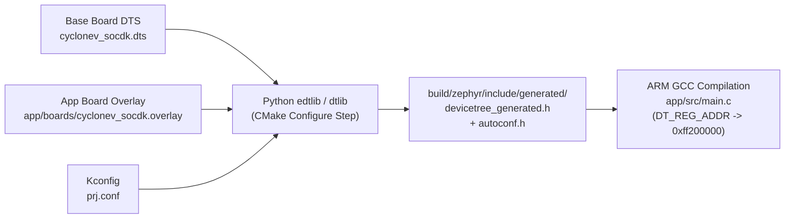
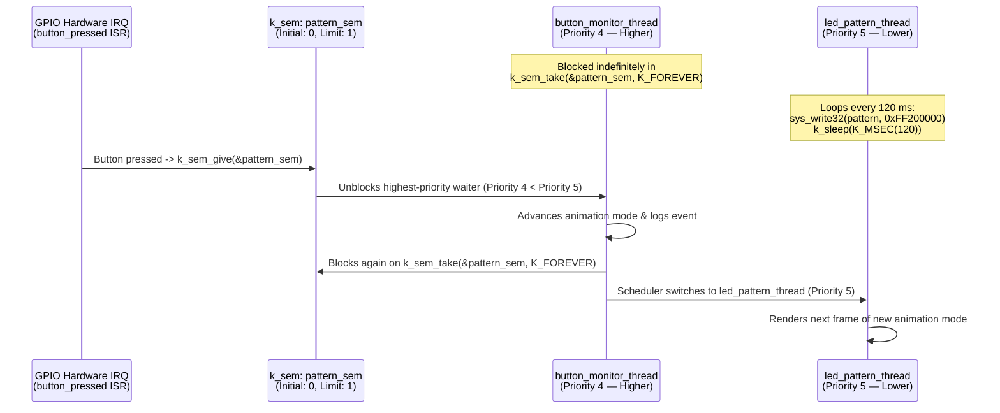

# Explanation: Zephyr RTOS Architecture, Compile-Time Devicetree, and Thread Synchronization on Cyclone V

> **Series:** cvsoc — Stepping into advanced FPGA development on the DE10-Nano  
> **Type:** Explanation (Understanding-oriented)  
> **Applies to:** Phase 8 (`12_zephyr_led` — [`tutorial_phase8_zephyr.md`](tutorial_phase8_zephyr.md) and [`qa.md`](qa.md))

---

## Introduction

By Phase 8 (`12_zephyr_led`), you have seen two opposite ends of the embedded software spectrum on the ARM Cortex-A9 HPS:
- **Bare-Metal (Phases 3–5):** A tiny (~4 KB) single-threaded loop in OCRAM with direct physical register access and zero OS abstractions.
- **Embedded Linux (Phases 6–7):** A full General-Purpose Operating System (GPOS) with virtual memory, user/kernel separation, an `ext4` root filesystem, and a TCP/IP network stack—weighing tens of megabytes and taking seconds to boot from an SD card.

**Zephyr RTOS** occupies the critical middle ground: a **Real-Time Operating System** with deterministic preemptive multi-threading, semaphores, Devicetree hardware abstraction, and Kconfig configurability—all statically linked with your application into a single **~49 KB `.elf` binary** that boots in milliseconds.

This document explains:
1. How an RTOS differs architecturally from both bare-metal and Linux.
2. How **Zephyr's compile-time Devicetree pipeline** differs fundamentally from Linux's runtime `.dtb` parsing.
3. How the Cyclone V **HPS GPIO bank numbering** maps physical schematic pin `HPS_KEY` (`GPIO54`) to Devicetree node `&gpio1 25`.
4. How **ISR-to-thread synchronization** via `k_sem_give()` / `k_sem_take()` works under Zephyr's priority-based preemptive scheduler.
5. Why JTAG flashing of Zephyr requires the **U-Boot SPL preloader** from Phase 6.

---

## 1. Architectural Comparison: Bare-Metal vs. Zephyr RTOS vs. Embedded Linux

```
┌─────────────────────────┐  ┌─────────────────────────────┐  ┌─────────────────────────────┐
│   Bare-Metal (Phase 3)  │  │    Zephyr RTOS (Phase 8)    │  │  Embedded Linux (Phase 6)   │
├─────────────────────────┤  ├─────────────────────────────┤  ├─────────────────────────────┤
│  Single main() + ISRs   │  │  led_pattern_thread (Prio 5)│  │  User Space Processes       │
│  (No scheduler)         │  │  button_monitor_thread (P4) │  │  (fpga_led, led_server, sh) │
│                         │  │  + Zephyr Kernel Scheduler  │  ├─────────────────────────────┤
│  Direct volatile MMIO   │  │  + GPIO / UART Drivers      │  │  MMU Boundary (Syscall/mmap)│
│  *(uint32_t *)0xFF200000│  │  (All in ONE ~49 KB .elf!)  │  ├─────────────────────────────┤
│                         │  │                             │  │  Linux 6.6 Kernel (zImage)  │
│  Runs in 64 KB OCRAM    │  │  Runs in DDR3 SDRAM         │  │  + fpga_load.ko + Rootfs    │
└─────────────────────────┘  └─────────────────────────────┘  └─────────────────────────────┘
```

| Dimension | Bare-Metal (`05`/`07`) | Zephyr RTOS (`12_zephyr_led`) | Embedded Linux (`10`/`11`) |
|---|---|---|---|
| **Binary Packaging** | Single `.elf` / `.bin` (~4 KB) | Single monolithic `.elf` (~49 KB) | Separate `u-boot`, `zImage`, `.dtb`, and `rootfs.ext4` (~30+ MB) |
| **Address Space** | Single physical address space (OCRAM `0xFFFF0000` or DDR3 `0x00100000`) | Single flat address space in DDR3 (`sys_write32` writes directly to `0xFF200000`) | Strict MMU separation: Kernel virtual space vs. per-process User virtual space |
| **Concurrency Model** | Single `while(1)` loop + hardware ISRs | Deterministic priority-based preemptive/cooperative **threads** + semaphores/mutexes | Preemptive multi-process + POSIX threads (`pthreads`) |
| **Worst-Case Latency** | Sub-microsecond ISR | **Deterministic (few microseconds)** thread context switch | Non-deterministic (hundreds of $\mu\text{s}$ to $\text{ms}$ without `PREEMPT_RT`) |
| **Hardware Description** | Hardcoded `#define` macros in `main.c` | **Compile-time Devicetree** (`.dts` + `.overlay` → C header macros) | **Runtime Devicetree Blob (`.dtb`)** parsed by kernel during boot |

---

## 2. How Zephyr's Compile-Time Devicetree Pipeline Works

Both Linux and Zephyr use the **Devicetree Source (`.dts`)** syntax to describe hardware, yet they process it in completely opposite ways!

### Linux: Runtime `.dtb` Parsing

In Linux (Phase 6), `dtc` compiles `.dts` into a binary **Flattened Device Tree Blob (`.dtb`)** stored on the SD card. When the Linux kernel boots, C code inside the kernel walks the binary `.dtb` tree in RAM, performs string comparisons against `"compatible"` properties (`of_find_compatible_node()`), dynamically allocates `struct platform_device` objects on the kernel heap, and binds drivers at runtime.

### Zephyr: Zero-Overhead Compile-Time Header Generation

On a microcontroller or RTOS where a binary is only 49 KB, bundling a `.dtb` parser and dynamically allocating device structs at boot would waste precious kilobytes of RAM and flash. Instead, Zephyr processes the Devicetree **entirely at compile time during the CMake configure step**:



Let's trace what happens to `12_zephyr_led/app/boards/cyclonev_socdk.overlay`:

```dts
/ {
    soc {
        fpga_leds: fpga-led-pio@ff200000 {
            compatible = "syscon";
            reg = <0xff200000 0x10>;
            reg-io-width = <4>;
        };
    };
};
```

1. During `west build`, Zephyr's Python `edtlib` script merges `cyclonev_socdk.dts` with `cyclonev_socdk.overlay` and emits thousands of `#define` macros into `build/zephyr/include/generated/devicetree_generated.h`, such as:
   ```c
   #define DT_N_S_soc_S_fpga_led_pio_ff200000_REG_IDX_0_VAL_ADDRESS 0xff200000
   ```
2. In `12_zephyr_led/app/src/main.c`, the line:
   ```c
   #define LED_PIO_ADDR DT_REG_ADDR(DT_NODELABEL(fpga_leds))
   sys_write32(pattern, LED_PIO_ADDR);
   ```
   expands via C token-pasting (`##`) directly to the integer literal `0xff200000`!
3. There is **zero runtime lookup overhead**—the compiled ARM machine instruction is identical to a hardcoded `*(volatile uint32_t *)0xFF200000 = pattern`, while keeping all board-specific addresses cleanly separated in `.overlay` files!

---

## 3. Cyclone V HPS GPIO Banking: Why `GPIO54` Is `&gpio1 25`

In Phases 4 and 5 (`07_hps_interrupts`), push-buttons `KEY[0]` and `KEY[1]` were FPGA-fabric push-buttons (`PIN_AH17` and `PIN_AH16`) routed through an FPGA `altera_avalon_pio`.

In `12_zephyr_led/app/boards/cyclonev_socdk.overlay`, look at the `buttons` node:
```dts
buttons {
    compatible = "gpio-keys";
    key0: key_0 {
        gpios = <&gpio1 25 (GPIO_ACTIVE_LOW | GPIO_PULL_UP)>;
    };
    key1: key_1 {
        gpios = <&gpio1 26 (GPIO_ACTIVE_LOW | GPIO_PULL_UP)>;
    };
};
```

Where do `&gpio1` and pin numbers `25` and `26` come from?

Inside the Cyclone V HPS hard silicon, the HPS GPIO controller is divided into **three Synopsys DesignWare GPIO hardware banks**, each managing **29 pins** (not 32!):

| HPS GPIO Bank | Zephyr / Linux DT Label | Base Address | Global HPS GPIO Pin Range | Pin Count |
|---|---|---|---|---|
| **GPIO Controller 0 (`gpio0`)** | `&gpio0` | `0xFF708000` | `HPS_GPIO[0..28]` | 29 pins |
| **GPIO Controller 1 (`gpio1`)** | `&gpio1` | `0xFF709000` | `HPS_GPIO[29..57]` | 29 pins |
| **GPIO Controller 2 (`gpio2`)** | `&gpio2` | `0xFF70A000` | `HPS_GPIO[58..66]` + 14 input-only | 27 pins |

To translate a global `HPS_GPIO[N]` schematic number (such as `HPS_GPIO54`, the DE10-Nano's HPS user button `HPS_KEY`, or `HPS_GPIO53`, `HPS_LED`) into a Devicetree bank and bit offset:
- Since $29 \le 54 \le 57$, pin `54` belongs to **Bank 1 (`&gpio1`)**.
- The bit offset inside `&gpio1` is:
  $$\text{Offset} = 54 - 29 = 25$$
- Similarly, global pin `55` maps to `&gpio1` bit $55 - 29 = 26$.

---

## 4. Two-Thread Design and ISR-to-Thread Semaphore Handshake

Let's examine the concurrency architecture in `12_zephyr_led/app/src/main.c`:



### Why Use a Semaphore (`K_SEM_DEFINE`) Instead of Doing Work in the ISR?

In `button_pressed()` (registered via `gpio_add_callback()`):
1. **ISR Execution Context Constraints:** `button_pressed()` runs inside **interrupt context** with the current interrupt masked. In any RTOS, ISRs must execute in a few microseconds and **are forbidden from calling blocking APIs** (`k_sleep()`, mutex locks, or heavy formatted I/O).
2. **Deferred Interrupt Processing Pattern:** The ISR does the absolute minimum work—calling `k_sem_give(&pattern_sem)` (an $O(1)$ non-blocking kernel operation that increments the binary semaphore up to its limit of `1` and marks any waiting thread as `READY`).
3. **Zephyr Priority Numbering (Lower Number = Higher Priority):**
   In Zephyr, **lower numerical priority values mean higher scheduling urgency**:
   - `button_monitor_thread` has **Priority 4**.
   - `led_pattern_thread` has **Priority 5**.
   - Most of the time, `button_monitor_thread` is asleep in `k_sem_take(&pattern_sem, K_FOREVER)`, consuming **0% CPU**, so `led_pattern_thread` (Priority 5) runs freely every 120 ms (`k_sleep(K_MSEC(120))`).
   - The instant `button_pressed()` calls `k_sem_give(&pattern_sem)`, `button_monitor_thread` (Priority 4) becomes runnable and **immediately preempts** `led_pattern_thread` (Priority 5) as soon as the ISR exits!

---

## 5. Why Zephyr Flashing Uses Phase 6's `u-boot-spl` Over JTAG

When you run `make flash` (or `west flash`) in `12_zephyr_led/`, OpenOCD executes a two-stage JTAG load sequence:
1. First, OpenOCD loads **`u-boot-spl`** into OCRAM (`0xFFFF0000`), sets a breakpoint after SDRAM initialization, and lets the Cortex-A9 run it.
2. Second, once the SPL hits the breakpoint (meaning the **1 GB DDR3 controller is calibrated and live** and the **HPS-to-FPGA bridges are released**), OpenOCD loads `build/zephyr/zephyr.elf` into DDR3 and jumps to Zephyr's entry point!

**Why does this work whether or not a Linux SD card is plugged into the DE10-Nano?**
Because JTAG (`SOCVHPS` `@1` TAP) has direct hardware authority over the Cortex-A9 core! Even if the board booted Linux from the SD card 5 minutes ago, the moment OpenOCD connects over JTAG, it halts the ARM CPU (`halt`), overwrites OCRAM/DDR3 with the SPL and `zephyr.elf`, and redirects the Program Counter (`PC`) to Zephyr—without ever touching the SD card.

---

## Further Reading

- **Tutorial:**
  - [Phase 8 Tutorial — Zephyr RTOS LED Control on DE10-Nano](tutorial_phase8_zephyr.md)
  - [Phase 8: Zephyr RTOS — Q&A](qa.md)
- **Next Explanation:**
  - [Explanation: Embedded Cybersecurity — Bitstream Encryption (AES-256) and Signed U-Boot FIT Images](explanation_phase9_secure_boot_and_crypto.md)
