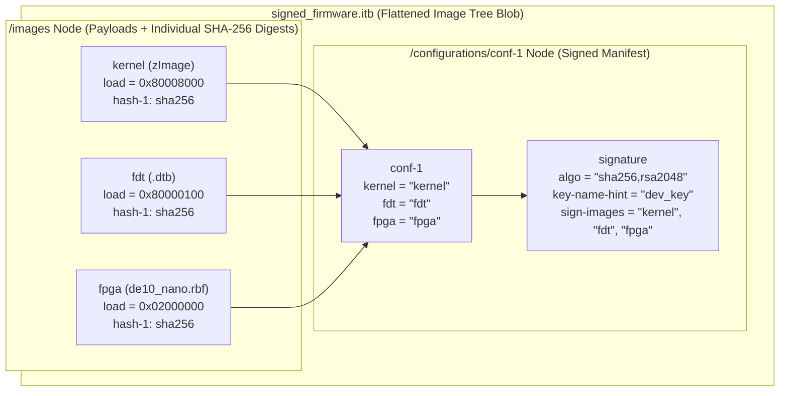

# Explanation: Embedded Cybersecurity — Bitstream Encryption (AES-256) and Signed U-Boot FIT Images

> **Series:** cvsoc — Stepping into advanced FPGA development on the DE10-Nano  
> **Type:** Explanation (Understanding-oriented)  
> **Applies to:** Phase 9 (`13_secure_boot` — [`13_secure_boot/doc/README.md`](../13_secure_boot/doc/README.md))

---

## Introduction

When an FPGA+SoC system transitions from a lab prototype on your desk to a deployed product in the field, a new class of engineering questions arises:
- **Intellectual Property (IP) Protection:** Anyone with physical access to the microSD card can copy `de10_nano.rbf` in seconds, clone your proprietary FPGA VHDL design onto counterfeit hardware, or reverse-engineer the netlist.
- **Unauthorized Firmware Execution:** An attacker with physical or network access can replace `zImage`, the Device Tree (`.dtb`), or `de10_nano.rbf` on the FAT32 boot partition with a trojanized kernel or malicious hardware bitstream.

Phase 9 (`13_secure_boot`) introduces the two cryptographic pillars that defend an FPGA+SoC system—**Symmetric Bitstream Encryption (`AES-256`)** for the FPGA fabric and **Asymmetric Digital Signatures (`RSA-2048 + SHA-256`)** via **U-Boot Flattened Image Trees (FIT, `.itb`)** for the software boot chain—while strictly avoiding permanent hardware eFuse lockdown so your DE10-Nano remains 100% reusable for learning.

This document explains the cryptographic architecture, hardware key storage trade-offs, and FIT verification mechanics behind `13_secure_boot`.

---

## 1. Threat Model and Cryptographic Division of Labor: AES vs. RSA

A common point of confusion in embedded security is: *Why do we use AES-256 for the FPGA bitstream, but RSA-2048 + SHA-256 for the U-Boot FIT image?*

Because they solve **two fundamentally different security properties** under very different silicon constraints:

| Property | Symmetric Encryption (`AES-256`) | Asymmetric Digital Signature (`RSA-2048 + SHA-256`) |
|---|---|---|
| **Security Goal** | **Confidentiality** (keeps the contents secret from eavesdroppers/cloners) | **Authenticity & Integrity** (proves *who* built the image and that *zero bits* were altered) |
| **Key Symmetry** | **Same secret key** (`aes_key.key`) is used by `quartus_cpf` to encrypt and by the Cyclone V FPGA silicon to decrypt. | **Private key** (`dev_key.key`, kept offline on build server) signs; **Public key** (`dev_key.pub`, embedded in U-Boot on the board) verifies. |
| **What happens if someone extracts the key from the board?** | If an attacker extracts a symmetric AES key from one board, they can decrypt the bitstream and forge encrypted bitstreams for all boards sharing that key. | Extracting the **public key** from the board gives the attacker **zero ability** to sign a malicious firmware image! Only the offline private key can create valid signatures. |
| **Hardware Throughput** | **Very fast in silicon:** Cyclone V has a hard AES-256 decryption engine in its configuration path that decrypts `.rbf` data at full FPP streaming speed (~100+ MB/s). | **Computationally heavy:** Modular exponentiation ($s^e \bmod n$) is only run on a 32-byte SHA-256 digest in software (U-Boot), not on megabytes of raw bitstream directly. |

In a production Cyclone V system, **both are combined**:
1. The FPGA `.rbf` is **encrypted with AES-256** (protecting your hardware IP from cloning).
2. The encrypted `.rbf`, the Linux `zImage`, and the `.dtb` are bundled into a **FIT image (`.itb`) and signed with RSA-2048 + SHA-256** (guaranteeing U-Boot never loads an untrusted kernel or bitstream).

---

## 2. Cyclone V Hardware Bitstream Encryption: BBRAM vs. eFuses

### How `quartus_cpf` Encrypts a `.sof` into `.rbf` + `.ekp`

In `13_secure_boot/scripts/encrypt_bitstream.sh`:
```bash
quartus_cpf -c \
  -k "${KEY_FILE}:${KEY_ID}" \
  --option=bitstream_compression=on \
  "${INPUT_SOF}" "${OUTPUT_RBF}"
```
1. **Compression First, Encryption Second:**
   Why must compression happen *before* AES encryption?
   Because AES-256 encryption transforms structured data into pseudo-random ciphertext with maximum Shannon entropy ($\approx 8.0\text{ bits/byte}$). Encrypted data is mathematically **incompressible**! Therefore, `quartus_cpf` first compresses the `.sof` configuration frames (reducing ~7 MB to ~1.9 MB) and then encrypts the compressed stream with your 256-bit key (`aes_key.key`).
   Inside the Cyclone V silicon during configuration, the order is reversed:
   $$\text{Encrypted .rbf} \xrightarrow{\text{Hard AES-256 Decryptor}} \text{Compressed Stream} \xrightarrow{\text{Hard Decompressor}} \text{Configuration SRAM}$$

2. **The `.ekp` (Encryption Key Programming) File:**
   Alongside `de10_nano_encrypted.rbf`, `quartus_cpf` generates `de10_nano_encrypted.ekp`. This file contains the 256-bit key formatted for JTAG key provisioning into the Cyclone V's internal key storage registers.

### Volatile BBRAM vs. Non-Volatile eFuses (Why eFuses Are Dangerous on Dev Boards)

The Cyclone V SoC provides two physical locations inside the silicon to store the 256-bit AES decryption key:

```
┌────────────────────────────────────────────────────────────────────────────┐
│                   Cyclone V Internal AES Key Storage                       │
│                                                                            │
│  Option A: Battery-Backed RAM (BBRAM)     Option B: Poly-Silicon eFuses    │
│  ┌──────────────────────────────────┐     ┌──────────────────────────────┐ │
│  │ • Volatile SRAM cells            │     │ • One-Time Programmable (OTP)│ │
│  │ • Retained via VCCA_FPLL / coin  │     │ • Microscopic fuses blown    │ │
│  │   cell; erased on power removal  │     │   permanently by current     │ │
│  │ • Re-programmable unlimited times│     │ • IRREVERSIBLE once blown!   │ │
│  │ • Safe for education & testing   │     │ • Can permanently lock out   │ │
│  │                                  │     │   unencrypted .sof/.rbf!     │ │
│  └──────────────────────────────────┘     └──────────────────────────────┘ │
└────────────────────────────────────────────────────────────────────────────┘
```

> **Why `13_secure_boot` Never Programs eFuses:**
> Blowing the Cyclone V's security eFuses physically melts microscopic polysilicon links on the die. If the security eFuse bit that enforces "accept *only* encrypted bitstreams" is blown and the `aes_key.key` file is ever lost—or if you want to go back to running Phases 0–8 with normal unencrypted `.sof`/`.rbf` files—the FPGA fabric on your DE10-Nano is **permanently locked forever**.
> By generating and inspecting `de10_nano_encrypted.rbf` and `de10_nano_encrypted.ekp` offline (or using volatile key storage), you learn the exact production toolchain flow with zero risk to your development board.

---

## 3. The Software Chain of Trust and U-Boot FIT Images (`signed_firmware.itb`)

### What Problem Does a Flattened Image Tree (FIT) Solve?

In Phase 6 (`10_linux_led`), the FAT32 boot partition (`mmc 0:2`) held three separate loose files:
- `zImage` (Linux kernel)
- `socfpga_cyclone5_de0_nano_soc.dtb` (Device Tree Blob)
- `de10_nano.rbf` (FPGA bitstream)

Even if you signed each of those three files individually, an attacker could perform a **Mix-and-Match (Downgrade) Attack**: pairing a validly signed older `zImage` (that had a known privilege escalation bug or debug `/dev/mem` hook) with a newer signed `.dtb` and `.rbf`!

A **U-Boot Flattened Image Tree (FIT, `.itb`)** solves both integrity and mix-and-match attacks by using the exact same tree structure as a Device Tree (`fit_image.its` compiled by `mkimage -f`):



### How `mkimage` Signs `configurations/conf-1` (`13_secure_boot/fit_image.its`)

Look at lines 60–70 of `13_secure_boot/fit_image.its`:
```dts
conf-1 {
    description = "Boot Linux with FPGA";
    kernel = "kernel";
    fdt = "fdt";
    fpga = "fpga";
    signature {
        algo = "sha256,rsa2048";
        key-name-hint = "dev_key";
        sign-images = "kernel", "fdt", "fpga";
    };
};
```

Notice that the `signature` node is placed inside **`configurations/conf-1`**, while `images/kernel`, `images/fdt`, and `images/fpga` each have a `hash-1 { algo = "sha256"; };` node:

1. **Step 1 — Hashing Each Payload:** `mkimage` computes the 256-bit SHA-256 hash of `zImage`, the `.dtb`, and `de10_nano.rbf`, embedding those 32-byte digests into `/images/<name>/hash-1/value`.
2. **Step 2 — Signing the Configuration Tuple:** Because `sign-images = "kernel", "fdt", "fpga"` is specified on `conf-1`, `mkimage` hashes the `conf-1` structure *including the SHA-256 hash nodes of all three images and their load addresses*, and signs that combined digest using the 2048-bit RSA private key (`keys/dev_key.key`).
3. **Why This Prevents Mix-and-Match Attacks:**
   - If an attacker flips a single bit in `zImage`, the SHA-256 check on `/images/kernel` fails.
   - If an attacker modifies `/images/kernel/hash-1/value` to match their modified `zImage`, the RSA-2048 signature verification on `/configurations/conf-1` fails!
   - If an attacker swaps `fdt` or changes the load address `<0x80008000>`, the RSA-2048 signature on `conf-1` also fails!

### How the Full Hardware Root of Trust Completes in Production

In a fully locked production system, every stage verifies the next stage **before** jumping to it:

```
┌──────────────────────┐   Verifies   ┌──────────────────────┐   Verifies   ┌──────────────────────┐   Verifies   ┌────────────────────────┐
│ 1. Silicon BootROM   │ ───────────► │ 2. U-Boot SPL        │ ───────────► │ 3. U-Boot + DTB      │ ───────────► │ 4. signed_firmware.itb │
│ (Immutable Mask ROM) │              │ (In 64 KB OCRAM)     │              │ (Embeds dev_key.pub  │              │ (zImage + .dtb + .rbf  │
│                      │              │                      │              │  with required="conf"│              │  signed by dev_key.key)│
└──────────────────────┘              └──────────────────────┘              └──────────────────────┘              └────────────────────────┘
```

When `mkimage -F -k keys -K u-boot.dtb -r signed_firmware.itb` is run during a verified U-Boot build (`CONFIG_FIT_SIGNATURE=y`):
- `mkimage -K u-boot.dtb -r` writes the RSA public key modulus (`n`), Montgomery squared constant (`r-squared`), and exponent (`e = 65537`) directly into `/signature/key-dev_key` inside **`u-boot.dtb`** with `required = "conf"`.
- When U-Boot runs `bootm $loadaddr` on the board, it reads the public key from its own read-only control DTB, verifies the RSA-2048 signature on `conf-1`, verifies the SHA-256 hashes of `kernel`, `fdt`, and `fpga`, programs the FPGA, and boots Linux—refusing to boot if any check fails.

---

## Further Reading

- **Tutorial:**
  - [Phase 9: Cybersecurity (Educational Secure Boot)](../13_secure_boot/doc/README.md)
- **Next Explanation:**
  - [Explanation: Atomic A/B Field Updates, Live FPGA Hot-Swap, and Automatic Rollback](explanation_phase10_ota_field_update_and_rollback.md)
