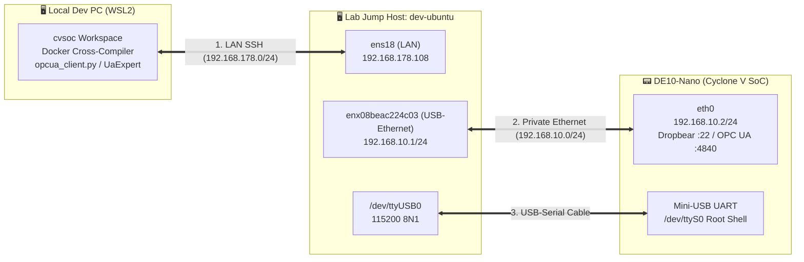
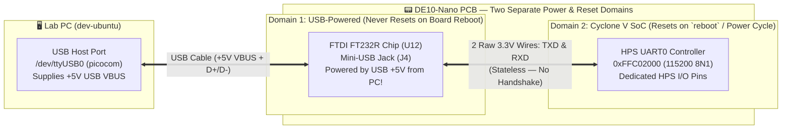

# How-to: Access and Deploy to a DE10-Nano Connected to a Remote Lab PC (`dev-ubuntu`) via SSH Jump Host & Port Forwarding

> **Series:** cvsoc — Stepping into advanced FPGA development on the DE10-Nano  
> **Type:** How-to Guide (Problem-oriented)  
> **Difficulty:** Intermediate  
> **Applies to:** All Linux / Networking Phases (`10_linux_led`, `11_ethernet_hps_led`, `13_secure_boot`, `16_field_update`, `17_opcua_hps_led`)  
> **Related Guides:** [How-to: Deploy Binaries Over Ethernet or Serial](howto_deploy_to_board_over_serial_and_ethernet.md) · [Field Guide: Deploying Without SSH](../11_ethernet_hps_led/doc/deploying_without_ssh.md)

---

## Overview

In many embedded engineering setups, your primary development workstation (for example, a Windows/WSL2 laptop or desktop where you edit code and run Docker cross-compilers) is **not** the machine physically wired to the DE10-Nano. Instead, the DE10-Nano sits on a lab bench connected to a dedicated Linux host (`dev-ubuntu`).

This guide documents:
1. **The 3-Tier Remote Hardware Lab Topology** (`This PC` ↔ `dev-ubuntu` ↔ `DE10-Nano`).
2. **How to Bootstrap the DE10-Nano Over Serial (`/dev/ttyUSB0`) + HTTP** when SSH is not yet configured on the board.
3. **Option A — SSH Local Port Forwarding (`ssh -L`):** Run OPC UA (`4840`), OTA (`8090`), or Web Dashboard tools directly on your local PC against `HOST=127.0.0.1`.
4. **Option B — Remote Serial Console (`picocom` over SSH):** Open an interactive UART root shell on the DE10-Nano from your local PC.
5. **Option C — Direct `ssh de10nano` & `scp` via `ProxyJump`:** Configure one-command passwordless SSH and `scp` from your local PC straight to the DE10-Nano across the jump host.

---

## 1. Physical & Network Topology



Why can't your local PC (`192.168.178.x`) `ping 192.168.10.2` directly?
- Because `192.168.10.0/24` is an isolated point-to-point subnet between `dev-ubuntu`'s USB-Ethernet dongle (`enx08beac224c03` at `192.168.10.1`) and the DE10-Nano's RJ45 port (`eth0` at `192.168.10.2`).
- Your LAN router knows nothing about `192.168.10.0/24`—only `dev-ubuntu` has a network interface on both subnets.

---

## 2. Bootstrapping a Fresh Board Over `/dev/ttyUSB0` + HTTP (Before SSH Keys Are Installed)

When the DE10-Nano boots a fresh SD card image:
1. It may not have `192.168.10.2/24` assigned on `eth0` yet (if no DHCP server runs on `enx08beac224c03`).
2. Dropbear SSH on the board will reject password/key logins until `/root/.ssh/authorized_keys` is populated with strict permissions (`chmod 700 /root /root/.ssh` and `chmod 600 /root/.ssh/authorized_keys`).

Because `dev-ubuntu` is physically wired to `/dev/ttyUSB0` (`115200 8N1`), you can bootstrap both networking and SSH keys automatically from `dev-ubuntu` using Python's `pyserial`:

### 2.1 Configure `192.168.10.2/24` and Transfer a Binary via Temporary HTTP Server

On `dev-ubuntu`:
1. Send `ip link set eth0 up && ip addr add 192.168.10.2/24 dev eth0` over `/dev/ttyUSB0`.
2. Start a temporary HTTP server on `dev-ubuntu` (`192.168.10.1:18080`) serving your cross-compiled binary.
3. Instruct the DE10-Nano over `/dev/ttyUSB0` to download and atomically swap the binary:
   ```sh
   wget -q -O /tmp/led_opcua_server http://192.168.10.1:18080/led_opcua_server
   chmod +x /tmp/led_opcua_server
   mv /tmp/led_opcua_server /usr/bin/led_opcua_server
   /usr/bin/led_opcua_server --port 4840 --pubsub-port 4841 >/var/log/led_opcua_server.log 2>&1 &
   ```

> **Why `mv` instead of `wget -O /usr/bin/led_opcua_server`?**  
> If `led_opcua_server` is already running, Linux blocks overwriting its inode with `ETXTBSY (Text file busy)`. Downloading to `/tmp/` and running `mv` atomically updates the directory entry without touching the running inode.

---

## 3. Option A: Access Board Network Services Locally via SSH Port Forwarding (`ssh -L`)

Once `led_opcua_server` is listening on `192.168.10.2:4840` (or `ota_daemon.py` on `192.168.10.2:8090`), you can forward that TCP port through `dev-ubuntu` to `127.0.0.1` on **your local PC**:

```bash
# Run on your local PC (starts tunnel in the background):
ssh -f -N -L 4840:192.168.10.2:4840 dev-ubuntu
```

What each flag does:
- `-f` — Backgrounds `ssh` after authentication succeeds.
- `-N` — Do not execute a remote shell command (only forward ports).
- `-L 4840:192.168.10.2:4840` — Listens on `127.0.0.1:4840` on your local PC and forwards every TCP connection through `dev-ubuntu` to `192.168.10.2:4840`.

With this tunnel active, run any Phase 11 command **directly on your local PC** using `HOST=127.0.0.1`:

```bash
cd 17_opcua_hps_led
make browse    HOST=127.0.0.1
make read      HOST=127.0.0.1 NODE=fpga.bitstream_state
make write     HOST=127.0.0.1 VAL=0xA5
make call      HOST=127.0.0.1
make subscribe HOST=127.0.0.1
```

You can also connect graphical OPC UA tools (such as **UaExpert** on Windows/Linux) directly to `opc.tcp://127.0.0.1:4840`.

To close the background tunnel when finished:

```bash
pkill -f "4840:192.168.10.2:4840"
```

### Example Use Cases for Option A (`ssh -L` Port Forwarding)

#### Use Case A1: Running Local Python Clients & Test Suites Against Real Silicon (`17_opcua_hps_led`)
When you are developing or modifying [`client/opcua_client.py`](../17_opcua_hps_led/client/opcua_client.py) in your local IDE on WSL2, you do not want to `scp` your Python scripts to `dev-ubuntu` after every edit. With port `4840` forwarded to `127.0.0.1:4840`, your local Python script talks directly to the C daemon on the DE10-Nano:
```bash
# Forward OPC UA port 4840 once:
ssh -f -N -L 4840:192.168.10.2:4840 dev-ubuntu

# Run your edited client locally on this PC:
python3 17_opcua_hps_led/client/opcua_client.py --host 127.0.0.1 --dump-hex call --method fpga.invert_pattern
```

#### Use Case A2: Connecting Desktop GUI Tools (UaExpert, Prosys, or Ignition SCADA)
Graphical industrial tools like **UaExpert** run on your local desktop (Windows/Linux GUI), not on the headless `dev-ubuntu` server. By forwarding `localhost:4840` to `192.168.10.2:4840`, you can open **UaExpert** on your PC, add server `opc.tcp://127.0.0.1:4840`, and visually click through the DE10-Nano's `Objects → DE10Nano → FPGA` tree, drag `LedPattern` into a live Data Access View, and right-click `InvertPattern` → **Call...** from the GUI.

#### Use Case A3: Pushing Zero-JTAG OTA Firmware Bundles (`16_field_update`)
In Phase 10 ([`16_field_update`](../16_field_update/doc/README.md)), `make bundles` builds `.tar.gz` update archives in `16_field_update/build/` on your local PC, and `ota_daemon.py` listens on HTTP port `8090` on the DE10-Nano. Forwarding port `8090` lets you push OTA updates and run rollback fault-injection tests directly from your local build folder:
```bash
# Forward OTA HTTP port 8090 from local PC -> dev-ubuntu -> DE10-Nano:
ssh -f -N -L 8090:192.168.10.2:8090 dev-ubuntu

# Query slot status and push v2.0.0 firmware directly from your local PC:
cd 16_field_update
make status  HOST=127.0.0.1
make push-v2 HOST=127.0.0.1
```

---

## 4. Option B: Interactive Serial Console From Your Local PC

To attach directly to the DE10-Nano's UART console (`/dev/ttyUSB0` on `dev-ubuntu`) from your local terminal:

```bash
ssh -t dev-ubuntu picocom -b 115200 /dev/ttyUSB0
```

- The `-t` flag allocates a pseudo-terminal (`pty`) on `dev-ubuntu` so interactive terminal programs like `picocom` work seamlessly.
- Press **`Ctrl+A` then `Ctrl+X`** to exit `picocom` cleanly without leaving a stale lock file in `/var/lock/LCK..ttyUSB0`.

### Example Use Cases for Option B (Remote Serial Console)

#### Use Case B1: Watching U-Boot SPL, Secure Boot Signatures & Kernel Boot Logs (`10_linux_led`, `13_secure_boot`)
Ethernet (`eth0`) and Dropbear SSH do not exist until the Linux kernel finishes booting and runs `/etc/init.d/` scripts. Whenever you need to watch **U-Boot SPL** initialize DDR3, verify RSA-2048 FIT signatures in Phase 9 ([`13_secure_boot`](../13_secure_boot/doc/README.md)), interrupt the U-Boot countdown prompt (`Hit any key to stop autoboot`), or debug a Device Tree overlay error during kernel boot, you must use the serial console:
```bash
# 1. On your local PC, open the serial console to the DE10-Nano:
ssh -t dev-ubuntu picocom -b 115200 /dev/ttyUSB0

# 2. Now you are at the DE10-Nano's root prompt (`#`).
#    Type `reboot` to restart the DE10-Nano (NOT dev-ubuntu!) and watch
#    the entire boot sequence from U-Boot SPL -> U-Boot -> Linux kernel:
de10nano# reboot
```

#### Use Case B2: Recovering From Broken Network Config or Kernel Bus Lockups
If `eth0` loses its IPv4 address (`192.168.10.2`), if a firewall rule blocks SSH, or if an un-gated FPGA reconfiguration freezes the Lightweight AXI bridge (`0xFF200000`) and triggers a kernel `Unhandled fault: external abort on non-linefetch`, SSH over Ethernet will hang. The out-of-band `/dev/ttyUSB0` serial console stays alive so you can inspect `dmesg` or reconfigure `eth0`:
```sh
# Inside picocom serial console on the DE10-Nano:
ip link set eth0 up
ip addr add 192.168.10.2/24 dev eth0
```

#### Use Case B3: First-Boot Provisioning of a Newly Flashed SD Card
Right after flashing a new `sdcard.img`, the board has no `/root/.ssh/authorized_keys` file yet. Use Option B to log in at the `de10nano login:` prompt (`root`) and set up networking and SSH keys for the first time.

---

## 5. Option C: Direct `ssh de10nano` and `scp` via SSH `ProxyJump`

By combining Dropbear SSH key authentication on the DE10-Nano with OpenSSH's `ProxyJump` directive on your local PC, you can `ssh` and `scp` directly between your local PC and the DE10-Nano in a single command.

### Step 1 — Install your SSH public key on the DE10-Nano

> **Important Dropbear Requirement:** Dropbear on Buildroot will silently reject `/root/.ssh/authorized_keys` if `/root`, `/root/.ssh`, or `authorized_keys` are writable by group or others! Always enforce `chmod 700 /root /root/.ssh` and `chmod 600 /root/.ssh/authorized_keys`.

On the DE10-Nano (via serial console):

```sh
mkdir -p /root/.ssh
chmod 700 /root /root/.ssh
echo "<your-ssh-public-key>" >> /root/.ssh/authorized_keys
chmod 600 /root/.ssh/authorized_keys
chown -R root:root /root /root/.ssh
```

### Step 2 — Add `Host de10nano` with `ProxyJump` to `~/.ssh/config` on Your Local PC

Add the following block to `~/.ssh/config` on your local PC:

```sshconfig
Host dev-ubuntu
  HostName 192.168.178.108
  User bale
  IdentityFile ~/.ssh/id_rsa_local

Host de10nano
  HostName 192.168.10.2
  User root
  ProxyJump dev-ubuntu
  IdentityFile ~/.ssh/id_rsa_local
  StrictHostKeyChecking no
  UserKnownHostsFile /dev/null
```

### Step 3 — Use `ssh de10nano` and `scp` Directly From Your Local PC

Now OpenSSH automatically tunnels through `dev-ubuntu` behind the scenes whenever you reference `de10nano`:

```bash
# 1. Run commands or open a shell on the DE10-Nano from your local PC:
ssh de10nano uname -a
ssh de10nano /sbin/devmem 0xFF200000 8

# 2. Cross-compile and deploy a new binary in one step from your local PC:
cd 17_opcua_hps_led
make server-cross
scp software/opcua_server/led_opcua_server de10nano:/tmp/led_opcua_server.new
ssh de10nano "killall led_opcua_server 2>/dev/null || true; \
              mv /tmp/led_opcua_server.new /usr/bin/led_opcua_server && \
              chmod +x /usr/bin/led_opcua_server && \
              /usr/bin/led_opcua_server --port 4840 --pubsub-port 4841 >/var/log/led_opcua_server.log 2>&1 &"
```

### Example Use Cases for Option C (`ssh de10nano` & `scp` via `ProxyJump`)

#### Use Case C1: Fast 2-Second Edit-Compile-Deploy Iteration for C Daemons (`11_ethernet_hps_led`, `17_opcua_hps_led`)
When adding a new OPC UA Variable or Method node in [`led_opcua_server.c`](../17_opcua_hps_led/software/opcua_server/led_opcua_server.c) (or extending [`led_server_pb.c`](../11_ethernet_hps_led/software/led_server/led_server_pb.c)), Option C lets you cross-compile on your local PC and push the new ARM binary directly to the DE10-Nano in two commands—without manually copying files to `dev-ubuntu:/tmp/` first:
```bash
make -C 17_opcua_hps_led server-cross
scp 17_opcua_hps_led/software/opcua_server/led_opcua_server de10nano:/tmp/led_opcua_server.new
ssh de10nano "killall led_opcua_server 2>/dev/null || true; mv /tmp/led_opcua_server.new /usr/bin/led_opcua_server && led_opcua_server &"
```

#### Use Case C2: Live FPGA Bitstream (`.rbf`) & Kernel Module (`.ko`) Hot-Reloading (`10_linux_led`)
After synthesizing a new FPGA design in Quartus on your local PC and converting `.sof` to `de10_nano.rbf`, use `scp` with `de10nano` to upload the bitstream straight into `/lib/firmware/` and trigger live FPGA Manager reconfiguration:
```bash
scp 10_linux_led/de10_nano.rbf de10nano:/lib/firmware/de10_nano.rbf
ssh de10nano "/etc/init.d/S40led_opcua_server stop && \
              /etc/init.d/S30fpga_load restart && \
              /etc/init.d/S40led_opcua_server start"
```

#### Use Case C3: Tailing Live Daemon Logs & Inspecting Physical Registers in Split Terminals
While running client requests (via Option A) in one local terminal, open a second local terminal to stream the live server log or inspect physical memory-mapped registers on the board:
```bash
# Stream live OPC UA server log from the DE10-Nano:
ssh de10nano tail -f /var/log/led_opcua_server.log

# Read physical FPGA PIO register (0xFF200000) and FPGA Manager state:
ssh de10nano "/sbin/devmem 0xFF200000 8 && cat /sys/class/fpga_manager/fpga0/state"
```

---

## 6. Summary Decision Matrix: Which Option Should You Use?

| What You Want to Do | Best Option | Command From This PC |
| :--- | :--- | :--- |
| Run local Python clients (`opcua_client.py`, `ota_client.py`) or GUI tools (**UaExpert**) against the board | **Option A (`ssh -L`)** | `ssh -f -N -L 4840:192.168.10.2:4840 dev-ubuntu`<br/>`make -C 17_opcua_hps_led browse HOST=127.0.0.1` |
| Watch U-Boot SPL, kernel boot messages, or fix broken `eth0` networking | **Option B (`picocom`)** | `ssh -t dev-ubuntu picocom -b 115200 /dev/ttyUSB0` |
| Copy cross-compiled ARM binaries (`.elf`), kernel modules (`.ko`), or bitstreams (`.rbf`) to the board | **Option C (`ProxyJump`)** | `scp binary de10nano:/tmp/` |
| Run one-liner Linux commands (`ps`, `devmem`, `tail -f /var/log/...`) on the board | **Option C (`ProxyJump`)** | `ssh de10nano /sbin/devmem 0xFF200000 8` |

---

## 7. Frequently Asked Questions (FAQ)

### Q1: What does `reboot` mean in Use Case B1? Which machine is rebooting?

When you run `ssh -t dev-ubuntu picocom -b 115200 /dev/ttyUSB0`, every keystroke you type inside `picocom` is sent across the USB-UART cable directly to the **DE10-Nano's `/dev/ttyS0` serial console**.

Therefore, typing `reboot` at the `#` prompt inside `picocom` executes `/sbin/reboot` **on the DE10-Nano (Cyclone V ARM Cortex-A9)**—it does **not** reboot `dev-ubuntu` or your local PC!
1. BusyBox `init` on the DE10-Nano cleanly stops running daemons (`S40led_opcua_server`, `S30fpga_load`), syncs the microSD card filesystem, and triggers the Cyclone V Reset Manager (`rstmgr` at `0xFFD05000`).
2. The ARM Cortex-A9 resets and immediately begins executing from the on-chip BootROM → **U-Boot SPL** → **U-Boot** → **Linux kernel**.

---

### Q2: Why does the UART serial console (`/dev/ttyUSB0`) keep working without disconnecting when the DE10-Nano reboots (or even loses board power)?

If you run `reboot` over **SSH (`eth0`)**, your SSH session immediately drops (`Connection closed by remote host`) and cannot reconnect for ~15 seconds until Linux finishes booting and restarts Dropbear. Yet over **UART (`/dev/ttyUSB0`)**, `picocom` never disconnects and captures every single character from millisecond zero of reset. Why?

Because of **two hardware design details on the Terasic DE10-Nano PCB**:



1. **The FTDI FT232R USB-to-UART Chip (`U12`) Is Bus-Powered by the PC's USB Cable:**
   On the DE10-Nano schematic, the FT232R chip next to the Mini-USB UART jack (`J4`) draws its power from the **+5V USB `VBUS` wire coming from `dev-ubuntu`**, *not* from the Cyclone V reset domain.
   - When the Cyclone V SoC reboots—or even if you unplug the DE10-Nano's 5V barrel power plug completely—the FT232R chip remains powered on and enumerated on `dev-ubuntu`'s USB bus.
   - As a result, `/dev/ttyUSB0` on `dev-ubuntu` never disappears, and `picocom` keeps its file descriptor open continuously.
2. **UART (`TXD`/`RXD`) Is a Stateless, Connectionless 2-Wire Voltage Signal:**
   Between the FT232R chip and the Cyclone V HPS `UART0` pins, there is no TCP state machine, no IP address, and no link negotiation—just two 3.3V CMOS wires (`TX` and `RX`) that idle HIGH (`3.3V`).
   - Within a few milliseconds of the ARM Cortex-A9 resetting, **U-Boot SPL** initializes the `UART0` baud-rate divisor at `0xFFC02000` to `115200` baud and begins shifting ASCII bits out of the `UART0_TX` pin:
     ```text
     U-Boot SPL 2024.07 (Oct 24 2026 - 18:12:04 +0000)
     Trying to boot from MMC1
     ```
   - The always-awake FT232R chip samples those voltage transitions and forwards the bytes over USB to `picocom` without missing a single character.
