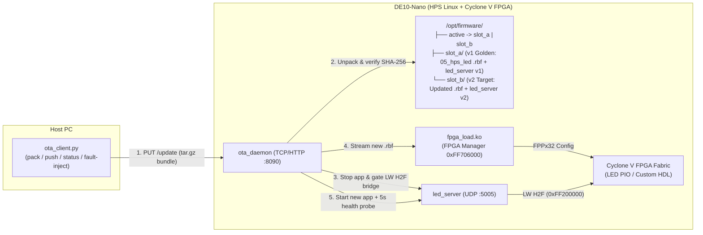
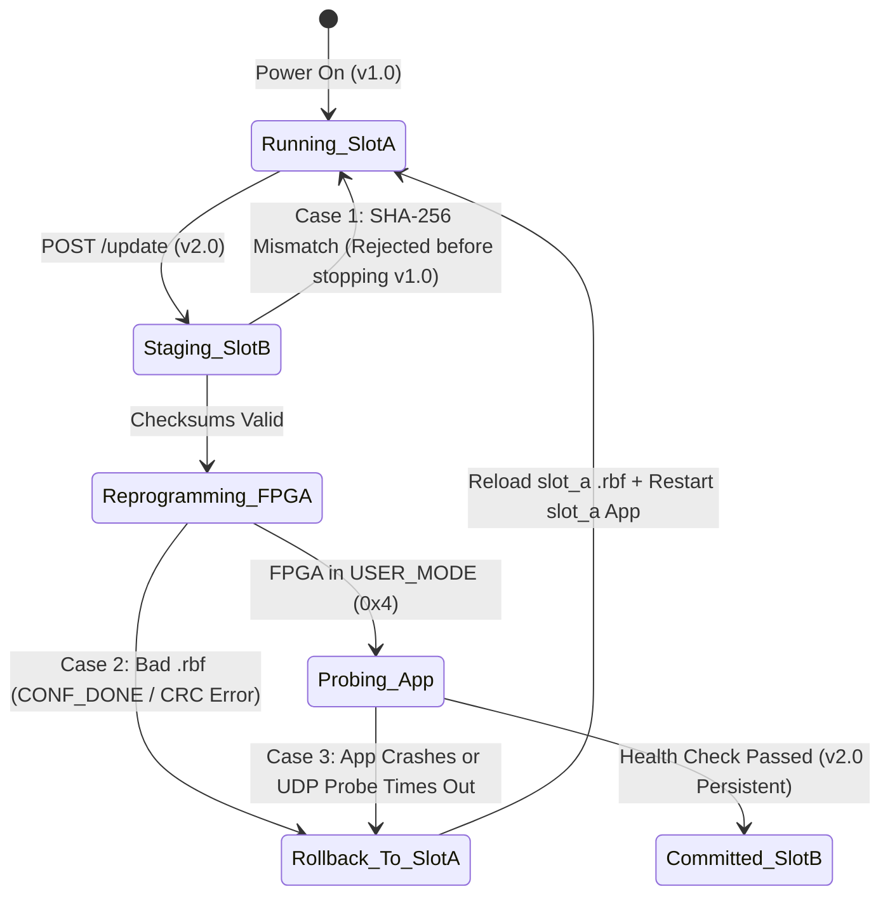

# Tutorial Plan: `16_field_update` — Network Field Update & Automatic Rollback (No JTAG)

> **Scope**: This plan covers **Part 1 (Power-Up Auto-Start & Live Network Update)** and **Part 3 (Health Check & Automatic Rollback)**, omitting cryptographic signature setup so everything runs out-of-the-box with the free Quartus Prime Lite edition and standard Linux/Python tools. Integrity during network transfer is verified with standard SHA-256 checksums.

---

## 1. Learning Objectives & Real-World Scenario

In deployed FPGA+SoC systems, technicians cannot open the enclosure to attach a JTAG cable or swap microSD cards. The system must:
1. **Start immediately on power-up** into the currently active firmware slot (`slot_a` or `slot_b`).
2. **Accept a firmware update bundle over Ethernet** from a PC (`ota_client.py`) containing a new FPGA bitstream (`.rbf`) and/or a new HPS application binary (`led_server`) plus a `manifest.json` (version + SHA-256 hashes).
3. **Hot-swap the FPGA hardware and software live** (zero JTAG, zero reboot required) while persisting the active slot selection across power cycles.
4. **Automatically roll back** to the known-good slot if:
   - The new `.rbf` bitstream is corrupted or uncompressed (`CONF_DONE` / `CRC_ERROR` failure in [`10_linux_led/software/fpga_load/fpga_load.c`](../../10_linux_led/software/fpga_load/fpga_load.c)), or
   - The new application binary crashes or fails its post-update health check within the commit window.

---

## 2. Architecture & Dual-Slot Layout



### On-Board Storage Layout (`/opt/firmware` on persistent `ext4` rootfs)
```text
/opt/firmware/
├── state.json              # {"active_slot": "slot_a", "pending_slot": null, "boot_count": 0}
├── active -> slot_a        # Atomic symlink to the currently active slot
├── slot_a/                 # Pre-populated Factory/Golden v1.0 firmware at build time
│   ├── manifest.json       # Version, timestamp, sha256 of de10_nano.rbf & led_server
│   ├── de10_nano.rbf       # Compressed FPGA bitstream
│   └── led_server          # ARM HPS application binary
└── slot_b/                 # Standby slot (populated by network update)
    ├── manifest.json
    ├── de10_nano.rbf
    └── led_server
```

> **Why gate the AXI bridges before reprogramming the FPGA?**
> In [`10_linux_led/software/fpga_load/fpga_load.c`](../../10_linux_led/software/fpga_load/fpga_load.c), the Lightweight HPS-to-FPGA bridge (`0xFF200000`) is enabled after programming. During a live FPGA update, we must **assert `BRGMODRST` before asserting `NCFGPULL`** (and stop `led_server` first) so no ARM process reads from `0xFF200000` while the FPGA fabric is in `STATE_CONFIG`, which would otherwise freeze the ARM AXI bus.

---

## 3. Directory Structure (`16_field_update/`)

```text
16_field_update/
├── Makefile                        # Build bundles (v1, v2, bad-rbf, bad-app), push update, run tests
├── doc/
│   └── README.md                   # Step-by-step tutorial walkthrough (Part 1 & Part 3)
├── br2-external/                   # Extends 11_ethernet_hps_led with S50ota_daemon + /opt/firmware/slot_a
│   └── board/de10_nano/
│       ├── S30fpga_load            # Loads /opt/firmware/active/de10_nano.rbf (with fallback to backup slot)
│       ├── S40led_server           # Starts /opt/firmware/active/led_server
│       └── S50ota_daemon           # Starts the network OTA update server on port 8090
├── daemon/
│   ├── ota_daemon.py               # Board-side OTA HTTP server, slot manager, health checker & rollback engine
│   └── test_ota_daemon.py          # Unit tests for slot switching, SHA-256 check, and rollback state machine
└── client/
    ├── pack_bundle.py              # Packages .rbf + binary + manifest.json (with optional --corrupt flags)
    └── ota_client.py               # PC CLI to query status, push updates, and watch live rollback logs
```

---

## 4. Implementation Breakdown

### Part 1: Auto-Start on Power-Up & Live Network Update (Happy Path)

- [x] **Task 1.1: Bridge-Safe Live Reconfiguration in `fpga_load` & `S30fpga_load`**
  - Update [`10_linux_led/software/fpga_load/fpga_load.c`](../../10_linux_led/software/fpga_load/fpga_load.c) so that at the very beginning of `fpga_load_init` (before pulsing `NCFGPULL`) and in `fpga_load_exit`, it asserts `BRGMODRST_LWH2F | BRGMODRST_H2F` in `RSTMGR_BRGMODRST` (`0xFFD0501C`). This guarantees the AXI bridges are safely fenced whenever the FPGA is reconfigured at runtime.
  - Symlink `/lib/firmware/update_candidate.rbf` → target slot's `de10_nano.rbf` so `modprobe fpga_load firmware=update_candidate.rbf` loads from the target slot.

- [x] **Task 1.2: Firmware Bundle Packager (`client/pack_bundle.py`)**
  - CLI script on the PC that packages:
    - `de10_nano.rbf` (compressed FPGA bitstream)
    - `led_server` (cross-compiled ARM executable with a `--version` flag and distinct default startup LED pattern, e.g., `v1.0` = `0x0F`, `v2.0` = Knight Rider / `0xAA` blink)
    - `manifest.json`:
      ```json
      {
        "version": "2.0.0",
        "description": "Knight Rider pattern + faster UDP response",
        "files": {
          "de10_nano.rbf": {"sha256": "<hex>", "size": 2105344},
          "led_server":    {"sha256": "<hex>", "size": 18432}
        }
      }
      ```
  - Outputs `build/fw_v2.0.0.tar.gz`.

- [x] **Task 1.3: On-Board OTA Update Daemon (`daemon/ota_daemon.py`)**
  - Lightweight Python 3 HTTP server (using standard library `http.server` bound to `::` dual-stack IPv6/IPv4 on port `8090`, matching the lessons from [`11_ethernet_hps_led/doc/deploying_without_ssh.md`](../../11_ethernet_hps_led/doc/deploying_without_ssh.md)).
  - Endpoints:
    - `GET /status` → Returns JSON with active slot (`slot_a`/`slot_b`), running version, FPGA Manager state (`FPGAMGR_STAT`), and rollback history.
    - `POST /update` → Executes the atomic 6-step update transaction into the **inactive** slot (`standby_slot`):
      1. **Receive & Unpack**: Extract bundle into `/tmp/ota_staging/`.
      2. **Verify Checksums**: Validate `manifest.json` and SHA-256 digests of `de10_nano.rbf` and `led_server` (reject immediately on mismatch without touching the running system).
      3. **Stage in Standby Slot**: Copy verified files to `/opt/firmware/<standby_slot>/` and `fsync()`.
      4. **Quiesce & Reprogram FPGA**:
         - Stop `S40led_server`.
         - Unload `fpga_load` and reload it pointing at `<standby_slot>/de10_nano.rbf`.
      5. **Start Candidate App & Health Probe**:
         - Launch `<standby_slot>/led_server`.
         - Verify over a 3-second window that the PID stays alive and responds to a local UDP `GET_PATTERN` health probe on `127.0.0.1:5005`.
      6. **Commit**: Atomically flip `/opt/firmware/active` symlink to `<standby_slot>`, update `state.json`, and `sync`.

- [x] **Task 1.4: PC Update Client (`client/ota_client.py`)**
  - Single command from the PC (or `dev-ubuntu`):
    ```bash
    make push-v2 HOST=192.168.1.100
    # or over link-local IPv6:
    python3 client/ota_client.py --host fe80::...%eth0 push build/fw_v2.0.0.tar.gz
    ```
  - Prints step-by-step progress returned by the board (`Unpacking → SHA-256 OK → Programming FPGA → Health Probe OK → Committed to slot_b`).

---

### Part 3: Fault Injection & Automatic Rollback (Resilience)

Students test three real-world failure modes and watch the board recover automatically without JTAG or human intervention:



- [x] **Task 3.1: Fault Scenario A — Corrupted Network Transfer (`make test-corrupt-transfer`)**
  - `pack_bundle.py --corrupt-payload` flips a byte in the `.tar.gz` payload after computing `manifest.json`.
  - **Expected behavior**: `ota_daemon` detects the SHA-256 mismatch in `/tmp/ota_staging/`, aborts at Step 2, and leaves `slot_a` running uninterrupted (zero downtime).

- [x] **Task 3.2: Fault Scenario B — Bad / Uncompressed FPGA Bitstream (`make test-bad-bitstream`)**
  - `pack_bundle.py --bad-rbf` packages a truncated or uncompressed `.rbf` with a *valid* SHA-256 in `manifest.json` (simulating a build misconfiguration where `MSEL=0x0A` rejects the bitstream).
  - **Expected behavior**:
    1. Checksum passes; `ota_daemon` stops `led_server` and attempts `modprobe fpga_load` with `slot_b`'s `.rbf`.
    2. `fpga_load` returns `-EIO` / `-ETIMEDOUT` (`CONF_DONE` never asserts).
    3. **Automatic Rollback**: `ota_daemon` catches the non-zero exit code, immediately reloads `slot_a/de10_nano.rbf` into the FPGA Manager, restarts `slot_a/led_server`, and returns an HTTP response detailing the rollback reason (`FPGA configuration failed; rolled back to slot_a v1.0.0`).

- [x] **Task 3.3: Fault Scenario C — Crashing Application Firmware (`make test-bad-app`)**
  - `pack_bundle.py --crash-app` builds a defective `led_server` binary (or passes `--simulate-crash-on-start`) that exits or hangs before answering the UDP health probe.
  - **Expected behavior**:
    1. `slot_b/de10_nano.rbf` loads into the FPGA.
    2. `slot_b/led_server` starts, but crashes (or fails the 3-second localhost UDP `GET` probe).
    3. **Automatic Rollback**: `ota_daemon` kills any remnant of the candidate process, reprograms `slot_a/de10_nano.rbf`, restarts `slot_a/led_server`, verifies `slot_a` is healthy again, and reports the rollback to the PC client.

- [x] **Task 3.4: Power-Cut Boot Guard in `S30fpga_load` / `S40led_server`**
  - If power is lost mid-update before `state.json` marks `pending_slot` as committed, on the next power-up the boot script detects the incomplete transaction, automatically restores `/opt/firmware/active` to the previous known-good slot, and boots cleanly.
