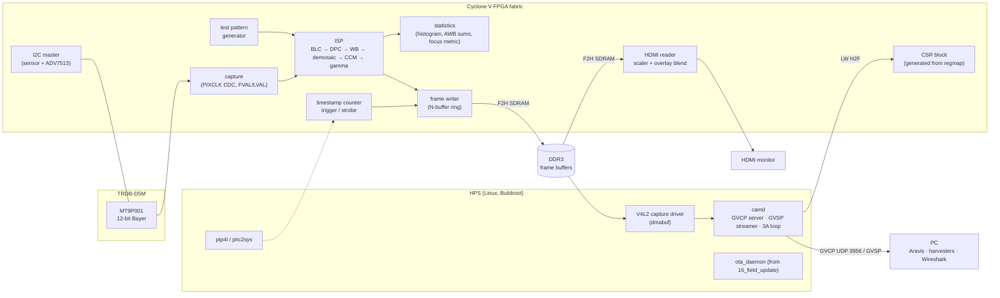

# Product Plan: `18_gige_camera` — DE10-Nano + D5M as a GigE Vision Camera

> **Scope**: Turn the DE10-Nano (Cyclone V SoC) and the Terasic TRDB-D5M 5 MP sensor board into a GenICam-described **GigE Vision camera** that standard clients (Aravis, GenTL consumers such as Python `harvesters`) can discover, configure, and stream from. The project is run *as if it were a startup's first product*: requirements, a target datasheet, risk-first milestones, ADRs, a bit-exact verification flow, CI, and a field-update / secure-boot story reused from earlier phases.
>
> All numbers marked **(est.)** are planning estimates that a milestone must measure and replace.

---

## 1. Learning Objectives

By the end of the project you will have built and understood:

1. **Sensor bring-up**: parallel CMOS capture (PIXCLK/FVAL/LVAL), clock-domain crossing, I2C sensor configuration, exposure and gain control on a rolling-shutter sensor.
2. **An FPGA image signal processor (ISP)**: black level, defect pixel correction, white balance, demosaic, color correction matrix, gamma, and a statistics block that drives auto-exposure / auto-white-balance.
3. **High-bandwidth data movement** across an SoC: FPGA → DDR3 frame buffers via the F2H SDRAM bridge, DDR bandwidth budgeting and port arbitration, zero-copy buffers into Linux.
4. **Industrial camera standards**: GigE Vision (GVCP, GVSP, bootstrap registers, heartbeat, packet resend), GenICam GenApi XML, SFNC feature naming, PFNC pixel formats, IEEE 1588 PTP, EMVA 1288 characterization.
5. **Linux media stack**: a V4L2 / media-controller capture driver with dmabuf export.
6. **Video output engineering**: HDMI timing, frame-rate conversion, scaling, overlays.
7. **Product engineering practice**: single-source register map, golden-model verification with cocotb, CI, hardware-in-the-loop testing, OTA updates, secure boot, per-unit calibration, factory test.

### Non-Goals

- Official GigE Vision compliance certification / logo licensing (A3).
- Power over Ethernet (the DE10-Nano has none, so this is a known product gap).
- Global shutter, image compression, USB3 Vision.

---

## 2. Product Definition

### Elevator pitch

A low-cost, open, FPGA-based GigE Vision camera with an on-device ISP and an **HDMI setup monitor**, so integrators can aim and focus on site without a laptop.

### Target datasheet (v1.0)

| Item | Target |
|---|---|
| Sensor | Micron/onsemi MT9P001 (TRDB-D5M), 2592×1944, 12-bit Bayer, electronic rolling shutter |
| Interface | Gigabit Ethernet, GigE Vision 2.x-style GVCP/GVSP, GenICam XML |
| Frame rate | ≈14 fps full resolution (sensor limit); higher with ROI / skipping |
| Pixel formats | `Mono8`, `BayerGR8`, `BayerGR12p`, `RGB8` (exact Bayer phase confirmed in M2) |
| Controls (SFNC names) | `Width`, `Height`, `OffsetX/Y`, `PixelFormat`, `ExposureTime`, `ExposureAuto`, `Gain`, `GainAuto`, `BalanceWhiteAuto`, `AcquisitionMode`, `AcquisitionStart/Stop`, `TriggerMode`, `TriggerSource`, `TriggerSoftware`, `TestPattern` |
| Timing | 64-bit device timestamp per frame; IEEE 1588 PTP sync to a PC grandmaster; scheduled action commands |
| I/O | 1× opto-less trigger input, 1× strobe output. The D5M occupies GPIO header JP1, so these go on JP7 or the Arduino header. |
| Local output | HDMI preview (720p60 baseline) with OSD, focus peaking, zebra, histogram |
| Field service | A/B OTA update with rollback, signed boot, per-unit calibration storage |
| Characterization | EMVA 1288-style summary: dark noise, DSNU, dark current, photon transfer (system gain, read noise, full well, dynamic range, linearity). No QE or absolute sensitivity, because there is no calibrated light source. |

---

## 3. The Defining Constraint: Data Path and Bandwidth

The DE10-Nano Gigabit PHY (KSZ9031) is wired to the **HPS EMAC**, not to the FPGA. Every image byte travels:

```text
sensor → FPGA capture/ISP → F2H SDRAM bridge → DDR3 frame buffer → EMAC DMA → PHY → PC
```

### Network budget (est.)

| Mode | Bytes / frame | Needed at sensor rate | Fits GigE (~940 Mbit/s payload)? |
|---|---|---|---|
| Full-res `BayerGR8` @ 14 fps | 5.0 MB | ~565 Mbit/s | Yes |
| Full-res `BayerGR12p` @ 14 fps | 7.6 MB | ~850 Mbit/s | Barely |
| 1080p ROI `BayerGR8` @ 30 fps | 2.1 MB | ~500 Mbit/s | Yes |
| Full-res `RGB8` | 15.1 MB | network-limited to ~7 fps | Rate-limited |

The wire is not the most likely bottleneck. **The 800 MHz Cortex-A9 sending UDP packets is.** At 1500-byte MTU, line rate means roughly 75k packets/s. Jumbo frames cut that by about 5×, but only if the EMAC FIFO configuration and the `stmmac` driver allow it. M0 exists to measure this.

> **M0 result (2026-10-25, [ADR-001](../../18_gige_camera/doc/adr/ADR-001-gvsp-packetization.md))**: one core sends 585 Mbit/s at MTU 1500 (full-res `BayerGR8` ≈ 14 fps) and 936 Mbit/s at the EMAC's maximum MTU of 3796. True 9000-byte jumbo frames are not possible. CPU per byte, not the wire, is the limit.

### DDR3 budget (est., to be measured in M5)

| Consumer | Bandwidth |
|---|---|
| Frame writer, full-res `BayerGR8` @ 14 fps | ~71 MB/s |
| Frame writer, full-res `RGB8` (32-bit packed) @ 14 fps | ~282 MB/s |
| EMAC transmit DMA | ≤125 MB/s |
| HDMI reader, 720p60, 32 bpp | ~221 MB/s |
| HDMI reader, 1080p60, 32 bpp | ~498 MB/s |
| Linux + streamer CPU traffic | variable |

The HPS SDRAM controller's peak is in the low GB/s, and sustained throughput is substantially lower. Budget each port explicitly and use the controller's per-port priority and weight settings. **Default the HDMI preview to 720p60** and treat 1080p60 as a stretch goal.

---

## 4. System Architecture



### Partitioning rule

- **FPGA**: everything that touches every pixel or needs cycle-accurate timing (capture, ISP, statistics, timestamps, triggers, DMA, HDMI timing).
- **Linux**: protocol, policy, and decisions (GigE Vision control and streaming, auto-exposure / auto-white-balance control loops from FPGA statistics, PTP servo, updates, security, calibration storage).

---

## 5. FPGA Design

### Streaming conventions

Custom HDL uses **AXI4-Stream video conventions** (`tvalid`/`tready`, `tuser` = start of frame, `tlast` = end of line), so every ISP stage is independently composable and testable. Adapt to Avalon-MM/ST only at the Platform Designer boundary. Write the ISP stages yourself instead of using the Intel VIP Suite, for the learning value and to avoid Quartus Lite licensing questions.

### Blocks

| Block | Notes |
|---|---|
| `d5m_capture` | Sample on PIXCLK, async FIFO into the system clock domain, emit AXI4-S. Start with a reduced PIXCLK until signal integrity on the 40-pin header is proven. |
| `test_pattern` | Color bars, ramps, moving box, frame counter burned into the pixels. Selected via the SFNC `TestPattern` feature. **Built first.** |
| `isp_blc`, `isp_dpc` | Black level subtract, defect pixel correction from a per-unit map |
| `isp_wb` | Per-channel gains (fixed point) |
| `isp_demosaic` | Bilinear first, edge-aware later; line buffers in M10K |
| `isp_ccm`, `isp_gamma` | 3×3 matrix, LUT-based gamma |
| `isp_stats` | Windowed histogram, per-channel sums for AWB, Sobel energy for focus |
| `stage_tap` | CSR-selectable tap that routes any ISP stage to the frame writer and/or HDMI |
| `frame_writer` | Avalon-MM master into F2H SDRAM, N-buffer ring, writes frame descriptor (index, timestamp, size, status) |
| `timestamp` | 64-bit counter, latched at FVAL rise; disciplined from Linux PTP in M6 |
| `hdmi_out` | ADV7513 init over I2C, video timing generator, frame-buffer reader, downscaler, ARGB overlay blend |
| `i2c_master` | Use the OpenCores I2C core so Linux can drive it with the upstream `i2c-ocores` driver |

### Sensor and HDMI bring-up path (no DDR)

For M1–M2, wire `test_pattern` / `d5m_capture` → small crop / line buffer → `hdmi_out` directly. This gives you a way to see images that does not depend on Ethernet, Linux, or GigE Vision. If HDMI looks right and Aravis looks wrong, the bug is in the network path.

---

## 6. HPS Software

| Component | Responsibility |
|---|---|
| `camd` (C, like the servers in `11_*` and `17_*`) | GVCP server: discovery, bootstrap registers, `READREG`/`WRITEREG`/`READMEM`/`WRITEMEM`, control channel privilege, heartbeat. GVSP streamer: leader/payload/trailer packets, block IDs, packet resend. 3A control loop. |
| GenICam XML | **Generated** from the register map (see §7) and served via the bootstrap "first URL" register |
| `d5m-capture` V4L2 driver (M5) | Media controller graph (sensor subdev → ISP subdev → capture video node), dmabuf export so `camd` sends packets without copying |
| `ptp4l` / `phc2sys` | Hardware timestamping on the EMAC (confirmed in M0: "IEEE 1588-2008 Advanced Timestamp supported"). The camera is a PTP client of a PC grandmaster and steers the FPGA timestamp counter. |
| `ota_daemon` | Reused from [`16_field_update`](../../16_field_update/doc/README.md) for A/B bundles (`.rbf` + `camd` + XML) |
| Secure boot | Reused from [`13_secure_boot`](../../13_secure_boot/doc/README.md) |
| Calibration store | Per-unit defect map, black level, CCM, serial number, MAC. Read at boot and written to CSRs. |
| HDMI OSD | `camd` renders a small ARGB overlay (IP, fps, exposure, temperature, firmware version) into DDR for the FPGA to blend |

Root filesystem: **Buildroot 2024.11.1** with a `br2-external/` tree, consistent with phases 6–11.

---

## 7. Register Map as the Single Source of Truth

Extend the IPCraft YAML approach first used in [`15_ddr3_fpga_hps/ddr3_test_master.mm.yml`](../../15_ddr3_fpga_hps/ddr3_test_master.mm.yml). One `regmap/camera.mm.yml` generates:

1. The VHDL CSR block.
2. A C header for `camd` and the V4L2 driver.
3. The **GenICam GenApi XML**: each SFNC feature maps to registers and fields, with min/max/increment and access mode.
4. The Markdown register reference in `doc/`.

Generated artifacts, including the GenICam XML, are **checked into git** so that reviews show diffs of the camera's public interface. CI regenerates them and fails if anything is stale. In camera companies, the generated XML is where hardware and software meet. Keeping it generated prevents an entire class of field bugs.

---

## 8. Verification Strategy

| Layer | Method |
|---|---|
| ISP stages | **cocotb + GHDL** testbenches stream real and synthetic images through the RTL and compare bit-exactly against a **Python/NumPy golden model** of the same fixed-point math |
| Capture | Testbench models D5M timing, including blanking and PIXCLK jitter |
| Protocol | Host-side tests run `camd` in `--sim` mode (as `17_opcua_hps_led` does) against Aravis and `harvesters`. Wireshark's GVCP/GVSP dissectors verify packets. |
| GenICam XML | Schema validation and a load test with the GenApi reference implementation / Aravis |
| System | Hardware-in-the-loop rig: board + monitor + camera pointed at its own HDMI output displaying known patterns (closed-loop self-test). Expect rolling-shutter banding against the monitor refresh. |
| Performance | fps, dropped and resent packets, CPU load, DDR bandwidth counters, glass-to-glass latency (film an on-screen frame counter) |
| Image quality | EMVA 1288-style measurements without a calibrated source. Dark measurements (lens cap): read noise, DSNU, dark current vs. exposure time. Photon transfer by the mean–variance method, which needs a stable, uniform source but not a calibrated one: system gain K, full well, dynamic range, linearity. The source is the HDMI monitor showing flat white at full backlight (to avoid PWM flicker) through a diffuser, or white paper under steady light. PRNU is best-effort. QE and absolute sensitivity are out of scope. |

### CI

On every push: RTL simulations, golden-model unit tests, `camd` sim-mode protocol tests, regmap generation freshness check, XML validation, Docker toolchain builds. Nightly (optional): HIL rig on a self-hosted runner.

---

## 9. Milestones

Each milestone ends with a demo and exit criteria. Risk is attacked first.

| # | Name | Deliverable | Exit criteria |
|---|---|---|---|
| **M0** | Throughput spike | UDP blaster on HPS Linux sending from a DDR buffer; jumbo frame test | Measured Mbit/s and packets/s at MTU 1500 and the largest working MTU, plus CPU load. Result recorded in ADR-001. |
| **M1** | Walking skeleton | `test_pattern` → frame writer → DDR → `camd` GVSP; minimal GVCP + hand-written XML; test pattern → HDMI | `arv-viewer` discovers the camera and shows a moving test pattern; HDMI shows the same pattern. **GigE path done 2026-10-25** (Aravis `arv-test` passes, byte-exact frames). HDMI done in M2 (2026-10-26). |
| **M2** | Sensor bring-up | D5M on GPIO header JP1: capture, I2C config, `BayerGR8`, fixed exposure, ROI; sensor → HDMI passthrough | Live sensor image on HDMI and in Aravis; Bayer phase confirmed; no FIFO overflows over 1 h. **In progress 2026-10-26:** sensor → GVSP works, all data lines verified; HDMI preview of the latest DDR frame works (720p60, 1:1 centered crop, color/grey/bars, 0 underflows). With light: image upright (sensor mirrored in both directions, plus a 1-pixel FPGA trim so the output stays BayerGR8), Bayer phase **GR confirmed** (raising only `Red_Gain` brightens only the R sites), interim software auto exposure and grey-world white balance in camd on the per-color sensor gains, `--focus` aid for the manual lens, sRGB display curve (LUT) on HDMI only. Open: 1 h soak (35 min done, 0 overflows), final focus. |
| **M3** | GenICam features | Generated regmap + XML; exposure, gain, ROI, pixel formats, software/hardware trigger, chunk timestamps | All §2 controls work from Aravis; XML validates; regmap freshness check in CI |
| **M4** | ISP + 3A | Full ISP chain, `RGB8`, auto exposure / auto white balance from FPGA statistics; HDMI stage tap and split screen | Every ISP stage passes golden-model bit-exact tests; AE converges in under 1 s after a lighting step. M2 left a CPU stand-in: camd samples 4096 cells of the DDR frame for AE/AWB and drives sensor shutter and gains (converges in 2–3 frames, about 1 s at 3.66 fps); M4 moves the statistics into the FPGA and the HDMI LUT into the ISP's gamma stage. |
| **M5** | Performance | V4L2 driver with dmabuf zero-copy, packet resend, `BayerGR12p`, DDR port tuning, HDMI frame-buffer reader with scaler and triple-buffering | Full-res `BayerGR8` at sensor-limited fps with <0.01 % resends; DDR budget measured and documented |
| **M6** | Product | PTP client of a PC grandmaster + scheduled action commands (single camera), OTA, secure boot, calibration store, factory self-test, HDMI installer features (focus peaking, zebra, OSD), EMVA 1288-style sheet, latency numbers | PTP offset to grandmaster measured and documented; an action command triggers exposure at the scheduled time (verified against the frame timestamp); datasheet in `doc/` filled with measured values; OTA round-trip with rollback passes |

---

## 10. Proposed Directory Layout

Follows the repo's per-project conventions. Like the FPGA phases, it has its own `quartus/` and `qsys/` design, and like the Linux phases, it has a root `Makefile` with a Buildroot image.

```text
18_gige_camera/
├── Makefile                 # rbf, buildroot, sdcard, flash, camd-host, camd-cross, test, help
├── doc/
│   ├── README.md            # tutorial / overview
│   ├── datasheet.md         # target → measured spec
│   └── adr/                 # ADR-001 … ADR-00N
├── regmap/camera.mm.yml     # single source of truth (§7)
├── hdl/                     # capture, isp/, stats, frame_writer, hdmi/, timestamp, top
├── sim/                     # cocotb testbenches + golden models (Python/NumPy)
├── qsys/hps_system.tcl
├── quartus/                 # de10_nano_project.tcl, pin assignments, Makefile (includes quartus-version.mk)
├── software/
│   ├── camd/                # GVCP/GVSP daemon (supports --sim)
│   └── d5m_capture/         # V4L2 driver (M5)
├── genicam/                 # generated XML, checked in; CI verifies it is fresh (ADR-004)
├── br2-external/
├── client/                  # Aravis / harvesters test scripts
└── tools/emva1288/          # characterization scripts
```

---

## 11. Initial Architecture Decision Records

| ADR | Decision (proposed) | Revisit when |
|---|---|---|
| ADR-001 | **Accepted (M0).** GVSP packetization in Linux userspace, 3768-byte default packets (MTU 3796), zero-copy in M5. FPGA-built packets are not needed for v1.0. | M5 |
| ADR-002 | Buildroot, not Yocto, for consistency with phases 6–11 | Never for this project |
| ADR-003 | AXI4-Stream video conventions inside custom HDL; Avalon only at Platform Designer boundaries | — |
| ADR-004 | IPCraft YAML regmap generates VHDL, C, GenICam XML, docs. Generated files are checked into git; CI checks freshness. | M3 |
| ADR-005 | Custom ISP, not the Intel VIP Suite | — |
| ADR-006 | `camd` in C, matching the existing servers in `11_*` and `17_*` | M3 |
| ADR-007 | HDMI preview default 720p60 to protect DDR bandwidth | M5 |
| ADR-008 | **Accepted (M1).** Frames go through the FPGA-to-HPS AXI bridge; FPGA-to-SDRAM ports wait for an image whose preloader matches the design | M5 |
| ADR-009 | **Accepted (M2).** camd bit-bangs the sensor's I2C through a CSR; the board image has no kernel I2C master for the FPGA pins | M5 |

---

## 12. Risk Register

| ID | Risk | Likelihood | Impact | Mitigation |
|---|---|---|---|---|
| R1 | A9 Linux cannot send UDP fast enough | ~~High~~ Low | High | **Retired by M0**: one core meets full-res `BayerGR8` ≈ 14 fps at MTU 1500. Remaining: streaming owns one core; zero-copy in M5. |
| R2 | EMAC FIFO / driver limits jumbo frames | Occurred | Medium | **M0**: max MTU is 3796, not 9000. 3768-byte packets still give 936 Mbit/s per core, so the impact is accepted. |
| R3 | Signal integrity of 12-bit parallel bus at high PIXCLK over the 40-pin header | Occurred | Medium | **M2:** even at 25 MHz, the sensor's default DOUT slew rate glitched every frame when all 12 lines switched together; fixed with the slowest DOUT slew (R0x07 = 0x0382). `camd --sensor-test` counts glitched frames. Repeat before raising PIXCLK. |
| R4 | D5M pin mapping differs from Terasic reference designs (written for other boards) | ~~High~~ Retired | Low | **Retired by M2:** pinout taken from the TRDB-D5M and DE10-Nano manuals; every data line verified with the sensor's color-field test pattern (`camd --sensor-test`) instead of SignalTap. |
| R5 | DDR bandwidth contention (writer + EMAC + HDMI + CPU) | Medium | High | §3 budget; per-port priority/weights; 720p preview default |
| R6 | GigE Vision spec access | Medium | Medium | Obtain spec from A3; use Aravis source, `arv-fake-gv-camera`, and Wireshark dissectors as open references |
| R7 | Scope creep (it is a "startup") | High | Medium | Strict milestone exit criteria; anything outside the §2 datasheet waits for v1.1 |
| R8 | Uncached FPGA frame buffer makes the kernel's send-path copy much slower than M0's cached buffer | Occurred | Medium | **Measured (M1):** −28 % at MTU 1500, −39 % at MTU 3796, still 14.2 fps full-res. Cached mapping + cache invalidation in M5. |
| R9 | Lab receiver below 1 Gbit/s (dev-ubuntu AX88179 runs at USB 2.0) hides loss and throttles via pause frames | Occurred | Medium | Move to USB 3 / PCIe NIC with MTU 3796 before M5; measure with pause off |
| R10 | No calibrated light source | Occurred | Low | EMVA 1288-style subset only (§8); QE and absolute sensitivity dropped from the datasheet |
| R11 | Board MAC address is random per boot (image sets none) | Occurred | Medium | Stable per-unit MAC in the M6 identity/calibration store; until then pin it in U-Boot env for the lab |

---

## 13. Resolved Questions (2026-10-25)

1. **GPIO header**: the D5M uses **JP1** (corrected from JP7 on 2026-10-25). Trigger input and strobe output go on JP7 or the Arduino header; the exact pins are chosen in M3.
2. **Second board**: none. M6 demonstrates PTP and action commands with one camera synced to a PC grandmaster instead of two-camera sync.
3. **Generated GenICam XML**: checked into git, with a CI freshness check (ADR-004).
4. **Light source for EMVA 1288**: none. Characterization is limited to the dark and photon-transfer subset described in §8.

---

## 14. References

- Repo phases reused: [`10_linux_led`](../tutorial_phase6_embedded_linux.md), [`11_ethernet_hps_led`](../tutorial_phase7_ethernet.md), [`13_secure_boot`](../../13_secure_boot/doc/README.md), [`15_ddr3_fpga_hps`](../../15_ddr3_fpga_hps/doc/README.md), [`16_field_update`](../../16_field_update/doc/README.md), [`17_opcua_hps_led`](../tutorial_phase11_opcua_industrial.md)
- [Project dependencies](../project_dependencies.md)
- Aravis (GigE Vision / USB3 Vision client library, includes `arv-fake-gv-camera`)
- EMVA GenICam standard (GenApi, SFNC, PFNC) and reference implementation
- A3 GigE Vision standard
- EMVA 1288 standard for camera characterization
- MT9P001 datasheet, TRDB-D5M user manual, ADV7513 programming guide
